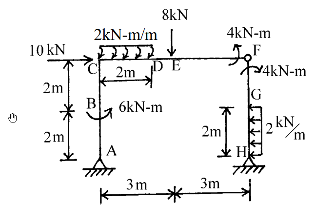
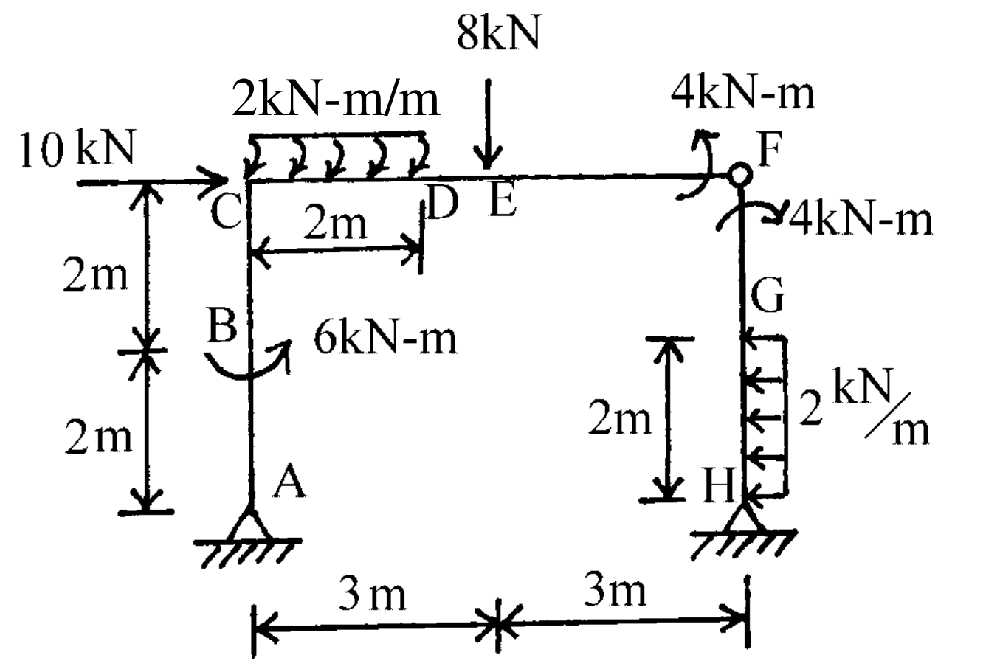

# SA-2002-1 題目正本

> 本檔只記錄考卷上寫了什麼、圖上畫了什麼，不含任何解法。解析見同資料夾 `SA-2002-1.md`。
> 判讀清單經使用者確認前，狀態為「待確認」；確認後本檔原則上不再修改（改動須回考卷原圖並記 log）。

| 項目 | 內容 |
|---|---|
| 考卷 | `raw/exams/SA-2002_結構學.pdf`，第 1 頁（全一頁），第一題 |
| 考年 | 2002（民國九十一年）專技高考結構工程技師「結構學」 |
| 配分 | 25 分 |
| 附圖 | `SA-2002-1-fig-1.png`、`SA-2002-1-fig-2.png` |
| 判讀狀態 | **已確認**（2026-11-05 使用者確認。原轉錄：2026-11-05 轉錄；PyMuPDF 110 dpi 整頁＋350–1000 dpi 局部放大；盲讀於開啟解析前完成） |

## 1. 考卷原文（逐字）

一、如下圖所示之剛架結構，點 F 為內鉸，在各種外力作用下，試繪其軸力圖、剪力圖及彎矩圖。（25 分）

## 2. 考卷給的公式、附表與參數

- 考卷沒有給任何參考公式或附表。
- 考卷沒有給 EI、EA（靜定結構，作圖不需要）。
- 卷首注意事項：㈠可以使用電子計算器，使用電子計算器計算之試題，需詳列解答過程。㈡不必抄題，作答時請將試題題號及答案依照順序寫在試卷上，於本試題上作答者，不予計分。
- 考試時間：二小時。

## 3. 附圖

*證據圖 SA-2002-1-fig-1.png*

*證據圖 SA-2002-1-fig-2.png（2026-11-05 自考卷重新擷取 500 dpi，無游標）*

圖面文字照錄：8kN、2kN-m/m、4kN-m、10 kN、F、C、D、E、4kN-m、2m、2m、B、6kN-m、G、2m、2 kN/m、2m、A、H、3m、3m

## 4. 判讀清單

| # | 項目 | 判讀 | 圖上／題文依據 | 把握 |
|---|---|---|---|---|
| 1 | 支承 A、H | 鉸支承（三角形＋剖線），兩者同高 | 圖上符號 | 確定 |
| 2 | F | 內鉸（梁與右柱於 F 以鉸連接） | 題文「點 F 為內鉸」；圖上 F 空心圓 | 確定 |
| 3 | 左柱幾何 | A–B 2 m、B–C 2 m，柱高 4 m | 左側尺寸線 2m｜2m | 確定 |
| 4 | 梁幾何 | C–F 水平 6 m，C 至中點 3 m、中點至 F 3 m | 下方尺寸線 3m｜3m（端點對齊左柱與右柱） | 確定 |
| 5 | D 位置 | 距 C 2 m | 梁下 2m 尺寸線 | 確定 |
| 6 | E 位置 | 距 C 3 m（8 kN 箭頭對齊下方 3m｜3m 中間刻度） | 400 dpi：箭頭 x 與中間刻度相差不到 0.1 m | 確定（解讀）；使用者確認 |
| 7 | 右柱幾何 | F–H 高 4 m（F 與 C 同高）；G 在 H 上方 2 m | 右柱 2m 尺寸線只標 G–H；F–G 由總高推得 | 確定（解讀）；使用者確認 |
| 8 | 10 kN | 水平向右，作用於 C（梁柱交點） | 箭頭指向 C，與 C 同高 | 確定 |
| 9 | 6 kN-m | 作用於 B 點的集中力偶，逆時針 | 900 dpi：弧線由左經下方繞到右側、箭頭朝上 | 確定 |
| 10 | 2 kN-m/m | C–D 段 2 m 均布分布力矩，順時針 | 900 dpi：每個小弧由上方向右下彎、箭頭朝左下 | 確定（解讀）；使用者確認 |
| 11 | 8 kN | E 點向下集中力 | 圖上箭頭 | 確定 |
| 12 | F 左側 4 kN-m | 作用於梁端（鉸左側）的力偶，逆時針 | 900 dpi：弧線自梁下方往右再向上、箭頭朝左上 | 確定（解讀）；使用者確認 |
| 13 | F 下方 4 kN-m | 作用於右柱頂（鉸下方）的力偶，順時針 | 900 dpi：弧線自左下往上越過柱、箭頭朝右下 | 確定（解讀）；使用者確認 |
| 14 | 2 kN/m | G–H 段（右柱下段 2 m）水平均布載重，向左 | 箭頭自柱右側指向柱、朝左 | 確定 |
| 15 | 所求 | 軸力圖、剪力圖、彎矩圖 | 題文 | 確定 |
| 16 | 證據圖 | 舊 fig-1 左側空白處有滑鼠游標（未壓到結構）；新增 fig-2（500 dpi） | — | 確定 |

---
*轉錄：2026-11-05（SA-U1-2 題目正本推廣・批 1）*
*確認：2026-11-05 使用者確認*
