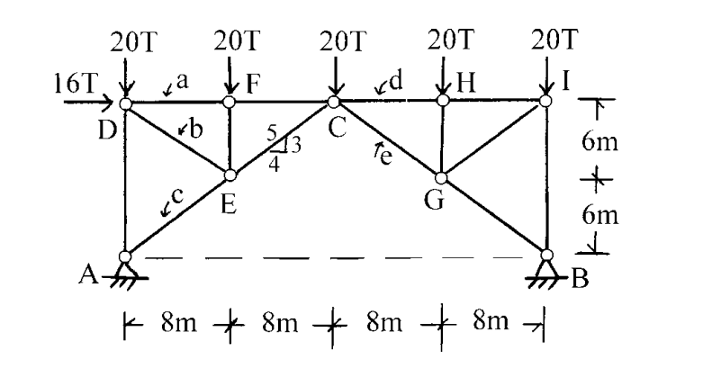

# SA-2002-2 題目正本

> 本檔只記錄考卷上寫了什麼、圖上畫了什麼，不含任何解法。解析見同資料夾 `SA-2002-2.md`。
> 判讀清單經使用者確認前，狀態為「待確認」；確認後本檔原則上不再修改（改動須回考卷原圖並記 log）。

| 項目 | 內容 |
|---|---|
| 考卷 | `raw/exams/SA-2002_結構學.pdf`，第 1 頁（全一頁），第二題 |
| 考年 | 2002（民國九十一年）專技高考結構工程技師「結構學」 |
| 配分 | 25 分（每小題 5 分） |
| 附圖 | `SA-2002-2-fig-1.png` |
| 判讀狀態 | **已確認**（2026-11-05 使用者確認；影響答案項目定案：#3 B 為鉸支承、#5 A–B 虛線不是桿件（使用者確認）。原轉錄：2026-11-05 轉錄；PyMuPDF 110 dpi 整頁＋350–1000 dpi 局部放大；盲讀於開啟解析前完成） |

## 1. 考卷原文（逐字）

二、如圖所示之桁架，在圖示之荷重作用時，試求桿件 a、b、c、d、e 之軸力（標明拉力或壓力）。（每小題 5 分，共 25 分）

## 2. 考卷給的公式、附表與參數

- 考卷沒有給任何參考公式或附表。
- 力的單位為 T（噸）；考卷沒有給 EA（靜定桁架不需要）。
- 卷首注意事項：㈠可以使用電子計算器，使用電子計算器計算之試題，需詳列解答過程。㈡不必抄題，作答時請將試題題號及答案依照順序寫在試卷上，於本試題上作答者，不予計分。
- 考試時間：二小時。

## 3. 附圖

*證據圖 SA-2002-2-fig-1.png*

圖面文字照錄：20T（×5）、16T、a、F、d、H、I、D、b、5、3、4、C、e、6m、6m、c、E、G、A、B、8m、8m、8m、8m

## 4. 判讀清單

| # | 項目 | 判讀 | 圖上／題文依據 | 把握 |
|---|---|---|---|---|
| 1 | 座標（以 A 為原點） | A(0,0)、B(32,0)；D(0,12)、F(8,12)、C(16,12)、H(24,12)、I(32,12)；E(8,6)、G(24,6) | 下方 4×8 m、右側 6m｜6m 尺寸線 | 確定 |
| 2 | 桿件 | DA、IB 豎桿；上弦 DF、FC、CH、HI；DE、FE、EC、AE；CG、HG、GI、GB；共 14 桿 | 400 dpi 圖面 | 確定 |
| 3 | A–B 虛線 | 不是桿件（虛線，僅示意 A、B 同高） | 圖上為虛線 | 確定（解讀）；使用者確認 |
| 4 | 斜率 5-3-4 | 標在 E–C 桿，A–E–C 為同一直線方向（3:4） | E(8,6)→C(16,12)；A(0,0)→E(8,6) | 確定 |
| 5 | 支承 A、B | 皆為鉸支承（三角形＋剖線） | 圖上符號 | 確定 |
| 6 | 靜定性 | j = 9、m = 14、r = 4，2j = m + r | 計數 | 確定 |
| 7 | 桿 a | D–F（上弦第一格） | a 標在 D–F 上方，旁有指向箭頭 | 確定 |
| 8 | 桿 b | D–E | b 標在 D–E 中段 | 確定 |
| 9 | 桿 c | A–E | c 標在 A–E 中段 | 確定 |
| 10 | 桿 d | C–H | d 標在 C–H 上方 | 確定 |
| 11 | 桿 e | C–G | e 標在 C–G 中段 | 確定 |
| 12 | 載重 | D、F、C、H、I 各 20T 向下；D 點 16T 水平向右 | 箭頭 | 確定 |
| 13 | 所求 | a、b、c、d、e 軸力並標拉壓 | 題文 | 確定 |

---
*轉錄：2026-11-05（SA-U1-2 題目正本推廣・批 1）*
*確認：2026-11-05 使用者確認*
