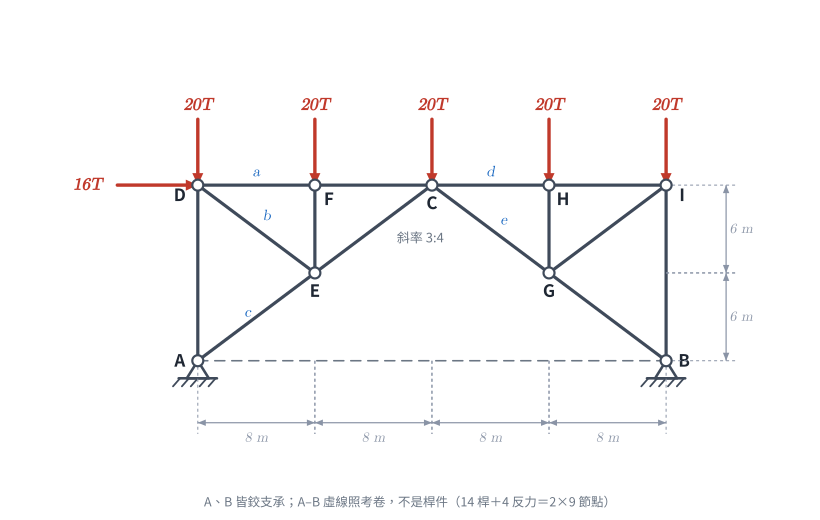

# 考題編號：SA-2002-2

**主分類：** `SA-U1-2` 靜定結構分析
**分析法：** 靜定分析 (截面法與節點法)
**標籤：** `桁架分析` `截面法` `節點法` `繫索桁架` `三鉸桁架`

---

## 1. 題目（考卷原文見題目正本）

> 考卷原文、公式／附表、附圖與判讀清單（已確認）見 [`SA-2002-2-problem.md`](SA-2002-2-problem.md)。本節只列解題時最容易讀錯的地方與本解使用的記號；題意以題目正本為準。

*重繪自考卷附圖，依判讀清單 #1–#13 重繪。攔：B 讀成滾支承、A–B 虛線讀成繫索。*

### 常見誤讀
| 項目 | 正確判讀 | 常見誤讀 |
|---|---|---|
| B 支承 | 鉸支承（與 A 的符號完全相同） | 滾支承（本題舊版解析） |
| A–B 虛線 | 不是桿件；A、B 皆鉸時 14 桿＋4 反力＝2×9 節點，本身已靜定 | 繫索 AB，否則「不穩定」（本題舊版解析） |
| 桿件代號 | a＝DF、b＝DE、c＝AE、d＝CH、e＝CG | — |

**本解記號：** 座標原點 A，x 向右、y 向上；反力以座標軸正向為正；桿力以拉為正；力的單位 T（噸）。

## 2. 考題核心精神與出題者意圖 (Core Concepts & Examiner's Intent)
- **三鉸型桁架**：本桁架左右兩半（A–D–F–E 與 B–I–H–G）只在上弦節點 C 相連，A、B 都是鉸支承——整體就是一座「三鉸拱」形式的桁架。4 個反力（$A_x, A_y, B_x, B_y$）用整體 3 個平衡式加上「左半部對 C 取矩」1 個條件即可全部求出，屬靜定。
- **截面法與節點法的靈活切換**：節點 A 有 $A_x, A_y, F_{AD}, F_{AE}$ 4 個未知數，必須先求出水平反力 $A_x$ 才能用節點法。出題者意在測驗考生能否先利用**截面法**切開整體結構、對 C 取矩求出水平反力，再回到節點法逐步解出各桿內力。

## 3. 解題戰略地圖與陷阱分析 (Strategic Roadmap & Trap Analysis)
1. **整體平衡求垂直反力**：$\sum M_A = 0$ 求 $B_y$（$A_x$、$B_x$ 都在 $y = 0$，對 A 無力矩），$\sum F_y = 0$ 求 $A_y$。
2. **截面法求水平反力**：切開 FC、EC，取**左半部**為自由體，對 C 點取矩（FC、EC 通過 C），只剩 $A_x$ 未知；再由整體 $\sum F_x = 0$ 求 $B_x$。
3. **節點法依序推導**：
   - 取節點 A 建立平衡，求出 c 桿 (AE)。
   - 取節點 D 建立平衡，求出 a 桿 (DF) 與 b 桿 (DE)。
   - 切開 CH、CG 取右半部，對 G 取矩求 d 桿 (CH)，$\sum F_y = 0$ 求 e 桿 (CG)。

**陷阱警告 (Traps)**：
- 陷阱一：把 B 看成滾支承、虛線看成繫索。兩種讀法下 a–e 的軸力恰好相同（繫索拉力就等於 B 的水平反力），但支承反力不同，判定穩定性的理由也完全不同。
- 陷阱二：計算力臂時幾何尺寸判讀錯誤（如 C 點座標為 $x=16, y=12$，G 點為 $x=24, y=6$）。

## 3.5 變數層次分析 (Variable Hierarchy Analysis)

### 最終目標
求出指定桁架桿件 a、b、c、d、e 的內力大小並標明拉力或壓力。

### 本題關鍵公式（依計算順序）
$$ \sum M_A = 0 \implies \text{求出支承反力 } B_y $$
$$ \sum M_C (\text{左半部}) = 0 \implies \text{求出水平反力 } \boxed{A_x},\ \sum F_x = 0 \implies \boxed{B_x} $$
$$ \text{節點 A 平衡} \implies \text{求出 } \boxed{F_{AE}} \text{ (c桿)} $$
$$ \text{節點 D 平衡} \implies \text{求出 } \boxed{F_{DF}} \text{ (a桿), } \boxed{F_{DE}} \text{ (b桿)} $$
$$ \sum M_G (\text{右半部}) = 0 \implies \text{求出 } \boxed{F_{CH}} \text{ (d桿)} $$
$$ \sum F_y (\text{右半部}) = 0 \implies \text{求出 } \boxed{F_{CG}} \text{ (e桿)} $$

### L1：題目直接給定
- 符號 ∣ 數值 ∣ 說明
  - $P_D$ ∣ 16T(→), 20T(↓) ∣ 節點 D 載重
  - $P_F, P_C, P_H, P_I$ ∣ 20T(↓) ∣ 各頂部節點載重
  - $\text{Span}$ ∣ 8m × 4 ∣ 桁架水平分段
  - $\text{Height}$ ∣ 6m × 2 ∣ 桁架垂直分段
  - 支承 ∣ A、B 皆鉸 ∣ 各有水平與垂直反力

### L2：需知識點推導
**一、支承反力計算**
- 符號 ∣ 公式／來源 ∣ 卡關?
  - $B_y$ ∣ $\sum M_A = 0$ ∣
  - $A_y$ ∣ $\sum F_y = 0$ ∣
  - $A_x$ ∣ 截面法（切 FC、EC），左半部 $\sum M_C = 0$ ∣
  - $B_x$ ∣ 整體 $\sum F_x = 0$ ∣

**二、節點法與截面法求內力**
- 符號 ∣ 公式／來源 ∣ 卡關?
  - $F_{AE}$ ∣ 節點 A，$\sum F_x = 0$ ∣
  - $F_{DF}, F_{DE}$ ∣ 節點 D，$\sum F_x = 0, \sum F_y = 0$ ∣
  - $F_{CH}$ ∣ 截面法（切 CH、CG），右半部 $\sum M_G = 0$ ∣
  - $F_{CG}$ ∣ 右半部自由體，$\sum F_y = 0$ ∣

### L3：深層知識（不懂就卡住）
- 知識點 ∣ 說明 ∣ 卡關?
  - **三鉸型結構的靜定性** ∣ 兩個剛體以一鉸相連、各自再以鉸支承接地：4 個反力＝整體 3 式＋中間鉸 1 式，靜定（三鉸不共線即穩定）。 ∣
  - **支承符號判讀** ∣ 同一張圖兩個支承畫法相同就是同一種支承；虛線通常只是輔助線，不是構件。 ∣

## 4. 步驟化詳細計算過程 (Step-by-Step Detailed Calculation)

### 步驟一：求垂直支承反力
1. **對 A 點取彎矩**（$A_x$、$B_x$ 皆作用在 $y = 0$，對 A 無力矩）：
   $$ \sum M_A = 0 \implies B_y (32) - 16(12) - 20(8) - 20(16) - 20(24) - 20(32) = 0 $$
   $$ 32 B_y - 192 - 160 - 320 - 480 - 640 = 0 $$
   $$ 32 B_y = 1792 \implies B_y = 56\text{ T} \text{ (向上)} $$
2. **垂直方向力平衡**：
   $$ \sum F_y = 0 \implies A_y + 56 - (20 \times 5) = 0 \implies A_y = 44\text{ T} \text{ (向上)} $$

### 步驟二：求水平支承反力
以截面法切開構件 FC、EC，取**左半部**（A、D、F、E）為自由體，對 C 點 $(x=16, y=12)$ 取彎矩（FC、EC 之內力通過 C 點，力矩為零）。
- 逆時針為正：
  - $A_y$ 對 C 點：$-44 \times 16 = -704$
  - $A_x$ 對 C 點（作用線在 $y=0$，設向右為正）：$+12 A_x$
  - $D_y$ 對 C 點：$+20 \times 16 = +320$
  - $D_x$ 對 C 點（作用線在 $y=12$）：力臂為 $0 \implies 0$
  - $F_y$ 對 C 點：$+20 \times 8 = +160$
$$ \sum M_C = -704 + 12 A_x + 320 + 160 = 0 $$
$$ 12 A_x = 224 \implies A_x = \frac{56}{3}\text{ T} \text{ (向右)} $$

整體水平平衡：
$$ \sum F_x = 0 \implies A_x + B_x + 16 = 0 \implies B_x = -16 - \frac{56}{3} = -\frac{104}{3}\text{ T} \text{ (向左)} $$

### 步驟三：求 c 桿 (AE) 內力
取**節點 A** 作為自由體，未知力為 $F_{AD}$ 及 $F_{AE}$ (c 桿)。
已知 $A_x = \frac{56}{3}\text{ T}$ (向右), $A_y = 44\text{ T}$ (向上)。
由幾何關係，AE 桿水平投影為 8m，垂直投影為 6m，斜長為 10m（斜率 3:4:5）。
$$ \sum F_x = 0 \implies \frac{56}{3} + F_{AE} \left(\frac{4}{5}\right) = 0 $$
$$ \frac{4}{5} F_{AE} = -\frac{56}{3} \implies \boxed{F_{AE} = -\frac{70}{3}\text{ T} \text{ (壓力)}} \quad \text{... (c 桿)} $$
*(註：同時由 $\sum F_y=0$：$44 + F_{AD} + \frac{3}{5}F_{AE} = 0$，可求得 $F_{AD} = -30\text{ T}$)*

### 步驟四：求 a 桿 (DF) 與 b 桿 (DE) 內力
取**節點 D** 作為自由體。
已知外力 16T(→), 20T(↓)，以及剛求出的 $F_{AD} = 30\text{ T}$ (壓力，對 D 點為向上推頂)。
DE 桿斜率與 AE 相同，垂直 6m，水平 8m (3:4:5)。
$$ \sum F_y = 0 \implies -20 + 30 - F_{DE} \left(\frac{3}{5}\right) = 0 \quad (\text{假設 } F_{DE} \text{ 為拉力向下}) $$
$$ 10 = \frac{3}{5} F_{DE} \implies \boxed{F_{DE} = \frac{50}{3}\text{ T} \text{ (拉力)}} \quad \text{... (b 桿)} $$
$$ \sum F_x = 0 \implies 16 + F_{DF} + F_{DE} \left(\frac{4}{5}\right) = 0 $$
$$ 16 + F_{DF} + \frac{50}{3} \times \frac{4}{5} = 0 \implies 16 + F_{DF} + \frac{40}{3} = 0 $$
$$ F_{DF} = -16 - \frac{40}{3} = -\frac{88}{3}\text{ T} \implies \boxed{F_{DF} = -\frac{88}{3}\text{ T} \text{ (壓力)}} \quad \text{... (a 桿)} $$

### 步驟五：求 d 桿 (CH) 與 e 桿 (CG) 內力
以截面法切開構件 CH、CG，取**右半部**（H、I、G、B）為自由體。
外力包含 H 點 20T(↓)、I 點 20T(↓)、支承 B 反力 $B_x = \frac{104}{3}$T(←)、$B_y = 56$T(↑)。
為了求 $F_{CH}$，對 G 點 $(x=24, y=6)$ 取彎矩（此時 $F_{CG}$ 力矩為零）：
- $B_x$ 對 G 點（向左，作用線在 $y=0$，G 下方 6m）：順時針 $(-)$ $\implies -\frac{104}{3} \times 6 = -208$
- H 點載重對 G 點：力臂為 0
- I 點載重對 G 點：順時針 $(-)$，力臂 8m $\implies -20 \times 8 = -160$
- $B_y$ 對 G 點：逆時針 $(+)$，力臂 8m $\implies +56 \times 8 = +448$
- $F_{CH}$ 對 G 點（假設拉力向左）：逆時針 $(+)$，力臂 6m $\implies +6 F_{CH}$
$$ \sum M_G = -208 - 160 + 448 + 6 F_{CH} = 0 $$
$$ 80 + 6 F_{CH} = 0 \implies \boxed{F_{CH} = -\frac{40}{3}\text{ T} \text{ (壓力)}} \quad \text{... (d 桿)} $$

為求 $F_{CG}$，考慮右半部垂直方向力平衡：
$$ \sum F_y = 0 \implies -20 \text{ (H點)} - 20 \text{ (I點)} + 56 \text{ (B點)} + F_{CG} \left(\frac{3}{5}\right) = 0 $$
*(註：若 $F_{CG}$ 為拉力，對右半部作用方向為左上，故有向上分量)*
$$ 16 + \frac{3}{5} F_{CG} = 0 \implies \boxed{F_{CG} = -\frac{80}{3}\text{ T} \text{ (壓力)}} \quad \text{... (e 桿)} $$

### 最終解答統整
- **a 桿 (DF)**：$88/3\text{ T} \text{ (壓力)}$
- **b 桿 (DE)**：$50/3\text{ T} \text{ (拉力)}$
- **c 桿 (AE)**：$70/3\text{ T} \text{ (壓力)}$
- **d 桿 (CH)**：$40/3\text{ T} \text{ (壓力)}$
- **e 桿 (CG)**：$80/3\text{ T} \text{ (壓力)}$
- 支承反力：$A_x = 56/3$ T(→)、$A_y = 44$ T(↑)、$B_x = 104/3$ T(←)、$B_y = 56$ T(↑)

## 5. 關鍵爭議點與進階探討 (Critical Issues & Advanced Discussion)
- **虛線與 B 支承的判讀**：考卷上 A、B 兩個支承的符號完全相同（三角形＋剖線），都是鉸支承；A–B 之間的虛線只是輔助線。兩端皆鉸時，14 桿＋4 反力＝2×9 節點，三鉸（A、C、B）不共線，結構靜定且穩定，不需要虛構一根繫索。舊版解析把 B 讀成滾支承，才會覺得「不加繫索就不穩定」。
- **為什麼兩種讀法桿力相同**：若 B 為滾支承＋AB 繫索，繫索拉力會等於本解 B 的水平反力（104/3 T），A 的水平反力則變成 $-16$ T；作用在桁架節點 A、B 上的水平力合計不變，所以 a–e 的軸力完全相同，只有支承反力不同。
- **整體與局部平衡的穿插**：三鉸型結構**必須**先透過「半邊自由體對中間鉸取矩」找出水平反力，才能進一步使用節點法。這種截面法與節點法交替使用的技巧，是國家考試評估考生對力學平衡透徹理解的常見手法。

*修正日期：2026-11-05（解析勘誤：B 由滾支承改為鉸支承、A–B 虛線不是桿件（題目正本判讀 #3、#5，使用者確認）；求解路徑由「截面法求繫索拉力 F_AB」改為「左半部對 C 取矩求水平反力 A_x」，§2、§3、§3.5、§4 步驟二與三、§5 改寫；a–e 答案不變（a −88/3、b +50/3、c −70/3、d −40/3、e −80/3 T），反力改為 A_x 56/3 T 向右、B_x 104/3 T 向左；驗證：三鉸分段取矩分數解與全桁架節點法聯立兩路徑，10 值 MISMATCHES: 0）*
*修正日期：2026-11-05（§1 改為指向題目正本並放重繪附圖（figs/SA-2002-2-fig-1-problem.svg）、加常見誤讀；圖由 gen_SA-2002-2.py 產生，可重跑）*
