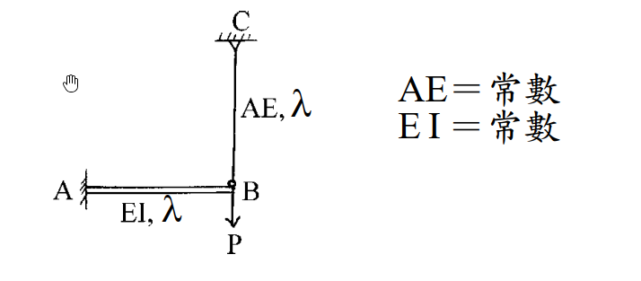
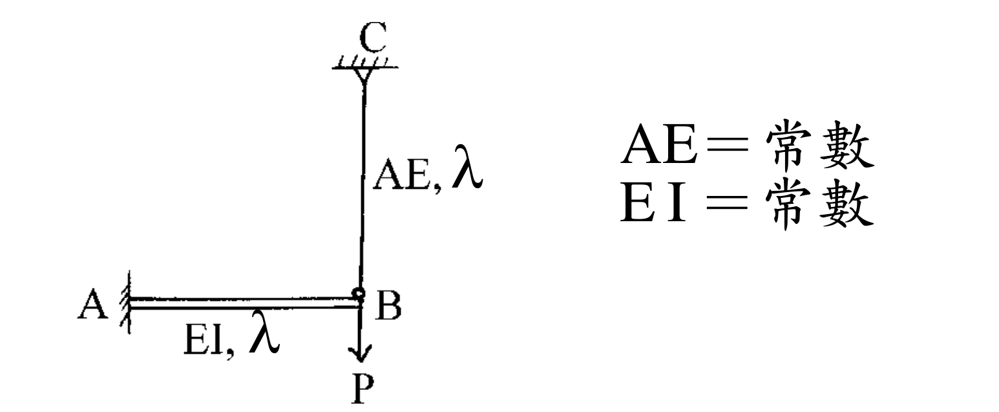

# SA-2002-3 題目正本

> 本檔只記錄考卷上寫了什麼、圖上畫了什麼，不含任何解法。解析見同資料夾 `SA-2002-3.md`。
> 判讀清單經使用者確認前，狀態為「待確認」；確認後本檔原則上不再修改（改動須回考卷原圖並記 log）。

| 項目 | 內容 |
|---|---|
| 考卷 | `raw/exams/SA-2002_結構學.pdf`，第 1 頁（正面），第三題（無圖號） |
| 考年 | 2002（民國 91 年）專技高考結構工程技師「結構學」 |
| 配分 | 25 分 |
| 附圖 | `SA-2002-3-fig-1.png`、`SA-2002-3-fig-2.png` |
| 判讀狀態 | **已確認**（2026-11-07 使用者確認；原轉錄：2026-11-07 轉錄；PyMuPDF 110 dpi 整頁＋400–1200 dpi 局部放大（向量繪圖）；盲讀於開啟解析前完成） |

## 1. 考卷原文（逐字）

三、如圖所示之梁，B 點用相同材料之桿吊掛。試求B 點垂直位移。（25 分）

## 2. 考卷給的公式、附表與參數

- 考卷沒有給任何參考公式或附表。
- 圖旁文字：AE＝常數、EI＝常數；沒有數值。
- 載重 P、長度 λ 皆為符號，沒有數值；答案應以 P、λ、EI、AE 表示。
- 考卷沒有說是否忽略梁 AB 的軸向變形、桿 BC 的彎曲（桿只標 AE）。
- 卷首注意事項：㈠可以使用電子計算器，使用電子計算器計算之試題，需詳列解答過程。㈡不必抄題，作答時請將試題題號及答案依照順序寫在試卷上，於本試題上作答者，不予計分。
- 考試時間：二小時（全一頁）。

## 3. 附圖

*證據圖 SA-2002-3-fig-1.png*

*證據圖 SA-2002-3-fig-2.png（2026-11-07 自考卷重新擷取 500 dpi，無游標）*

圖面文字照錄：C、AE, λ、A、EI, λ、B、P、AE＝常數、EI＝常數

## 4. 判讀清單

| # | 項目 | 判讀 | 圖上／題文依據 | 把握 |
|---|---|---|---|---|
| 1 | A | 固定端（左側直立剖線牆，梁端直接接牆，無三角形） | 450 dpi 放大：A 端為一條直立線加斜剖線 | 確定 |
| 2 | C | 鉸支承（三角形倒掛於上方剖線） | 450 dpi 放大：C 下方三角形頂點接桿 | 確定 |
| 3 | B | 桿與梁以鉸連接（小空心圓）；梁 AB 在 B 為自由端 | B 點小圓圈；梁不延伸過 B | 確定 |
| 4 | 梁 AB | 水平，長 λ，EI＝常數（雙線畫法） | 梁下標「EI, λ」 | 確定 |
| 5 | 桿 BC | 垂直，長 λ，AE＝常數，位於 B 正上方 | 桿旁標「AE, λ」；桿與 B 在同一鉛直線 | 確定 |
| 6 | 材料 | 梁與桿為相同材料（同一 E），I 與 A 各自為常數 | 題文「用相同材料之桿吊掛」 | 確定 |
| 7 | 載重 | B 點垂直向下 P | B 下方箭頭向下標 P | 確定 |
| 8 | 所求 | B 點垂直位移 | 題文 | 確定 |
| 9 | 考卷沒有給 | P、λ、EI、AE 的數值；梁軸向變形是否忽略 | 題文與圖 | 確定 |
| 10 | 靜不定度 | 固定 3＋鉸 2＝5 個反力、方程式 3＋B 鉸 1（桿為二力構件），一度靜不定 | 計數 | 確定（解讀）；使用者確認 |
| 11 | 證據圖 | 舊 fig-1 有滑鼠游標（圖左上空白處，未壓構件）；新增 fig-2（500 dpi，無游標） | — | 確定 |

---
*轉錄：2026-11-07（SA-U2-2 題目正本推廣・批 1）*
*確認：2026-11-07 使用者確認*
