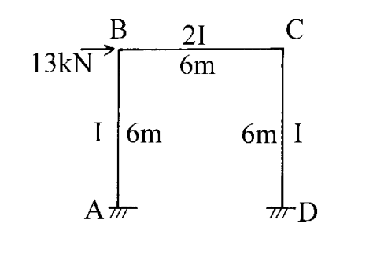

# SA-2002-4 題目正本

> 本檔只記錄考卷上寫了什麼、圖上畫了什麼，不含任何解法。解析見同資料夾 `SA-2002-4.md`。
> 判讀清單經使用者確認前，狀態為「待確認」；確認後本檔原則上不再修改（改動須回考卷原圖並記 log）。

| 項目 | 內容 |
|---|---|
| 考卷 | `raw/exams/SA-2002_結構學.pdf`，第 1 頁（全一頁）最下方，第四題 |
| 考年 | 2002（民國 91 年）專技高考結構工程技師「結構學」 |
| 配分 | 25 分 |
| 附圖 | `SA-2002-4-fig-1.png` |
| 判讀狀態 | **已確認**（2026-11-04 使用者確認。原轉錄：2026-11-04 轉錄；PyMuPDF 150 dpi 整頁＋350–500 dpi 局部放大；盲讀於開啟解析前完成） |

## 1. 考卷原文（逐字）

四、試用傾角變位法(Slope-deflection method)解此剛架，並作彎矩圖。E＝常數。（25 分）

## 2. 考卷給的公式、附表與參數

- 考卷沒有給任何參考公式或附表；所需公式須自備。
- 卷首注意事項：㈠可以使用電子計算器，使用電子計算器計算之試題，需詳列解答過程。㈡不必抄題，作答時請將試題題號及答案依照順序寫在試卷上，於本試題上作答者，不予計分。
- 考試時間：2 小時。

## 3. 附圖

*證據圖 SA-2002-4-fig-1.png*

圖面文字照錄：13kN、B、C、2I、6m、I、6m、6m、I、A、D

## 4. 判讀清單

| # | 項目 | 判讀 | 圖上／題文依據 | 把握 |
|---|---|---|---|---|
| 1 | A、D 支承 | 固接 | 柱底水平短線＋斜線（400 dpi） | 確定 |
| 2 | B、C 接合 | 剛接 | 梁柱交角無鉸圈 | 確定 |
| 3 | 柱 AB | 長 6 m、慣性矩 I | 柱旁標「I」「6m」 | 確定 |
| 4 | 柱 CD | 長 6 m、慣性矩 I | 柱旁標「6m」「I」 | 確定 |
| 5 | 梁 BC | 長 6 m、慣性矩 2I | 梁上標「2I」、下標「6m」 | 確定 |
| 6 | E | 常數 | 題文「E＝常數」 | 確定 |
| 7 | 載重 | B 點水平 13 kN 向右 | 箭頭指向 B 點、向右 | 確定 |
| 8 | 指定方法 | 傾角變位法 | 題文明寫 | 確定 |
| 9 | 所求 | 解剛架（各桿端彎矩）並作彎矩圖 | 題文 | 確定 |

---
*轉錄：2026-11-04（SA-U2-3 題目正本推廣・批 1；判讀沿用同日盲解稽核紀錄 wiki/queries/盲解紀錄-SA-U2-3a-2026-11-04.md，並回考卷原圖核對）*
*確認：2026-11-04 使用者確認*
