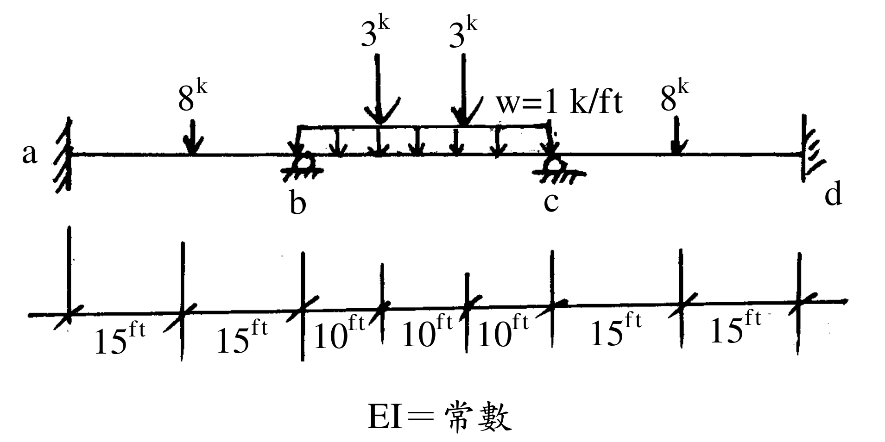

# SA-2003-1 題目正本

> 本檔只記錄考卷上寫了什麼、圖上畫了什麼，不含任何解法。解析見同資料夾 `SA-2003-1.md`。
> 判讀清單經使用者確認前，狀態為「待確認」；確認後本檔原則上不再修改（改動須回考卷原圖並記 log）。

| 項目 | 內容 |
|---|---|
| 考卷 | `raw/exams/SA-2003_結構學.pdf`，第 1 頁（全一頁），第一題 |
| 考年 | 2003（民國 92 年）專技高考結構工程技師「結構學」 |
| 配分 | 25 分 |
| 附圖 | `SA-2003-1-fig-2.png`（本次從考卷擷取 500 dpi；既有 `SA-2003-1-fig-1.png` 保留） |
| 判讀狀態 | **已確認**（2026-11-07 使用者確認；原轉錄：2026-11-07 轉錄；PyMuPDF 110 dpi 整頁＋300–900 dpi 局部放大（附圖為內嵌點陣圖，掃描品質）；盲讀於開啟解析前完成） |

## 1. 考卷原文（逐字）

一、試以彎矩分配法，求解各節點彎矩。（25 分）

## 2. 考卷給的公式、附表與參數

- 考卷沒有給任何參考公式或附表。
- 給定：EI＝常數（圖下標註「EI＝常數」）。
- 考卷沒有給 E、I 數值，也沒有給支承沉陷。
- 卷首注意事項：㈠不必抄題，作答時請將試題題號及答案依照順序寫在試卷上，於本試題上作答者，不予計分。㈡可以使用電子計算器，但需詳列解答過程。
- 考試時間：二小時。代號 00460，全一頁。

## 3. 附圖

*證據圖 SA-2003-1-fig-2.png（500 dpi，自考卷擷取；舊證據圖 SA-2003-1-fig-1.png 有游標雜訊，保留不改）*

圖面文字照錄：3k、3k、8k、w=1 k/ft、8k、a、b、c、d、15ft、15ft、10ft、10ft、10ft、15ft、15ft、EI＝常數

## 4. 判讀清單

| # | 項目 | 判讀 | 圖上／題文依據 | 把握 |
|---|---|---|---|---|
| 1 | a、d 端 | 固定端（直立粗線加斜剖線） | 300 dpi 放大：a 在左牆、d 在右牆，皆為牆面剖線 | 確定 |
| 2 | b、c 支承 | 梁下支承，符號為半圓頂加地面剖線；鉸或滾無法明確區分。本題只有垂直載重、不計軸向變形，兩者對答案無影響 | 900 dpi 放大：圓頂下無滾輪、也無明確三角形 | 確定（解讀）；使用者確認 |
| 3 | 跨長 | ab＝30 ft、bc＝30 ft、cd＝30 ft | 尺寸線 15｜15｜10｜10｜10｜15｜15 ft，刻度對齊 a、b、c、d | 確定 |
| 4 | ab 跨載重 | 8k 向下，作用於距 a 15 ft（跨中） | 箭頭對齊第一個 15 ft 刻度 | 確定 |
| 5 | bc 跨均佈 | w＝1 k/ft 向下，自 b 至 c 滿跨 | 均佈載重框左右端對齊 b、c | 確定 |
| 6 | bc 跨集中載重 | 兩個 3k 向下，分別在距 b 10 ft、20 ft 處（三分點） | 兩箭頭對齊兩個 10 ft 刻度 | 確定 |
| 7 | cd 跨載重 | 8k 向下，作用於距 c 15 ft（跨中） | 箭頭對齊 15 ft 刻度 | 確定 |
| 8 | 材料 | EI＝常數（三跨相同） | 圖下文字 | 確定 |
| 9 | 考卷沒有給 | 支承沉陷、EI 數值、單位以外的換算（k＝kip） | 題文 | 確定 |
| 10 | 所求 | 以彎矩分配法求各節點彎矩 | 題文（限定方法） | 確定 |
| 11 | 證據圖 | 既有 fig-1 在左側「15ft」字樣上有游標雜訊；另從考卷擷取 500 dpi 乾淨版 fig-2 | 縮圖總表 | 確定 |

---
*轉錄：2026-11-07（SA 剩餘單元（U1-2 尾段、U2-5、U3-1、U3-2）題目正本推廣・批 1）*
*確認：2026-11-07 使用者確認*
