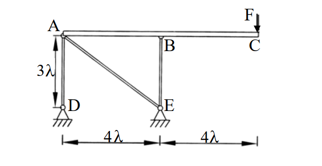

# SA-2003-2 題目正本

> 本檔只記錄考卷上寫了什麼、圖上畫了什麼，不含任何解法。解析見同資料夾 `SA-2003-2.md`。
> 判讀清單經使用者確認前，狀態為「待確認」；確認後本檔原則上不再修改（改動須回考卷原圖並記 log）。

| 項目 | 內容 |
|---|---|
| 考卷 | `raw/exams/SA-2003_結構學.pdf`，第 1 頁（全一頁），第二題 |
| 考年 | 2003（民國九十二年）專技高考結構工程技師「結構學」 |
| 配分 | 25 分 |
| 附圖 | `SA-2003-2-fig-1.png` |
| 判讀狀態 | **已確認**（2026-11-05 使用者確認。原轉錄：2026-11-05 轉錄；PyMuPDF 110 dpi 整頁＋350–1000 dpi 局部放大；盲讀於開啟解析前完成） |

## 1. 考卷原文（逐字）

二、圖示結構係由三根斷面性質相同(EA)之均質連桿(AD、AE 及 BE)以及一根剛梁(EI→∞)所組成之複合結構。若忽略剛梁自重之影響，試求：（25 分）

㈠各連桿之內力

㈡C 點之位移

## 2. 考卷給的公式、附表與參數

- 考卷沒有給任何參考公式或附表。
- F、EA、λ 皆為符號，考卷沒有給數值。
- 卷首注意事項：㈠不必抄題，作答時請將試題題號及答案依照順序寫在試卷上，於本試題上作答者，不予計分。㈡可以使用電子計算器，但需詳列解答過程。
- 考試時間：二小時。

## 3. 附圖

*證據圖 SA-2003-2-fig-1.png*

圖面文字照錄：A、F、B、C、3λ、D、E、4λ、4λ

## 4. 判讀清單

| # | 項目 | 判讀 | 圖上／題文依據 | 把握 |
|---|---|---|---|---|
| 1 | 剛梁 | A–B–C，EI→∞，水平 | 題文；圖上雙線梁 | 確定 |
| 2 | 幾何 | A 至 B 4λ、B 至 C 4λ；D 在 A 正下方 3λ、E 在 B 正下方 3λ | 下方尺寸線 4λ｜4λ（刻度對齊 A/D 與 B/E 豎線）；左側 3λ | 確定 |
| 3 | 連桿 | AD（3λ 垂直）、AE（斜，長 5λ）、BE（3λ 垂直），EA 相同 | 題文；圖上三根雙線桿 | 確定 |
| 4 | A 點 | 剛梁與 AD、AE 於 A 鉸接 | 圖上 A 空心圓 | 確定 |
| 5 | B 點 | 剛梁與 BE 於 B 鉸接 | 圖上 B 下方小圓 | 確定 |
| 6 | 支承 D、E | 鉸支承（三角形＋剖線） | 圖上符號 | 確定 |
| 7 | 載重 | C 端集中力 F，向下 | 箭頭與「F」字；F 是力的大小，不是節點 | 確定（解讀）；使用者確認 |
| 8 | 自重 | 忽略剛梁自重 | 題文 | 確定 |
| 9 | 所求 | ㈠三根連桿內力；㈡C 點位移 | 題文 | 確定 |

---
*轉錄：2026-11-05（SA-U1-2 題目正本推廣・批 1）*
*確認：2026-11-05 使用者確認*
