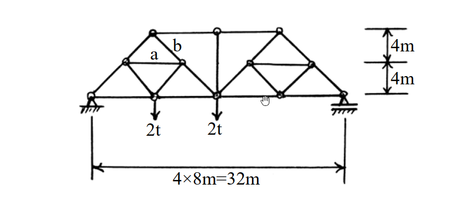
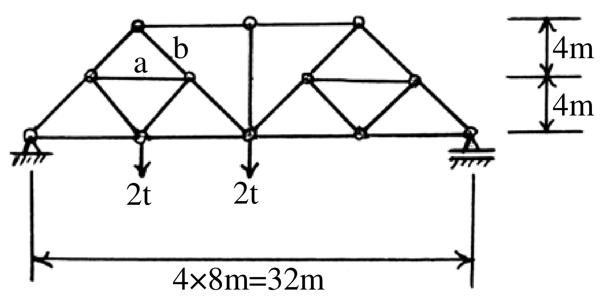

# SA-2003-3 題目正本

> 本檔只記錄考卷上寫了什麼、圖上畫了什麼，不含任何解法。解析見同資料夾 `SA-2003-3.md`。
> 判讀清單經使用者確認前，狀態為「待確認」；確認後本檔原則上不再修改（改動須回考卷原圖並記 log）。

| 項目 | 內容 |
|---|---|
| 考卷 | `raw/exams/SA-2003_結構學.pdf`，第 1 頁（全一頁），第三題 |
| 考年 | 2003（民國九十二年）專技高考結構工程技師「結構學」 |
| 配分 | 25 分 |
| 附圖 | `SA-2003-3-fig-1.png`、`SA-2003-3-fig-2.png` |
| 判讀狀態 | **已確認**（2026-11-05 使用者確認。原轉錄：2026-11-05 轉錄；PyMuPDF 110 dpi 整頁＋350–1000 dpi 局部放大；盲讀於開啟解析前完成） |

## 1. 考卷原文（逐字）

三、試求圖示桁架中 a, b 桿之內力。（25 分）

## 2. 考卷給的公式、附表與參數

- 考卷沒有給任何參考公式或附表。
- 力的單位為 t（噸）。
- 卷首注意事項：㈠不必抄題，作答時請將試題題號及答案依照順序寫在試卷上，於本試題上作答者，不予計分。㈡可以使用電子計算器，但需詳列解答過程。
- 考試時間：二小時。

## 3. 附圖

*證據圖 SA-2003-3-fig-1.png*

*證據圖 SA-2003-3-fig-2.png（2026-11-05 自考卷重新擷取 500 dpi，無游標）*

圖面文字照錄：a、b、4m、4m、2t、2t、4×8m=32m

## 4. 判讀清單

| # | 項目 | 判讀 | 圖上／題文依據 | 把握 |
|---|---|---|---|---|
| 1 | 座標（以左支承為原點） | 下弦 (0,0)(8,0)(16,0)(24,0)(32,0)；中層 (4,4)(12,4)(20,4)(28,4)；上弦 (8,8)(16,8)(24,8) | 下方 4×8m＝32m、右側 4m｜4m 尺寸線；節點位置 500 dpi 量測 | 確定（解讀）；使用者確認 |
| 2 | 桿件 | 左半：(0,0)–(4,4)–(8,8)、(8,8)–(12,4)–(16,0)、(4,4)–(12,4)、(4,4)–(8,0)、(8,0)–(12,4)；右半對稱；上弦 (8,8)–(16,8)–(24,8)；中央豎桿 (16,8)–(16,0)；下弦四格；共 21 桿 | 500 dpi 圖面 | 確定 |
| 3 | 靜定性 | j = 12、m = 21、r = 3 | 計數 | 確定 |
| 4 | 桿 a | 左側水平腹桿 (4,4)–(12,4) | a 字位於該桿正上方三角形內 | 確定（解讀）；使用者確認 |
| 5 | 桿 b | (8,8)–(12,4) 斜桿 | b 字標在該桿上段 | 確定 |
| 6 | 支承 | 左端鉸支承（三角形直接在剖線上）；右端滾支承（三角形下有一橫線再接剖線） | 900 dpi 支承放大 | 確定（解讀）；使用者確認 |
| 7 | 載重 | 下弦 (8,0)、(16,0) 各 2t 向下 | 箭頭位置 | 確定 |
| 8 | 所求 | a、b 桿內力 | 題文 | 確定 |
| 9 | 證據圖 | 舊 fig-1 滑鼠游標在下弦 (24,0) 節點旁；新增 fig-2（500 dpi） | — | 確定 |

---
*轉錄：2026-11-05（SA-U1-2 題目正本推廣・批 1）*
*確認：2026-11-05 使用者確認*
