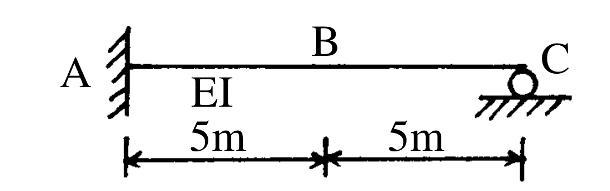

# SA-2003-4 題目正本

> 本檔只記錄考卷上寫了什麼、圖上畫了什麼，不含任何解法。解析見同資料夾 `SA-2003-4.md`。
> 判讀清單經使用者確認前，狀態為「待確認」；確認後本檔原則上不再修改（改動須回考卷原圖並記 log）。

| 項目 | 內容 |
|---|---|
| 考卷 | `raw/exams/SA-2003_結構學.pdf`，第 1 頁（全一頁），第四題 |
| 考年 | 2003（民國九十二年）專技高考結構工程技師「結構學」 |
| 配分 | 25 分 |
| 附圖 | `SA-2003-4-fig-2.png`（2026-11-07 重新擷取）；既有 `SA-2003-4-fig-1.png` |
| 判讀狀態 | **已確認**（2026-11-07 使用者確認。原轉錄：2026-11-07 轉錄；PyMuPDF 110 dpi 整頁＋450–1200 dpi 局部放大；考卷可抽文字，逐字原文以 PDF 文字層核對；盲讀於開啟解析前完成） |

## 1. 考卷原文（逐字）

四、如圖所示之梁結構，EI 值為常數，試分別繪出此梁中點 B 之彎矩及剪力影響線圖。
（說明：影響線圖中，需標示 B 點彎矩及剪力之影響值）（25 分）

## 2. 考卷給的公式、附表與參數

- 考卷沒有給任何參考公式或附表。
- 考卷沒有給 EI 數值（題文只說 EI 為常數）；沒有給載重（影響線題，單位移動載重）。
- 卷首注意事項：㈠不必抄題，作答時請將試題題號及答案依照順序寫在試卷上，於本試題上作答者，不予計分。㈡可以使用電子計算器，但需詳列解答過程。
- 考試時間：二小時。

## 3. 附圖

*證據圖 SA-2003-4-fig-2.png（2026-11-07 自考卷 500 dpi 重新擷取）；既有 SA-2003-4-fig-1.png 帶有滑鼠游標（手形游標在梁上方空白處，未壓到構件），保留不改。*

圖面文字照錄：A、B、C、EI、5m、5m

## 4. 判讀清單

| # | 項目 | 判讀 | 圖上／題文依據 | 把握 |
|---|---|---|---|---|
| 1 | 座標 | A(0)、B(5)、C(10)，單位 m | 下方 5m｜5m 尺寸線，端點對齊 A 牆面、B、C 滾輪中心 | 確定 |
| 2 | 支承 A | 固定端 | A 端為垂直牆線＋左側剖線，梁直接接入 | 確定 |
| 3 | 支承 C | 滾支承（只有垂直反力） | 圓圈＋地面剖線（450 dpi） | 確定 |
| 4 | B 點 | 梁中點，沒有內鉸 | B 只有字母標記，梁線連續無圓圈 | 確定 |
| 5 | EI | 全梁同一 EI，常數 | 題文「EI 值為常數」；圖上 EI 標在 A–B 段下方 | 確定 |
| 6 | 所求 | B 點彎矩影響線、B 點剪力影響線，並標示影響值 | 題文＋說明 | 確定 |
| 7 | 靜不定度 | 一度靜不定（固定端 3 個＋滾支承 1 個反力） | 支承判讀 | 確定 |
| 8 | 考卷沒有給 | 移動載重的型式（未說單位力，影響線慣例為單位垂直力）；未說要標哪幾點的影響值以外的位置 | 題文 | 確定（解讀）；使用者確認 |

---
*轉錄：2026-11-07（SA-U1-3 題目正本推廣・批 1）*
*確認：2026-11-07 使用者確認*
