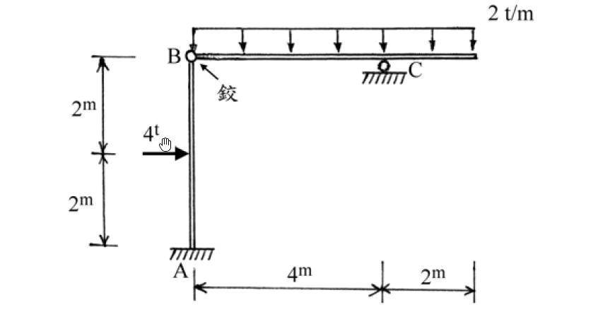
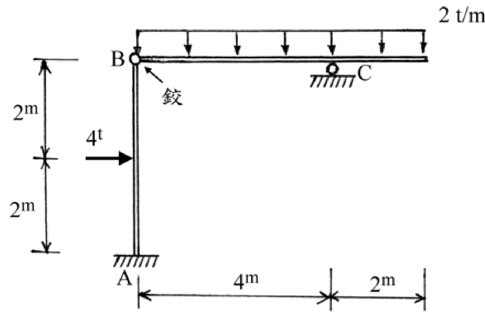

# SA-2004-1 題目正本

> 本檔只記錄考卷上寫了什麼、圖上畫了什麼，不含任何解法。解析見同資料夾 `SA-2004-1.md`。
> 判讀清單經使用者確認前，狀態為「待確認」；確認後本檔原則上不再修改（改動須回考卷原圖並記 log）。

| 項目 | 內容 |
|---|---|
| 考卷 | `raw/exams/SA-2004_結構學.pdf`，第 1 頁（全一頁），第一題 |
| 考年 | 2004（民國九十三年）專技高考結構工程技師「結構學」 |
| 配分 | 25 分 |
| 附圖 | `SA-2004-1-fig-1.png`、`SA-2004-1-fig-2.png` |
| 判讀狀態 | **已確認**（2026-11-05 使用者確認。原轉錄：2026-11-05 轉錄；PyMuPDF 110 dpi 整頁＋350–1000 dpi 局部放大；盲讀於開啟解析前完成） |

## 1. 考卷原文（逐字）

一、試分析如圖所示之靜定結構系統，並繪製剪力圖及彎矩圖。其中 A 端為固定支承；B 為鉸接點；C 為滾支承。（25 分）

## 2. 考卷給的公式、附表與參數

- 考卷沒有給任何參考公式或附表。
- 考卷沒有給 EI（靜定結構不需要）。
- 卷首注意事項：㈠不必抄題，作答時請將試題題號及答案依照順序寫在試卷上，於本試題上作答者，不予計分。㈡可以使用電子計算器。
- 考試時間：二小時。

## 3. 附圖

*證據圖 SA-2004-1-fig-1.png*

*證據圖 SA-2004-1-fig-2.png（2026-11-05 自考卷重新擷取 500 dpi，無游標）*

圖面文字照錄：2 t/m、B、鉸、C、2m、4t、2m、A、4m、2m

## 4. 判讀清單

| # | 項目 | 判讀 | 圖上／題文依據 | 把握 |
|---|---|---|---|---|
| 1 | A | 固定支承 | 題文；柱底剖線 | 確定 |
| 2 | B | 鉸接點（柱頂與梁鉸接） | 題文；圖上空心圓並以「鉸」字指示 | 確定 |
| 3 | C | 滾支承 | 題文；圖上圓輪 | 確定 |
| 4 | 柱 | A–B 垂直，高 4 m | 左側 2m｜2m 尺寸線（上端對齊 B） | 確定 |
| 5 | 梁 | B–C 4 m，C 至右端 2 m（懸臂） | 下方 4m｜2m 尺寸線 | 確定 |
| 6 | 均布載重 | 2 t/m 向下，作用於梁全長 6 m（B 至右端） | 載重框左端對齊 B、右端對齊梁端 | 確定 |
| 7 | 4t | 水平向右，作用於柱中點（距 A 2 m） | 箭頭對齊左側尺寸線中間刻度 | 確定 |
| 8 | 所求 | 剪力圖及彎矩圖 | 題文（不含軸力圖） | 確定 |
| 9 | 證據圖 | 舊 fig-1 滑鼠游標壓在 4t 箭頭上；新增 fig-2（500 dpi） | — | 確定 |

---
*轉錄：2026-11-05（SA-U1-2 題目正本推廣・批 1）*
*確認：2026-11-05 使用者確認*
