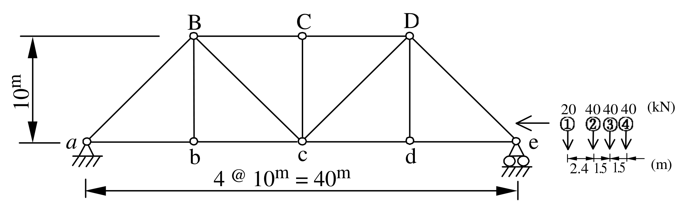

# SA-2004-2 題目正本

> 本檔只記錄考卷上寫了什麼、圖上畫了什麼，不含任何解法。解析見同資料夾 `SA-2004-2.md`。
> 判讀清單經使用者確認前，狀態為「待確認」；確認後本檔原則上不再修改（改動須回考卷原圖並記 log）。

| 項目 | 內容 |
|---|---|
| 考卷 | `raw/exams/SA-2004_結構學.pdf`，第 1 頁（全一頁），第二題 |
| 考年 | 2004（民國九十三年）專技高考結構工程技師「結構學」 |
| 配分 | 25 分 |
| 附圖 | `SA-2004-2-fig-2.png`（2026-11-07 重新擷取）；既有 `SA-2004-2-fig-1.png` |
| 判讀狀態 | **已確認**（2026-11-07 使用者確認。原轉錄：2026-11-07 轉錄；PyMuPDF 110 dpi 整頁＋450–1200 dpi 局部放大；考卷可抽文字，逐字原文以 PDF 文字層核對；盲讀於開啟解析前完成） |

## 1. 考卷原文（逐字）

二、求圖示桁架在卡車序列載重作用下，最大可能之 a 點反力及 bc 桿件內力。（25 分）

## 2. 考卷給的公式、附表與參數

- 考卷沒有給任何參考公式或附表。
- 卡車序列載重（圖上）：軸 ①②③④ 依序 20、40、40、40 kN，軸距 2.4、1.5、1.5 m。
- 考卷沒有給 EA（靜定桁架不需要）；沒有說明載重作用於上弦或下弦。
- 卷首注意事項：㈠不必抄題，作答時請將試題題號及答案依照順序寫在試卷上，於本試題上作答者，不予計分。㈡可以使用電子計算器。
- 考試時間：二小時。

## 3. 附圖

*證據圖 SA-2004-2-fig-2.png（2026-11-07 自考卷 500 dpi 重新擷取）；既有 SA-2004-2-fig-1.png 帶有滑鼠游標（手形游標在跨長尺寸線下方，未壓到構件），保留不改。*

圖面文字照錄：B、C、D、10m、a、b、c、d、e、4 @ 10m = 40m、20 40 40 40 (kN)、①②③④、2.4 1.5 1.5 (m)

## 4. 判讀清單

| # | 項目 | 判讀 | 圖上／題文依據 | 把握 |
|---|---|---|---|---|
| 1 | 座標（以 a 為原點） | a(0,0)、b(10,0)、c(20,0)、d(30,0)、e(40,0)；B(10,10)、C(20,10)、D(30,10) | 下方「4 @ 10m = 40m」、左側 10m 尺寸線；B、C、D 與 b、c、d 豎桿垂直對齊（400 dpi） | 確定 |
| 2 | 桿件 | 下弦 ab、bc、cd、de；上弦 BC、CD；端斜桿 aB、De；豎桿 Bb、Cc、Dd；斜桿 Bc、cD；共 13 桿 | 400 dpi 圖面 | 確定 |
| 3 | 斜桿方向 | Bc 由 B 往右下到 c；cD 由 c 往右上到 D（兩斜桿交於 c） | 圖面 | 確定 |
| 4 | 支承 a | 鉸支承（三角形＋剖線） | 圖上符號 | 確定 |
| 5 | 支承 e | 滾支承（三角形下兩個圓圈） | 900 dpi 局部 | 確定 |
| 6 | 靜定性 | j = 8、m = 13、r = 3，2j = m + r | 計數 | 確定 |
| 7 | 卡車軸重 | ① 20 kN、② 40 kN、③ 40 kN、④ 40 kN | 軸上方數字與圈號（900 dpi） | 確定 |
| 8 | 軸距 | ①–② 2.4 m、②–③ 1.5 m、③–④ 1.5 m，總長 5.4 m | 軸下方尺寸線（900 dpi） | 確定 |
| 9 | 行駛方向 | 卡車在 e 右側、箭頭向左，① 為車頭 | 圖上「←」在 ① 左方 | 確定 |
| 10 | 載重作用弦 | 考卷沒有給（圖上卡車畫在下弦高度右側）；a 反力與 bc 桿力的影響線在上弦或下弦受載皆相同 | 圖面＋桁架幾何（b、c 上方皆有節點） | 確定（解讀）；使用者確認 |
| 11 | 所求 | 最大可能之 a 點反力、bc 桿件內力（題文未指定拉或壓，皆可能） | 題文 | 確定 |

---
*轉錄：2026-11-07（SA-U1-3 題目正本推廣・批 1）*
*確認：2026-11-07 使用者確認*
