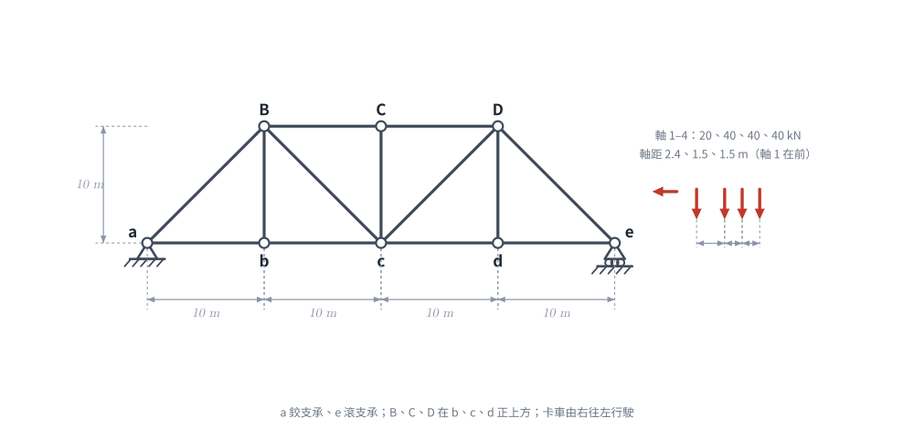
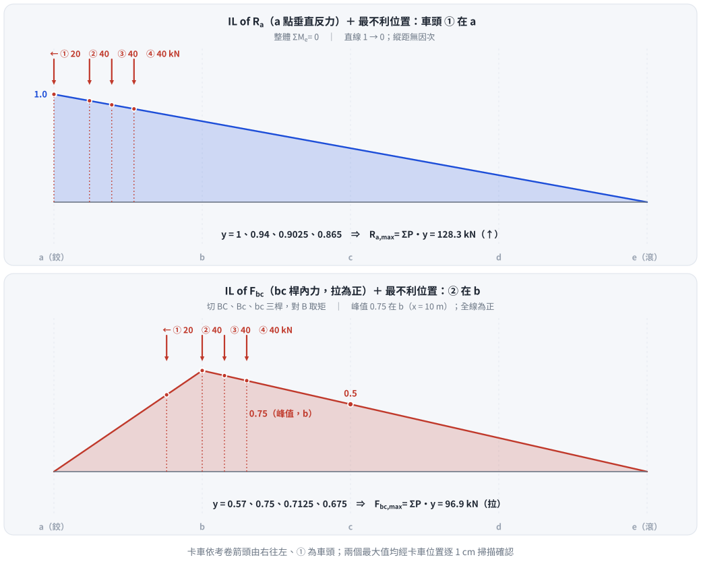

# 考題編號：SA-2004-2

**主分類：** `SA-U1-3` 靜定及靜不定結構影響線
**副分類：** 無
**分析法：** 影響線
**標籤：** `桁架` `影響線` `移動載重` `最大內力`

---

## 1. 題目（考卷原文見題目正本）

> 考卷原文、公式／附表、附圖與判讀清單（已確認）見 [`SA-2004-2-problem.md`](SA-2004-2-problem.md)。本節只列解題時最容易讀錯的地方與本解使用的記號；題意以題目正本為準。

*重繪自考卷附圖，依判讀清單 #1–#11 重繪。攔：e 讀成鉸支承、斜桿 Bc／cD 方向讀反、軸距或軸重順序抄錯。*

### 常見誤讀
| 項目 | 正確判讀 | 常見誤讀 |
|---|---|---|
| e 支承 | 滾支承 | 鉸支承 |
| 斜桿方向 | Bc 由 B 往右下到 c；cD 由 c 往右上到 D | 方向對調 |
| 卡車 | 軸 1–4 為 20、40、40、40 kN，軸距 2.4、1.5、1.5 m，由右往左、軸 1 在前 | 軸重順序或軸距對調 |
| 載重作用弦 | 考卷沒有明說；a 反力與 bc 桿力的影響線在上、下弦受載皆相同 | 當成題目條件 |

**本解記號：** 記號與正負號約定沿用 §4。

---

## 2. 考題核心精神與出題者意圖 (Core Concepts & Examiner's Intent)

本題的核心在於測驗考生對於**影響線（Influence Lines）**的繪製與**移動載重（Moving Loads）**極值分析的掌握度。
出題者意圖包含：
1. **影響線的建立**：能否正確利用節點法或截面法，繪製出特定支承反力（$R_a$）與桁架特定桿件（$bc$ 桿）的影響線。特別是桁架的影響線在節點之間呈線性變化。
2. **移動載重極值判斷**：對於給定的卡車序列載重，能否利用「載重斜率變化法則」或試誤法，找出產生最大反應的臨界位置（Critical Position）。
3. **方向性判斷**：卡車行駛方向對極值的影響，測驗考生是否能細心觀察圖示箭頭並正確配置載重座標。

## 3. 解題戰略地圖與陷阱分析 (Strategic Roadmap & Trap Analysis)

**解題戰略：**
1. **建立座標系與載重模型**：以 $a$ 點為原點（$x=0$），向右為正。依據箭頭指示，卡車向左行駛，故 $20\text{kN}$ 為前導載重，其 $x$ 座標最小。
2. **繪製 $a$ 點反力影響線**：利用靜力平衡求得 $R_a$ 隨單位力位置 $x$ 的函數。
3. **計算最大反力 $R_{a,\max}$**：將最重且最密集的載重盡可能靠近影響線最大值處（即 $x=0$），求得最大反力。
4. **繪製 $bc$ 桿內力影響線**：在 $b, c$ 之間切截面，取左半部結構，對 $B$ 點取力矩求 $F_{bc}$，繪出其影響線，確認峰值位置。
5. **計算最大桿端內力 $F_{bc,\max}$**：將卡車序列依序放置，利用斜率判別法找出使總內力達到極值的載重位置，計算該位置下的內力總和。

**陷阱分析：**
- **陷阱一：卡車載重方向錯置**。圖示有明確的向左箭頭，若將 $20\text{kN}$ 放至右側（當作車尾），將導致載重位置與題意不符，進而算出錯誤的極值。
- **陷阱二：桁架影響線的節間特性**。桁架載重透過橋面版與縱梁傳遞至節點，因此影響線在節間（如 $a$-$b$ 或 $b$-$c$）必定是直線連接。若使用連續梁的拋物線或錯判節間傳遞，會導致 $F_{bc}$ 影響線繪製錯誤。
- **陷阱三：盲目猜測臨界位置**。對於 $F_{bc}$ 的三角形影響線，最大值可能發生在任一重載通過峰值（$x=10$）時。必須透過判定準則或逐一計算來確認，不可僅憑直覺將最重載重放於峰值即停止。

## 3.5 變數層次分析 (Variable Hierarchy Analysis)

### 最終目標
`求出卡車載重作用下，a 點最大反力及 bc 桿最大拉力。`

### 本題關鍵公式（依計算順序）
- 影響線方程式：
  $$ \boxed{IL(x)} = \text{Function of } x $$
- 移動載重反應總和：
  $$ R = \sum_{i=1}^{n} P_i \cdot \boxed{IL(x_i)} $$
- 載重移動判定準則（求極值）：
  $$ \Delta R = \left( \sum P_{\text{left}} \cdot m_{\text{left}} + \sum P_{\text{right}} \cdot m_{\text{right}} \right) \Delta x $$

### L1：題目直接給定
| 符號 | 數值 | 說明 |
|---|---|---|
| $L$ | $40\text{m}$ | 桁架總跨距 |
| $h$ | $10\text{m}$ | 桁架高度 |
| $P_1, P_2, P_3, P_4$ | $20, 40, 40, 40 \text{ kN}$ | 卡車各軸載重 |
| $d_{12}, d_{23}, d_{34}$ | $2.4, 1.5, 1.5 \text{ m}$ | 載重間距 |

### L2：需知識點推導
| 符號 | 公式／來源 | 卡關? |
|---|---|---|
| $IL_{Ra}$ | 靜力平衡：$\sum M_e = 0$ | |
| $IL_{Fbc}$ | 截面法：切過 $BC, Bc, bc$，對 $B$ 點取力矩 | |

### L3：深層知識（不懂就卡住）
| 知識點 | 說明 | 卡關? |
|---|---|---|
| 影響線斜率判定法 | 當載重跨越影響線峰值時，若 $\frac{dR}{dx}$ 變號，則該位置即為極大值。 | |

## 4. 步驟化詳細計算過程 (Step-by-Step Detailed Calculation)

### Step 1: 建立座標系與卡車模型
設定 $a$ 點為座標原點 $x=0$，向右為正。
依據圖示箭頭，卡車由右向左行駛，故 $P_1 = 20\text{kN}$ 為最左側之前導載重。
各載重座標相對關係為：
- $x_1 = x$
- $x_2 = x + 2.4$
- $x_3 = x + 3.9$
- $x_4 = x + 5.4$

### Step 2: $a$ 點最大反力 $R_{a,\max}$ 分析
**1. 繪製 $R_a$ 影響線：**
當單位載重 $P=1$ 位於 $x$ 處時，由整體靜力平衡 $\sum M_e = 0$：
$$ R_a \times 40 - 1 \times (40 - x) = 0 \implies IL_{Ra}(x) = 1 - \frac{x}{40} \quad (0 \le x \le 40) $$
影響線為一遞減直線，最大值 $1.0$ 位於 $x=0$。

**2. 尋求最大反應位置：**
由於 $IL_{Ra}$ 隨 $x$ 遞減，要使反力最大，應將所有載重盡可能放置於最左側（靠近 $a$ 點）。
將前導載重 $P_1$ 置於 $a$ 點，即 $x_1 = 0$：
- $x_1 = 0\text{m} \implies y_1 = 1 - 0/40 = 1.0$
- $x_2 = 2.4\text{m} \implies y_2 = 1 - 2.4/40 = 37.6 / 40 = 0.94$
- $x_3 = 3.9\text{m} \implies y_3 = 1 - 3.9/40 = 36.1 / 40 = 0.9025$
- $x_4 = 5.4\text{m} \implies y_4 = 1 - 5.4/40 = 34.6 / 40 = 0.865$

代入載重求和：
$$ R_a = \sum P_i y_i = 20(1.0) + 40(0.94) + 40(0.9025) + 40(0.865) $$
$$ R_a = 20 + 37.6 + 36.1 + 34.6 = 128.3 \text{ kN} $$

若將卡車繼續向左移使 $P_1$ 離開橋面，由載重判定準則可知，失去 $20\text{kN} \times 1.0$ 的貢獻，但其餘載重每向左移動 $1\text{m}$ 僅增加 $(120\text{kN}) \times (1/40) = 3\text{kN/m}$，得不償失，故此為最大值。
$$ \boxed{R_{a,\max} = 128.3 \text{ kN} \ (\uparrow)} $$

### Step 3: $bc$ 桿最大內力 $F_{bc,\max}$ 分析
**1. 繪製 $F_{bc}$ 影響線：**
取通過第二節間（$b$-$c$ 之間）之垂直截面，切斷 $BC, Bc, bc$ 三桿。
取左半部自由體圖，為求 $F_{bc}$，對 $B$ 點 $(x=10, y=10)$ 取力矩 $\sum M_B = 0$。

- **當單位載重在截面右側 ($10 \le x \le 40$)：**
  左半部僅有反力 $R_a$。
  $$ \sum M_B = R_a \times 10 - F_{bc} \times 10 = 0 \implies F_{bc} = R_a = 1 - \frac{x}{40} $$
- **當單位載重在截面左側 ($0 \le x \le 10$)：**
  載重透過縱梁分配至 $a, b$ 點，此時 $F_{bc}$ 仍可由左半部整體力矩平衡求得（包含載重於 $a,b$ 點之貢獻，等效為直接以 $P=1$ 的力矩計算）。
  $$ \sum M_B = R_a \times 10 - 1 \times (10 - x) - F_{bc} \times 10 = 0 $$
  $$ F_{bc} = R_a - \left(1 - \frac{x}{10}\right) = \left(1 - \frac{x}{40}\right) - 1 + \frac{x}{10} = \frac{3x}{40} $$

整理影響線方程式，這是一個在 $x=10$（即 $b$ 點）產生峰值的三角形：
- 峰值：$x = 10\text{m}$ 時， $y = 0.75$
- 左斜率：$m_1 = 3/40$
- 右斜率：$m_2 = -1/40$

**2. 尋求最大反應位置（載重判定準則）：**
卡車向左行駛，令載重 $P_k$ 通過峰值 $x=10$。反應變化率為：
$$ \frac{dF}{dx} = \sum P_{\text{left}} \cdot m_1 + \sum P_{\text{right}} \cdot m_2 $$
因為卡車向左，位置變數 $dx < 0$，我們需找到 $\frac{dF}{dx}$ 由負轉正的瞬間（即 $dF$ 由正變負，代表越過極大值）。
- **當 $P_1$ 越過 $x=10$ (僅 $P_1$ 在左)：**
  $\frac{dF}{dx} = 20(3/40) + 120(-1/40) = (60 - 120)/40 = -1.5$ 
  ($dx < 0 \implies dF > 0$，內力持續增加)
- **當 $P_2$ 越過 $x=10$ ($P_1, P_2$ 在左)：**
  $\frac{dF}{dx} = 60(3/40) + 80(-1/40) = (180 - 80)/40 = +2.5$ 
  ($dx < 0 \implies dF < 0$，內力開始減少)

**結論：最大值發生在載重 $P_2 (40\text{kN})$ 剛好位於 $x=10$ 時。**

**3. 計算 $F_{bc,\max}$：**
配置載重：$x_2 = 10\text{m}$。
- $x_1 = 10 - 2.4 = 7.6\text{m}$
- $x_2 = 10\text{m}$
- $x_3 = 10 + 1.5 = 11.5\text{m}$
- $x_4 = 10 + 3.0 = 13.0\text{m}$

查表代入影響線 $y$ 值：
- $y_1 = \frac{3 \times 7.6}{40} = 0.57$
- $y_2 = 0.75$
- $y_3 = 1 - \frac{11.5}{40} = 0.7125$
- $y_4 = 1 - \frac{13.0}{40} = 0.675$

計算總內力：
$$ F_{bc} = 20(0.57) + 40(0.75) + 40(0.7125) + 40(0.675) $$
$$ F_{bc} = 11.4 + 30 + 28.5 + 27 = 96.9 \text{ kN} $$
$$ \boxed{F_{bc,\max} = 96.9 \text{ kN} \text{ (拉力)}} $$

*圖 2　$R_a$ 與 $F_{bc}$ 影響線及卡車最不利位置。攔的是把 $F_{bc}$ 峰值放在跨中 c（斷面在 b–c 節間、對 B 取矩，峰值在 b），以及峰值上放錯軸 —— ② 在 b 才是最大；產圖腳本以卡車位置逐 1 cm 掃描確認兩個最大值。*

## 5. 關鍵爭議點與進階探討 (Critical Issues & Advanced Discussion)
- **載重行駛方向的判斷**：題目明確畫出了向左的箭頭，因此本解析嚴格遵守載重由右向左移動的情境（$20\text{kN}$ 在最左側）。若實務設計中橋梁允許雙向行駛，則需額外檢核反向行駛的情況。例如若卡車掉頭（$40\text{kN}$ 在最左側），重新放置於影響線上將會得到 $F_{bc} = 97.8\text{kN}$ 的結果，略大於單向行駛。但在國家考試中，遵循圖示箭頭的明確指示是最安全的答題策略，因此最終答案仍以圖示方向為準。

*修正日期：2026-11-07（§1 改為指向題目正本並放重繪附圖（figs/SA-2004-2-fig-1-problem.svg）、加常見誤讀；圖由 gen_SA-2004-2.py 產生，可重跑）*
*圖解補繪：2026-11-07（圖 2 影響線，向量圖，腳本 `gen_SA-2004-2_il.py`，可重跑）*
*修正日期：2026-11-07（標頭主分類名稱更正（非勘誤）：「靜定結構分析」→「靜定及靜不定結構影響線」，代號 SA-U1-3 不變）*
