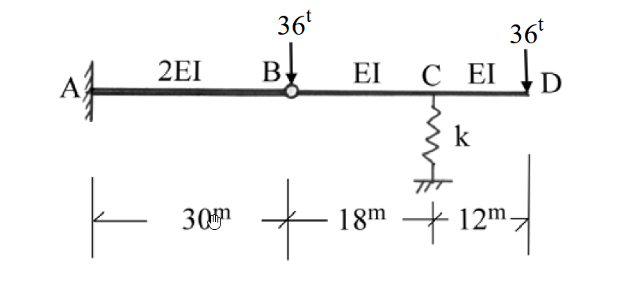
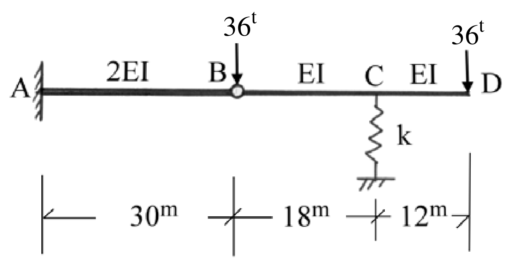

# SA-2004-3 題目正本

> 本檔只記錄考卷上寫了什麼、圖上畫了什麼，不含任何解法。解析見同資料夾 `SA-2004-3.md`。
> 判讀清單經使用者確認前，狀態為「待確認」；確認後本檔原則上不再修改（改動須回考卷原圖並記 log）。

| 項目 | 內容 |
|---|---|
| 考卷 | `raw/exams/SA-2004_結構學.pdf`，第 1 頁（全一頁），第三題 |
| 考年 | 2004（民國九十三年）專技高考結構工程技師「結構學」 |
| 配分 | 25 分 |
| 附圖 | `SA-2004-3-fig-1.png`、`SA-2004-3-fig-2.png` |
| 判讀狀態 | **已確認**（2026-11-05 使用者確認。原轉錄：2026-11-05 轉錄；PyMuPDF 110 dpi 整頁＋350–1000 dpi 局部放大；盲讀於開啟解析前完成） |

## 1. 考卷原文（逐字）

三、如圖所示 C 點為彈簧支承之複合梁，試求在圖示之荷重作用時，點 C、D 之傾角及點 B、C、D 之垂直變位。彎曲剛度 EI = 1×10⁶ t-m²。彈簧支承之彈簧常數 k = 10⁴ t/m。（25 分）

## 2. 考卷給的公式、附表與參數

- 考卷沒有給任何參考公式或附表。
- EI = 1×10⁶ t-m²；k = 10⁴ t/m（題文；PDF 文字層為「1×106」「104」，上標依頁面影像補回）。
- 卷首注意事項：㈠不必抄題，作答時請將試題題號及答案依照順序寫在試卷上，於本試題上作答者，不予計分。㈡可以使用電子計算器。
- 考試時間：二小時。

## 3. 附圖

*證據圖 SA-2004-3-fig-1.png*

*證據圖 SA-2004-3-fig-2.png（2026-11-05 自考卷重新擷取 500 dpi，無游標）*

圖面文字照錄：36t、36t、A、2EI、B、EI、C、EI、D、k、30m、18m、12m

## 4. 判讀清單

| # | 項目 | 判讀 | 圖上／題文依據 | 把握 |
|---|---|---|---|---|
| 1 | A | 固定端（牆） | 圖上剖線牆 | 確定 |
| 2 | B | 內鉸（AB 與 BC 鉸接） | 圖上 B 空心圓；題文「複合梁」 | 確定（解讀）；使用者確認 |
| 3 | C | 線彈簧支承（垂直），k = 10⁴ t/m | 圖上彈簧＋題文 | 確定 |
| 4 | D | 自由端 | 圖上無支承 | 確定 |
| 5 | 尺寸 | AB 30 m、BC 18 m、CD 12 m | 下方尺寸線 | 確定 |
| 6 | 剛度 | AB 為 2EI；BC、CD 為 EI；EI = 1×10⁶ t-m² | 圖上標字；題文 | 確定 |
| 7 | 載重 | B 點 36t 向下、D 點 36t 向下 | 箭頭位置（B 箭頭落在鉸上） | 確定 |
| 8 | 所求 | C、D 傾角；B、C、D 垂直變位 | 題文 | 確定 |
| 9 | 證據圖 | 舊 fig-1 滑鼠游標壓在「30m」尺寸字上；新增 fig-2（500 dpi） | — | 確定 |

---
*轉錄：2026-11-05（SA-U1-2 題目正本推廣・批 1）*
*確認：2026-11-05 使用者確認*
