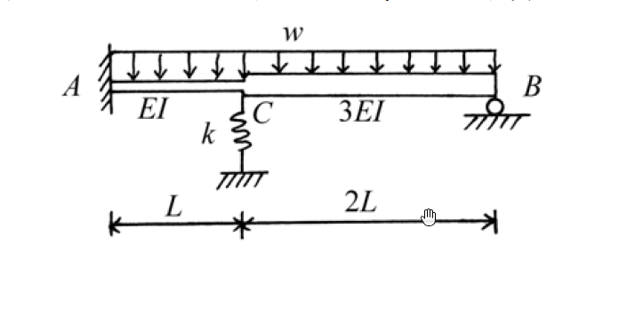
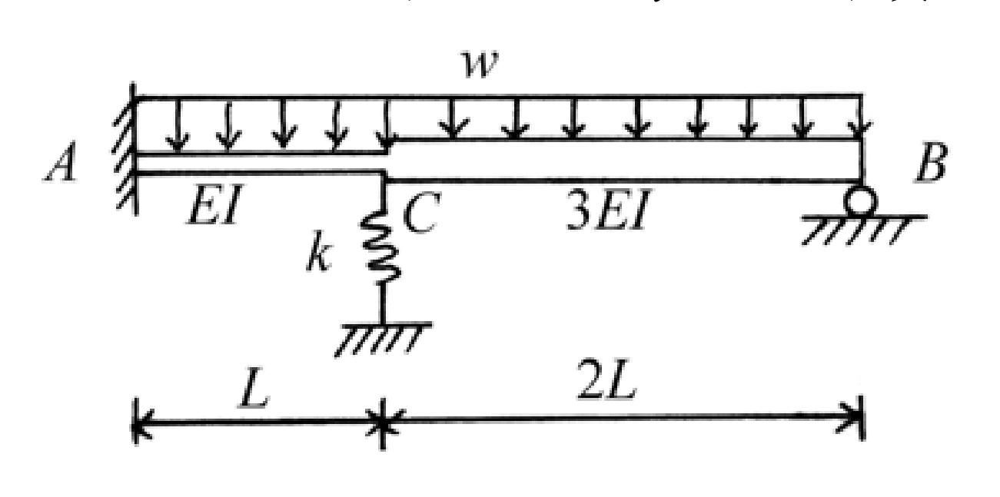

# SA-2004-4 題目正本

> 本檔只記錄考卷上寫了什麼、圖上畫了什麼，不含任何解法。解析見同資料夾 `SA-2004-4.md`。
> 判讀清單經使用者確認前，狀態為「待確認」；確認後本檔原則上不再修改（改動須回考卷原圖並記 log）。

| 項目 | 內容 |
|---|---|
| 考卷 | `raw/exams/SA-2004_結構學.pdf`，第 1 頁（全一頁）下方，第四題 |
| 考年 | 2004（民國 93 年）專技高考結構工程技師「結構學」 |
| 配分 | 25 分 |
| 附圖 | `SA-2004-4-fig-1.png`、`SA-2004-4-fig-2.png` |
| 判讀狀態 | **已確認**（2026-11-05 使用者確認。原轉錄：2026-11-05 轉錄；PyMuPDF 110 dpi 整頁＋250–800 dpi 局部放大、PDF 向量座標；盲讀於開啟解析前完成） |

## 1. 考卷原文（逐字）

四、 如圖所示之梁結構，在均佈載重 w 作用下，其中 C 點有一軸力彈簧，其勁度 k = 12 EI/L³，試以直接勁度法或矩陣位移法，求各構件端之彎矩及彈簧力大小。（25 分）

## 2. 考卷給的公式、附表與參數

- 考卷沒有給任何參考公式或附表。
- 考卷只給符號：w、EI、L、k = 12 EI/L³（題文）；圖上 AC 段標 EI、CB 段標 3EI。
- 考卷沒有給數值，答案為 w、L 的式子。
- 考卷沒有說是否忽略軸向變形（梁只受垂直載重，軸力為零）。
- 卷首注意事項：㈠不必抄題，作答時請將試題題號及答案依照順序寫在試卷上，於本試題上作答者，不予計分。㈡可以使用電子計算器。
- 考試時間：二小時。

## 3. 附圖

*證據圖 SA-2004-4-fig-1.png*

*證據圖 SA-2004-4-fig-2.png（2026-11-05 自考卷重新擷取 500 dpi，無游標）*

圖面文字照錄：A、B、C、w、EI、3EI、k、L、2L

## 4. 判讀清單

| # | 項目 | 判讀 | 圖上／題文依據 | 把握 |
|---|---|---|---|---|
| 1 | 構件與節點 | A–C–B 一直線水平梁，C 為連續節點（不是內鉸） | 500 dpi：C 處梁連續，只是斷面由細變粗 | 確定 |
| 2 | 支承 A | 固定端（左側牆＋剖線） | 附圖 | 確定 |
| 3 | 支承 B | 滾支承（圓＋剖線） | 附圖 | 確定 |
| 4 | 支承 C | 垂直軸力彈簧 k = 12 EI/L³，下端接地 | 題文；附圖彈簧畫在 C 正下方 | 確定 |
| 5 | 尺寸 | AC = L、CB = 2L | 下方尺寸線，C 的刻度對齊彈簧 | 確定 |
| 6 | 撓曲剛度 | AC：EI；CB：3EI | 圖上標註；CB 段畫得較厚 | 確定 |
| 7 | 載重 | 均佈 w，向下，A 到 B 全長 | 附圖箭頭由 A 排到 B | 確定 |
| 8 | 所求 | 各構件端彎矩、彈簧力 | 題文 | 確定 |
| 9 | 考卷沒有給 | w、L、EI 的數值；軸向變形條件 | — | 確定 |
| 10 | 證據圖 | 舊截圖 fig-1：解析度低（約 714×364），滑鼠游標（手形）壓在 2L 尺寸線上；新增 fig-2（2026-11-05 自考卷重新擷取 500 dpi） | — | 確定 |

---
*轉錄：2026-11-05（SA-U2-4 題目正本推廣・批 1）*
*確認：2026-11-05 使用者確認*
