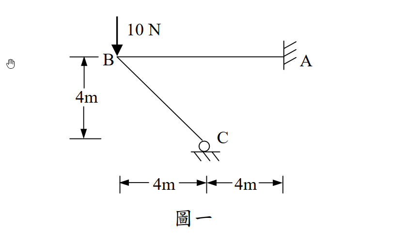
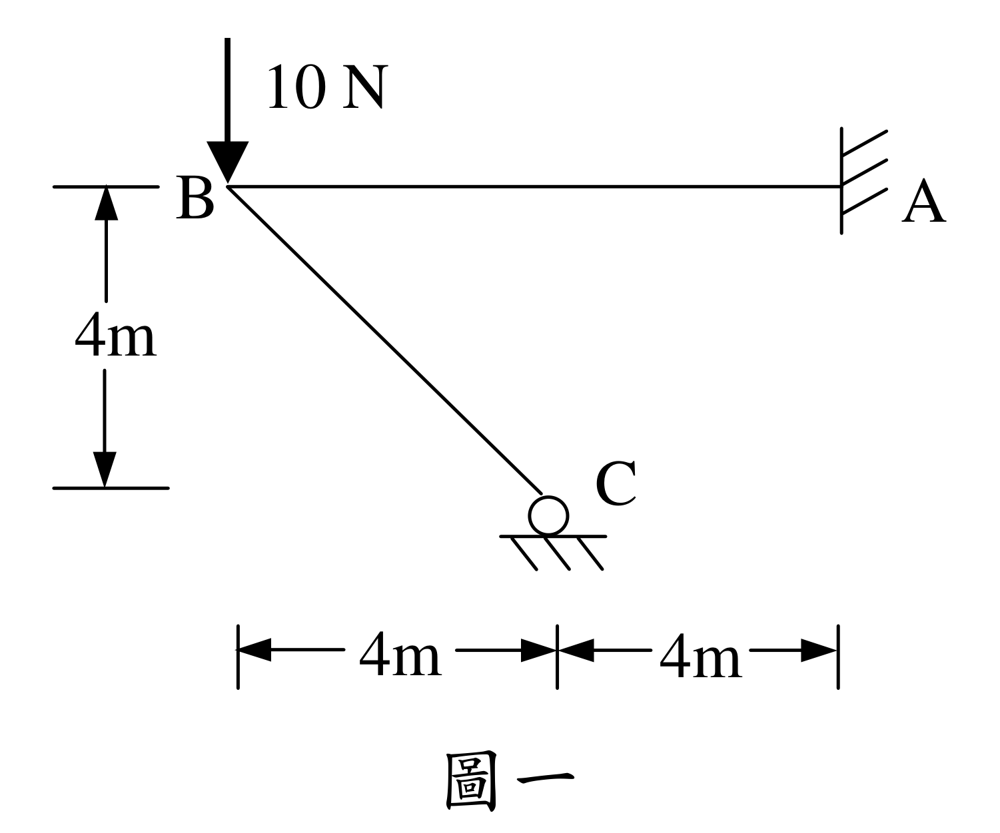

# SA-2005-1 題目正本

> 本檔只記錄考卷上寫了什麼、圖上畫了什麼，不含任何解法。解析見同資料夾 `SA-2005-1.md`。
> 判讀清單經使用者確認前，狀態為「待確認」；確認後本檔原則上不再修改（改動須回考卷原圖並記 log）。

| 項目 | 內容 |
|---|---|
| 考卷 | `raw/exams/SA-2005_結構學.pdf`，第 1 頁（正面）上部，第一題（圖一） |
| 考年 | 2005（民國 94 年）專技高考結構工程技師「結構學」 |
| 配分 | 25 分 |
| 附圖 | `SA-2005-1-fig-1.png`、`SA-2005-1-fig-2.png` |
| 判讀狀態 | **已確認**（2026-11-07 使用者確認。原轉錄：2026-11-07 轉錄；PyMuPDF 110 dpi 整頁＋300–500 dpi 局部放大、PDF 向量座標核對；盲讀於開啟解析前完成） |

## 1. 考卷原文（逐字）

一、剛架（frame）如圖一，其構架高為4m，跨距為8 m，A 點為固接（fixed），C 點為滾接（roller）。若每根桿件為邊長20 cm 之方形截面，且楊氏係數E = 10⁶ N/cm²，則當B 點有一垂直載重10 N 時，且不計軸力及剪力下，請以最小功法（least work）計算每根桿件之彎矩。（若以他法計算，則不予以計分）（25 分）

## 2. 考卷給的公式、附表與參數

- 考卷沒有給任何參考公式或附表。
- 斷面：邊長 20 cm 方形（考卷沒有直接給 I 值）；E = 10⁶ N/cm²。
- 「不計軸力及剪力」（題文原句，照錄）。
- 指定方法：最小功法；他法不計分。
- 卷首注意事項：㈠不必抄題，作答時請將試題題號及答案依照順序寫在試卷上，於本試題紙上作答者，不予計分。㈡可以使用電子計算器，但需詳列解答過程。
- 考試時間：2 小時。

## 3. 附圖

*證據圖 SA-2005-1-fig-1.png*

*證據圖 SA-2005-1-fig-2.png（2026-11-07 自考卷重新擷取 500 dpi，無游標）*

圖面文字照錄：10 N、B、A、C、4m、4m、4m、圖一

## 4. 判讀清單

| # | 項目 | 判讀 | 圖上／題文依據 | 把握 |
|---|---|---|---|---|
| 1 | 構件 | B–A 水平桿；B–C 斜桿；B 為剛接角點（無圓圈） | 圖面 | 確定 |
| 2 | A | 固定端（桿端接直立牆＋斜剖線）；在 B 的右方 | 題文「A 點為固接」；圖示 | 確定 |
| 3 | C | 滾支承：圓圈坐在水平剖線上，提供垂直反力 | 題文「C 點為滾接」；圓圈中心 PDF x=380.3、底線 y=456.3 | 確定（解讀）；使用者確認 |
| 4 | 幾何 | B (0, 0)、C 在 B 右方 4 m、下方 4 m；A 在 B 右方 8 m、同高。BC 長 4√2 m | 下方尺寸線端點 x=313.3｜382.3｜443.0 分別對齊 B、C 圓心、A 牆；左側 4m 上緣 y=380.7 對齊 B、下緣 y=445.9 對齊 C 圓頂（圓心 451.9） | 確定 |
| 5 | 載重 | B 點 10 N 垂直向下 | 箭頭尖端 (311.0, 380.0) 落在 B | 確定 |
| 6 | 斷面 | 兩桿相同：邊長 20 cm 方形，E = 10⁶ N/cm² | 題文「每根桿件」 | 確定 |
| 7 | 考卷沒有給 | I 值（需由 20 cm 方形自算）；單位混用 N、cm、m | 題文 | 確定 |
| 8 | 靜不定度 | 固定 3＋滾 1＝4 反力，3 方程式：一度靜不定 | 計數 | 確定 |
| 9 | 所求 | 每根桿件之彎矩；最小功法 | 題文 | 確定 |
| 10 | 證據圖 | 舊 fig-1 左側邊界外有滑鼠游標（未壓在構件上）；新增 fig-2（500 dpi） | — | 確定 |

---
*轉錄：2026-11-07（SA-U2-1 題目正本推廣・批 1）*
*確認：2026-11-07 使用者確認*
