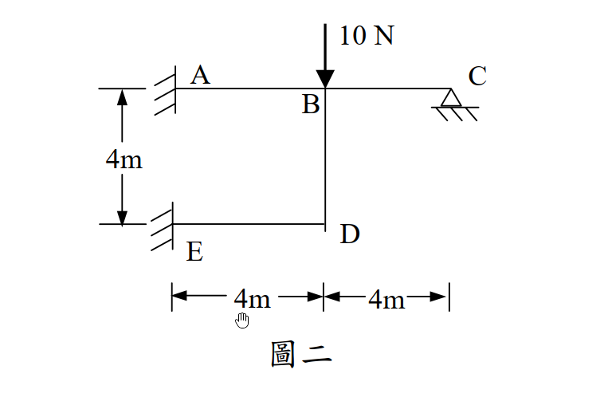

# SA-2005-2 題目正本

> 本檔只記錄考卷上寫了什麼、圖上畫了什麼，不含任何解法。解析見同資料夾 `SA-2005-2.md`。
> 判讀清單經使用者確認前，狀態為「待確認」；確認後本檔原則上不再修改（改動須回考卷原圖並記 log）。

| 項目 | 內容 |
|---|---|
| 考卷 | `raw/exams/SA-2005_結構學.pdf`，第 1 頁中段，第二題（圖二） |
| 考年 | 2005（民國 94 年）專技高考結構工程技師「結構學」 |
| 配分 | 25 分 |
| 附圖 | `SA-2005-2-fig-1.png` |
| 判讀狀態 | **已確認**（2026-11-04 使用者確認。原轉錄：2026-11-04 轉錄；PyMuPDF 150 dpi 整頁＋350–500 dpi 局部放大；盲讀於開啟解析前完成） |

## 1. 考卷原文（逐字）

二、剛架（frame）如圖二，其構架高為 4m，跨距為 8 m，A、E 兩點為固接（fixed），C 點為鉸接（hinge）。若每根桿件之慣性矩 I 及楊氏係數 E 為常數，則當 B 點有一垂直載重 10 N 時，計算每根桿件之彎矩。（25 分）

## 2. 考卷給的公式、附表與參數

- 考卷沒有給任何參考公式或附表；所需公式須自備。
- 卷首注意事項：㈠不必抄題，作答時請將試題題號及答案依照順序寫在試卷上，於本試題紙上作答者，不予計分。㈡可以使用電子計算器，但需詳列解答過程。
- 考試時間：2 小時。

## 3. 附圖

*證據圖 SA-2005-2-fig-1.png*

圖面文字照錄：10 N、A、B、C、4m、E、D、4m、4m、圖二

## 4. 判讀清單

| # | 項目 | 判讀 | 圖上／題文依據 | 把握 |
|---|---|---|---|---|
| 1 | A | 左上固接（牆面斜線） | 400 dpi | 確定 |
| 2 | E | 左下固接（牆面斜線） | 400 dpi | 確定 |
| 3 | C | 鉸支承 | 題文「C 點為鉸接（hinge）」＋圖上三角形支承 | 確定（解讀）；使用者確認 |
| 4 | B | 梁 A-B-C 上距 A 4 m，與柱 BD 剛接 | 圖面節點 | 確定 |
| 5 | D | 柱 BD 與下梁 ED 之剛接角點 | BD 線條略超出 D，判為繪圖誤差 | 確定（解讀）；使用者確認 |
| 6 | 尺寸 | AB = BC = 4 m、BD = 4 m、ED = 4 m | 高 4m、下方 4m＋4m 尺寸線 | 確定 |
| 7 | E、I | 各桿相同 | 題文 | 確定 |
| 8 | 載重 | B 點 10 N 向下 | 箭頭 | 確定 |
| 9 | 指定方法 | 未指定 | 題文 | 確定 |
| 10 | 所求 | 每根桿件之彎矩 | 題文 | 確定 |

---
*轉錄：2026-11-04（SA-U2-3 題目正本推廣・批 1；判讀沿用同日盲解稽核紀錄 wiki/queries/盲解紀錄-SA-U2-3a-2026-11-04.md，並回考卷原圖核對）*
*確認：2026-11-04 使用者確認*
