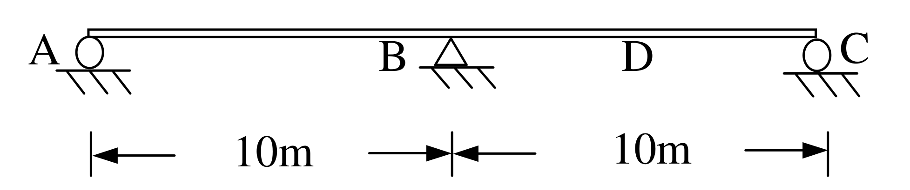

# SA-2005-3 題目正本

> 本檔只記錄考卷上寫了什麼、圖上畫了什麼，不含任何解法。解析見同資料夾 `SA-2005-3.md`。
> 判讀清單經使用者確認前，狀態為「待確認」；確認後本檔原則上不再修改（改動須回考卷原圖並記 log）。

| 項目 | 內容 |
|---|---|
| 考卷 | `raw/exams/SA-2005_結構學.pdf`，第 1 頁（正面），全一張，第三題（圖三） |
| 考年 | 2005（民國九十四年）專技高考結構工程技師「結構學」 |
| 配分 | 25 分 |
| 附圖 | `SA-2005-3-fig-2.png`（2026-11-07 重新擷取）；既有 `SA-2005-3-fig-1.png` |
| 判讀狀態 | **已確認**（2026-11-07 使用者確認。原轉錄：2026-11-07 轉錄；PyMuPDF 110 dpi 整頁＋450–1200 dpi 局部放大；考卷可抽文字，逐字原文以 PDF 文字層核對；盲讀於開啟解析前完成） |

## 1. 考卷原文（逐字）

三、二跨之靜不定梁如圖三，各梁之楊氏係數 E 及慣性矩 I 為常數，試每隔 2.5m 畫出 BC 跨度中點 D 之彎矩感應線（influence line）。（25 分）

（「感應線」照考卷原文，即影響線。）

## 2. 考卷給的公式、附表與參數

- 考卷沒有給任何參考公式或附表。
- 考卷沒有給 E、I 數值（只說為常數）。
- 卷首注意事項：㈠不必抄題，作答時請將試題題號及答案依照順序寫在試卷上，於本試題紙上作答者，不予計分。㈡可以使用電子計算器，但需詳列解答過程。
- 考試時間：2 小時。

## 3. 附圖

*證據圖 SA-2005-3-fig-2.png（2026-11-07 自考卷 500 dpi 重新擷取）；既有 SA-2005-3-fig-1.png 帶有滑鼠游標（手形游標在「圖三」字樣上，未壓到構件），保留不改。*

圖面文字照錄：A、B、D、C、10m、10m、圖三

## 4. 判讀清單

| # | 項目 | 判讀 | 圖上／題文依據 | 把握 |
|---|---|---|---|---|
| 1 | 座標 | A(0)、B(10)、C(20)，D(15)，單位 m | 尺寸線 10m｜10m；D 為題文「BC 跨度中點」，圖上 D 字母位置量得約 15.0 m | 確定 |
| 2 | 支承 A | 滾支承（圓圈＋剖線） | 450 dpi | 確定 |
| 3 | 支承 B | 鉸支承（三角形＋剖線） | 450 dpi | 確定 |
| 4 | 支承 C | 滾支承（圓圈＋剖線） | 450 dpi | 確定 |
| 5 | 梁 | A–C 連續，無內鉸；EI 常數 | 梁線連續（雙線繪製）；題文 | 確定 |
| 6 | 所求 | D 點彎矩影響線，每隔 2.5 m 計算一個縱座標（x = 0、2.5、…、20 m 共 9 點） | 題文「每隔 2.5m 畫出」 | 確定（解讀）；使用者確認 |
| 7 | 靜不定度 | 一度靜不定 | 三個垂直支承 | 確定 |

---
*轉錄：2026-11-07（SA-U1-3 題目正本推廣・批 1）*
*確認：2026-11-07 使用者確認*
