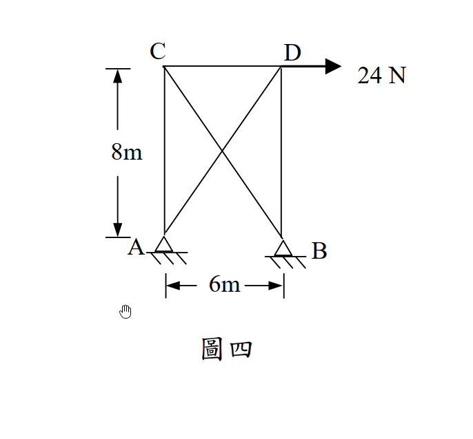
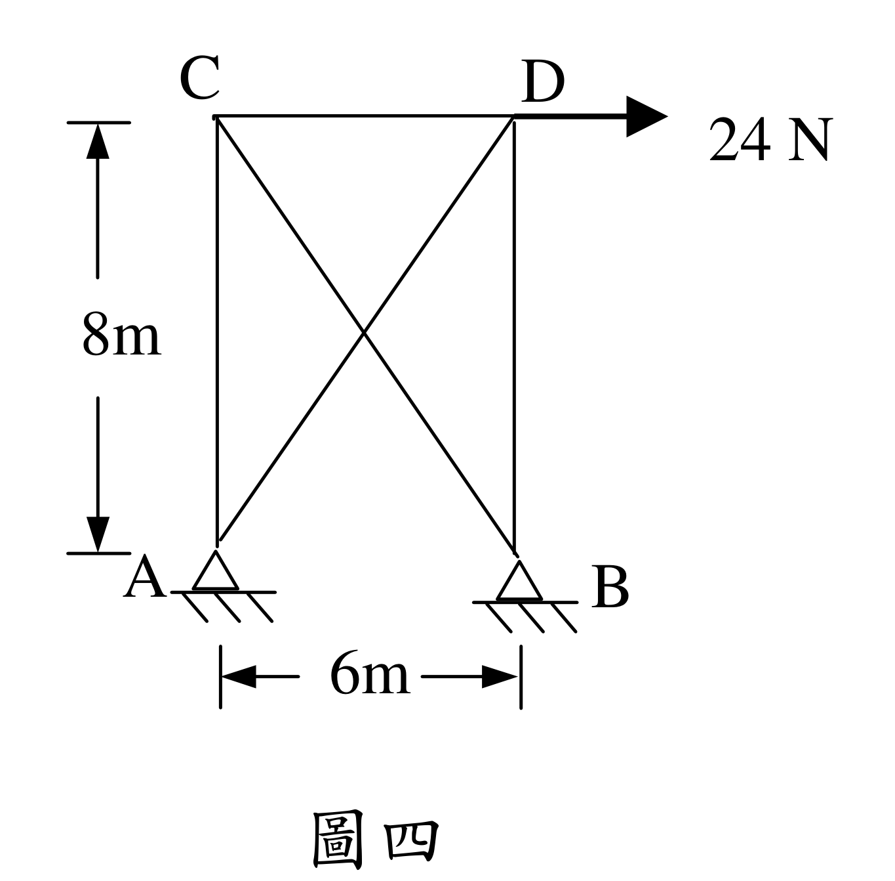

# SA-2005-4 題目正本

> 本檔只記錄考卷上寫了什麼、圖上畫了什麼，不含任何解法。解析見同資料夾 `SA-2005-4.md`。
> 判讀清單經使用者確認前，狀態為「待確認」；確認後本檔原則上不再修改（改動須回考卷原圖並記 log）。

| 項目 | 內容 |
|---|---|
| 考卷 | `raw/exams/SA-2005_結構學.pdf`，第 2 頁（背面），第四題（圖四） |
| 考年 | 2005（民國 94 年）專技高考結構工程技師「結構學」 |
| 配分 | 25 分 |
| 附圖 | `SA-2005-4-fig-1.png`、`SA-2005-4-fig-2.png` |
| 判讀狀態 | **已確認**（2026-11-07 使用者確認。原轉錄：2026-11-07 轉錄；PyMuPDF 110 dpi 整頁＋300–500 dpi 局部放大、PDF 向量座標核對；盲讀於開啟解析前完成） |

## 1. 考卷原文（逐字）

四、桁架（truss）示如圖四，A、B 兩點為鉸接（hinge）。若每根桿件之斷面積為10 cm²，楊氏係數E = 10⁶ N/cm²，則當D 點有一水平載重24 N 時，計算各桿件之應力。（25 分）

## 2. 考卷給的公式、附表與參數

- 考卷沒有給任何參考公式或附表。
- 每根桿件斷面積 10 cm²、E = 10⁶ N/cm²。
- 沒有指定解法。
- 卷首注意事項：㈠不必抄題，作答時請將試題題號及答案依照順序寫在試卷上，於本試題紙上作答者，不予計分。㈡可以使用電子計算器，但需詳列解答過程。
- 考試時間：2 小時。

## 3. 附圖

*證據圖 SA-2005-4-fig-1.png*

*證據圖 SA-2005-4-fig-2.png（2026-11-07 自考卷重新擷取 500 dpi，無游標）*

圖面文字照錄：C、D、24 N、8m、A、B、6m、圖四

## 4. 判讀清單

| # | 項目 | 判讀 | 圖上／題文依據 | 把握 |
|---|---|---|---|---|
| 1 | 節點 | A、B（下）、C、D（上）四個節點 | 圖面字母 | 確定 |
| 2 | 桿件 | AC、BD（豎桿）、CD（上弦）、AD、BC（斜桿）共 5 根；**A–B 之間沒有下弦桿** | 底邊只有剖線與尺寸線，A、B 三角形間無線段；PDF 線段僅 5 條桿 | 確定 |
| 3 | 交叉 | 兩斜桿交叉處不相連（無節點） | 交叉點無圓點 | 確定（解讀）；使用者確認 |
| 4 | 支承 | A、B 皆為鉸支承（各 2 反力） | 三角形＋剖線；題文「A、B 兩點為鉸接」 | 確定 |
| 5 | 幾何 | 寬 6 m（A–B）、高 8 m；斜桿長 10 m | 左側尺寸 y=262.5｜357.0 對齊 C、A；下方 x=329.8｜395.8 對齊 A、B | 確定 |
| 6 | 載重 | D 點 24 N 水平向右 | 箭頭由 D 沿上弦方向向右 | 確定 |
| 7 | 靜不定度 | m＝5、r＝4、j＝4：5＋4−8＝一度靜不定 | 計數 | 確定 |
| 8 | 所求 | 「各桿件之應力」：應力＝內力／面積（N/cm²），不是只求內力 | 題文 | 確定（解讀）；使用者確認 |
| 9 | 證據圖 | 舊 fig-1 下方空白處有滑鼠游標（未壓在構件上）；新增 fig-2（500 dpi） | — | 確定 |

---
*轉錄：2026-11-07（SA-U2-1 題目正本推廣・批 1）*
*確認：2026-11-07 使用者確認*
