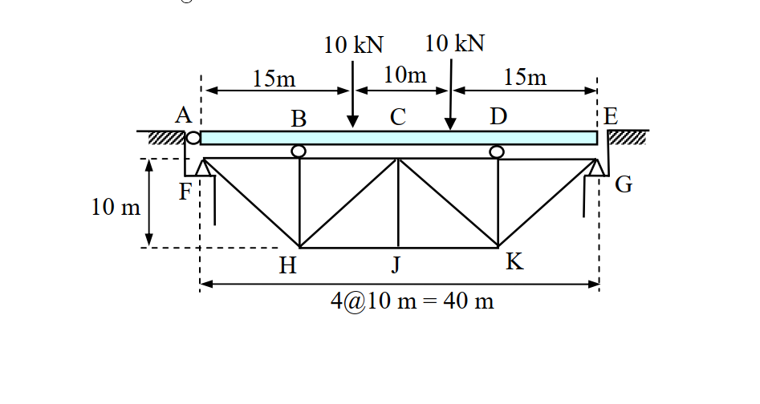
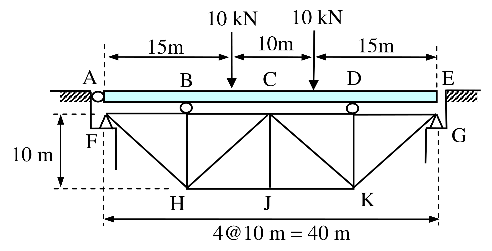

# SA-2006-1 題目正本

> 本檔只記錄考卷上寫了什麼、圖上畫了什麼，不含任何解法。解析見同資料夾 `SA-2006-1.md`。
> 判讀清單經使用者確認前，狀態為「待確認」；確認後本檔原則上不再修改（改動須回考卷原圖並記 log）。

| 項目 | 內容 |
|---|---|
| 考卷 | `raw/exams/SA-2006_結構學.pdf`，第 1 頁（正面）上部，第一題（無圖號） |
| 考年 | 2006（民國 95 年）專技高考結構工程技師「結構學」 |
| 配分 | 25 分 |
| 附圖 | `SA-2006-1-fig-1.png`、`SA-2006-1-fig-2.png` |
| 判讀狀態 | **已確認**（2026-11-07 使用者確認。原轉錄：2026-11-07 轉錄；PyMuPDF 110 dpi 整頁＋300–500 dpi 局部放大、PDF 向量座標核對；盲讀於開啟解析前完成） |

## 1. 考卷原文（逐字）

一、如圖所示之橋梁，試計算J 點之垂直變位。圖中AE 為梁（beam）構件，其餘為桁架（truss）構件，支點A、B、D 為滾支承（roller），而支點F 與G 為鉸支承（hinge）。假設各構件之E 值（彈性模數）、I 值（慣性矩）與A 值（斷面積）皆為常數。不計構件之自重與梁之深度。（25 分）

## 2. 考卷給的公式、附表與參數

- 考卷沒有給任何參考公式或附表。
- E、I、A 只說是常數，沒有數值（答案以 EI、EA 表示）。
- 不計自重與梁之深度。
- 沒有指定解法；考卷沒有說梁是否忽略軸向或剪切變形。
- 卷首注意事項：㈠可以使用電子計算器。㈡不必抄題，作答時請將試題題號及答案依照順序寫在試卷上，於本試題上作答者，不予計分。
- 考試時間：2 小時。

## 3. 附圖

*證據圖 SA-2006-1-fig-1.png*

*證據圖 SA-2006-1-fig-2.png（2026-11-07 自考卷重新擷取 500 dpi，無游標）*

圖面文字照錄：10 kN、10 kN、15m、10m、15m、A、B、C、D、E、F、G、10 m、H、J、K、4@10 m = 40 m

## 4. 判讀清單

| # | 項目 | 判讀 | 圖上／題文依據 | 把握 |
|---|---|---|---|---|
| 1 | 梁 | A–E 為梁，長 40 m，擱在 A（橋台）、B、D 三個滾支承上 | 題文；淺藍矩形 | 確定 |
| 2 | E 端 | **沒有支承**（自由端，D–E 為 10 m 懸臂）；E 只是梁端與橋台間的間隙 | 題文只列 A、B、D、F、G 五個支點；圖上 E 端無圓圈／三角形 | 確定（解讀）；使用者確認 |
| 3 | B、D | 梁與桁架上弦之間的滾支承（只傳垂直力），位於 x＝10 m、30 m，即 H、K 豎桿正上方 | 圓圈中心 PDF x≈299.5、394.8；F x=253.6、G x=442.6，比例 4.73 pt/m | 確定 |
| 4 | C | 梁中點 x＝20 m 的標示，**不是支承、也不是載重點** | C 字下方無圓圈；載重箭頭在 x=325.6、372.4 | 確定 |
| 5 | 載重 | 兩個 10 kN 向下，分別在 x＝15 m、25 m（B–C、C–D 中點），不在節點上 | 上方尺寸 15m｜10m｜15m（箭頭至 x=324.2、371.6，換算 14.7／24.7 m） | 確定 |
| 6 | 桁架節點 | 上弦 F(0)、x=10、x=20、x=30、G(40)（上弦內部三點**沒有字母**）；下弦 H(10)、J(20)、K(30)，深 10 m | 4@10 m＝40 m；左側 10 m 尺寸 | 確定 |
| 7 | 桁架桿件 | 上弦 4 段；下弦 H–J、J–K；豎桿 3 根（10、20、30 m）；斜桿 F–H、H–(20 上弦)、(20 上弦)–K、K–G；共 13 根 | 圖面 | 確定 |
| 8 | 支承 F、G | 鉸支承（三角形），各 2 反力；位於桁架上弦兩端 | 題文；三角形 | 確定 |
| 9 | 剛度 | 所有構件 E、I、A 皆常數（梁與桁架桿相同） | 題文 | 確定 |
| 10 | 考卷沒有給 | E、I、A 數值；梁是否計軸向變形 | 題文 | 確定 |
| 11 | 靜不定度 | 梁：3 垂直反力、2 方程式，一度；桁架：m 13＋r 4＝17＞2j 16，一度；合計二度靜不定 | 計數 | 確定 |
| 12 | 所求 | J 點垂直變位 | 題文 | 確定 |
| 13 | 證據圖 | 舊 fig-1 解析度偏低（947 px）；新增 fig-2（500 dpi） | — | 確定 |

---
*轉錄：2026-11-07（SA-U2-1 題目正本推廣・批 1）*
*確認：2026-11-07 使用者確認*
