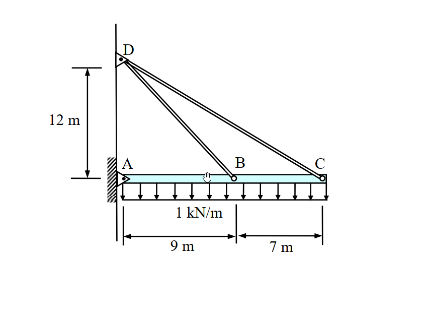
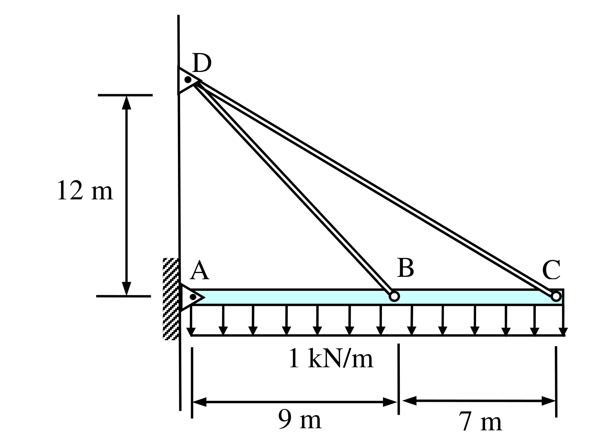

# SA-2006-2 題目正本

> 本檔只記錄考卷上寫了什麼、圖上畫了什麼，不含任何解法。解析見同資料夾 `SA-2006-2.md`。
> 判讀清單經使用者確認前，狀態為「待確認」；確認後本檔原則上不再修改（改動須回考卷原圖並記 log）。

| 項目 | 內容 |
|---|---|
| 考卷 | `raw/exams/SA-2006_結構學.pdf`，第 1 頁（正面），第二題（無圖號） |
| 考年 | 2006（民國 95 年）專技高考結構工程技師「結構學」 |
| 配分 | 25 分 |
| 附圖 | `SA-2006-2-fig-1.png`、`SA-2006-2-fig-2.png` |
| 判讀狀態 | **已確認**（2026-11-07 使用者確認；原轉錄：2026-11-07 轉錄；PyMuPDF 110 dpi 整頁＋400–1200 dpi 局部放大；PDF 向量座標；盲讀於開啟解析前完成） |

## 1. 考卷原文（逐字）

二、如圖所示之結構受垂直均佈載重1 kN/m 之作用，試計算連桿（linkage）DB 與DC 之張力。圖中AC 為梁構件，A、B、C、D 點均為鉸接（hinge）。假設橫梁之EI = 1 kN-m²，連桿之AE = 1 kN，其中E 為構件之彈性模數，I 為斷面慣性矩，A 為斷面積。不計構件之自重與AC 構件之軸向變形，亦不計梁之深度。（25 分）

## 2. 考卷給的公式、附表與參數

- 考卷沒有給任何參考公式或附表。
- 給定：橫梁 EI＝1 kN-m²；連桿 AE＝1 kN（兩根連桿相同）；不計自重、不計 AC 軸向變形、不計梁深。
- 考卷沒有說連桿 DB、DC 的 AE 是否不同（只寫「連桿之 AE＝1 kN」，視為兩桿相同）。
- 卷首注意事項：㈠可以使用電子計算器。㈡不必抄題，作答時請將試題題號及答案依照順序寫在試卷上，於本試題上作答者，不予計分。
- 考試時間：2 小時。

## 3. 附圖

*證據圖 SA-2006-2-fig-1.png*

*證據圖 SA-2006-2-fig-2.png（2026-11-07 自考卷重新擷取 500 dpi，無游標）*

圖面文字照錄：D、12 m、A、B、C、1 kN/m、9 m、7 m

## 4. 判讀清單

| # | 項目 | 判讀 | 圖上／題文依據 | 把握 |
|---|---|---|---|---|
| 1 | A | 鉸支承於左側直立牆（三角形尖端朝梁，內有圓點） | 400 dpi 放大；題文「A…為鉸接」 | 確定 |
| 2 | D | 鉸支承於同一面牆，位於 A 正上方 | PDF 座標：D 鉸中心 x＝294.8、A 鉸中心 x＝296.9（pt） | 確定 |
| 3 | B、C | 連桿與梁的鉸接點（小空心圓）；梁 AC 在 B 處連續（非梁內鉸） | B 圓圈畫在梁上，題文「AC 為梁構件」；若 B 為梁內鉸則結構靜定，與題給 EI、AE 求張力不合 | 確定（解讀）；使用者確認 |
| 4 | 尺寸 9 m、7 m | A→B 9 m、B→C 7 m，梁全長 16 m；尺寸線端點對齊 A 鉸、B 圓圈、C 圓圈 | PDF 座標：尺寸界線 x＝296.5、383.1、449.1；圓心 296.9、381.3、449.2 | 確定 |
| 5 | 尺寸 12 m | D 在梁軸（A）上方 12 m | PDF 座標：上界線 y＝688.0、D 鉸心 y＝681.5；下界線 y＝772.5、A 鉸心 y＝772.8。上界線略低於 D，圖面非按比例 | 確定（解讀）；使用者確認 |
| 6 | 梁 AC | 水平，EI＝1 kN-m²，不計軸向變形；梁右端延伸到 C（略超出 C 圓圈為繪圖外框） | 題文；圖面 | 確定 |
| 7 | 連桿 | DB、DC 為二力桿，AE＝1 kN | 題文 | 確定 |
| 8 | 載重 | 垂直向下均佈 1 kN/m，作用 A 至 C 全長 | 箭頭自 A（x＝296）排到 C（x＝452） | 確定 |
| 9 | 所求 | 連桿 DB、DC 的張力 | 題文 | 確定 |
| 10 | 靜不定度 | A 鉸 2＋兩連桿各 1＝4 個未知力，方程式 3，一度靜不定 | 計數 | 確定（解讀）；使用者確認 |
| 11 | 證據圖 | 舊 fig-1 滑鼠游標壓在梁 A–B 段（易誤看成梁上另一個點或鉸）；新增 fig-2（500 dpi，無游標） | — | 確定 |

---
*轉錄：2026-11-07（SA-U2-2 題目正本推廣・批 1）*
*確認：2026-11-07 使用者確認*
