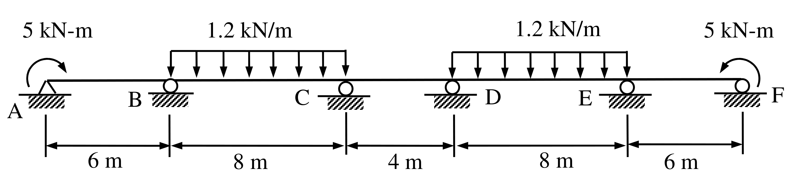

# SA-2006-3 題目正本

> 本檔只記錄考卷上寫了什麼、圖上畫了什麼，不含任何解法。解析見同資料夾 `SA-2006-3.md`。
> 判讀清單經使用者確認前，狀態為「待確認」；確認後本檔原則上不再修改（改動須回考卷原圖並記 log）。

| 項目 | 內容 |
|---|---|
| 考卷 | `raw/exams/SA-2006_結構學.pdf`，背面，第三題 |
| 考年 | 2006（民國 95 年）專技高考結構工程技師「結構學」 |
| 配分 | 25 分 |
| 附圖 | `SA-2006-3-fig-2.png`（本次從考卷擷取 500 dpi；既有 `SA-2006-3-fig-1.png` 保留） |
| 判讀狀態 | **已確認**（2026-11-07 使用者確認；原轉錄：2026-11-07 轉錄；PyMuPDF 110 dpi 整頁＋400 dpi 局部放大（附圖為向量／點陣混合）；盲讀於開啟解析前完成） |

## 1. 考卷原文（逐字）

三、試以彎矩分配法（moment distribution method）計算圖中連續梁各結點處之彎矩，並繪製彎矩圖。圖中除A 點為鉸支承（hinge）外，其餘均為滾支承（roller）。已知梁之E 值（彈性模數）與I 值（慣性矩）為常數。彎矩之計算精度取至0.1 kN-m 以下。（25 分）

## 2. 考卷給的公式、附表與參數

- 考卷沒有給任何參考公式或附表。
- 給定：E、I 為常數；精度取至 0.1 kN-m 以下。
- 卷首注意事項：可以使用電子計算器。不必抄題，作答時請將試題題號及答案依照順序寫在試卷上，於本試題上作答者，不予計分。
- 考試時間：2 小時。代號 00360，全一張（正、背面）。

## 3. 附圖

*證據圖 SA-2006-3-fig-2.png（500 dpi，自考卷擷取；舊證據圖 SA-2006-3-fig-1.png 有游標雜訊，保留不改）*

圖面文字照錄：5 kN-m、1.2 kN/m、1.2 kN/m、5 kN-m、A、B、C、D、E、F、6 m、8 m、4 m、8 m、6 m

## 4. 判讀清單

| # | 項目 | 判讀 | 圖上／題文依據 | 把握 |
|---|---|---|---|---|
| 1 | 支承 | A 鉸支承（三角形）；B、C、D、E、F 滾支承（圓圈） | 400 dpi 放大＋題文 | 確定 |
| 2 | 跨長 | AB＝6、BC＝8、CD＝4、DE＝8、EF＝6 m | 尺寸線刻度對齊各支承 | 確定 |
| 3 | A 端彎矩 | 5 kN-m，順時針（弧形箭頭自左下繞上方指向右） | 400 dpi 放大 | 確定 |
| 4 | F 端彎矩 | 5 kN-m，逆時針（弧形箭頭自右下繞上方指向左）；與 A 端成鏡射對稱 | 400 dpi 放大 | 確定 |
| 5 | 均佈載重 | BC、DE 跨各 1.2 kN/m 向下，滿跨 | 均佈框左右端對齊 B–C、D–E | 確定 |
| 6 | CD 跨 | 無載重 | 圖面 | 確定 |
| 7 | 對稱性 | 幾何、支承剛度（不計軸向）與載重對 CD 跨中點對稱 | 圖面 | 確定（解讀）；使用者確認 |
| 8 | 考卷沒有給 | E、I 數值（只說常數）、支承沉陷 | 題文 | 確定 |
| 9 | 所求 | 彎矩分配法求各結點彎矩並繪彎矩圖 | 題文 | 確定 |
| 10 | 證據圖 | 既有 fig-1 在 D 字樣附近有游標；另擷取 500 dpi 乾淨版 fig-2 | 縮圖總表 | 確定 |

---
*轉錄：2026-11-07（SA 剩餘單元（U1-2 尾段、U2-5、U3-1、U3-2）題目正本推廣・批 1）*
*確認：2026-11-07 使用者確認*
