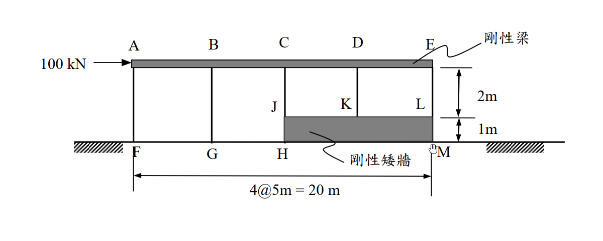
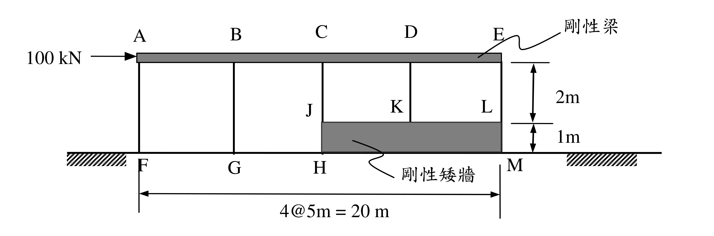

# SA-2006-4 題目正本

> 本檔只記錄考卷上寫了什麼、圖上畫了什麼，不含任何解法。解析見同資料夾 `SA-2006-4.md`。
> 判讀清單經使用者確認前，狀態為「待確認」；確認後本檔原則上不再修改（改動須回考卷原圖並記 log）。

| 項目 | 內容 |
|---|---|
| 考卷 | `raw/exams/SA-2006_結構學.pdf`，第 2 頁下半，第四題 |
| 考年 | 2006（民國 95 年）專技高考結構工程技師「結構學」 |
| 配分 | 25 分 |
| 附圖 | `SA-2006-4-fig-1.png`、`SA-2006-4-fig-2.png` |
| 判讀狀態 | **已確認**（2026-11-04 使用者確認；影響答案項目定案：#5 柱底固接（使用者確認）。原轉錄：2026-11-04 轉錄；PyMuPDF 150 dpi 整頁＋350–500 dpi 局部放大；盲讀於開啟解析前完成） |

## 1. 考卷原文（逐字）

四、如圖示，一建物結構受 100 kN 之水平橫力。假設該建物之 AE 構件為剛性梁（慣性矩 I＝∞），HJLM 構件為剛性矮牆（I＝∞）。各柱之彈性模數（E 值）與慣性矩（I 值）均為常數。試以傾角變位法（slope-deflection method）計算長柱 AF 與短柱 EL 二者柱底彎矩之比值，以及二者柱底剪力之比值。不計構件之自重。（25 分）

## 2. 考卷給的公式、附表與參數

- 考卷沒有給任何參考公式或附表；所需公式須自備。
- 卷首注意事項：㈠可以使用電子計算器。㈡不必抄題，作答時請將試題題號及答案依照順序寫在試卷上，於本試題上作答者，不予計分。
- 考試時間：2 小時。

## 3. 附圖

*證據圖 SA-2006-4-fig-1.png*

*證據圖 SA-2006-4-fig-2.png（2026-11-04 由考卷重新擷取 500 dpi；原 fig-1 截圖含游標圖示）*

圖面文字照錄：A、B、C、D、E、剛性梁、100 kN、J、K、L、2m、1m、F、G、H、剛性矮牆、M、4@5m = 20 m

## 4. 判讀清單

| # | 項目 | 判讀 | 圖上／題文依據 | 把握 |
|---|---|---|---|---|
| 1 | 柱位 | A、B、C、D、E 間距 5 m | 「4@5m = 20 m」 | 確定 |
| 2 | 長柱 | AF、BG，高 3 m（2 m＋1 m），柱底落於地面 | 右側尺寸 2m、1m；F、G 在地面線上 | 確定 |
| 3 | 短柱 | CJ、DK、EL，高 2 m，柱底落於矮牆頂 | J、K、L 標在牆頂；尺寸 2m 由梁下緣至牆頂 | 確定 |
| 4 | 尺寸基準 | 2 m 量自剛性梁下緣至牆頂 | 500 dpi（fig-2）尺寸線上端對齊梁下緣 | 確定（解讀）；使用者確認 |
| 5 | 柱底（F、G 與 J、K、L） | 固接 | 考卷**未明寫**；地面為斜線填充、矮牆 I＝∞ | 不確定（影響答案，請確認）；使用者確認 |
| 6 | 柱頂 | 與剛性梁剛接，不轉動 | 題文 I＝∞ | 確定 |
| 7 | 柱 E、I | 各柱相同 | 題文 | 確定 |
| 8 | 載重 | A 點水平 100 kN 向右 | 箭頭 | 確定 |
| 9 | 指定方法 | 傾角變位法 | 題文 | 確定 |
| 10 | 所求 | M_AF,底／M_EL,底 與 V_AF／V_EL（比值） | 題文 | 確定 |

---
*轉錄：2026-11-04（SA-U2-3 題目正本推廣・批 1；判讀沿用同日盲解稽核紀錄 wiki/queries/盲解紀錄-SA-U2-3a-2026-11-04.md，並回考卷原圖核對）*
*確認：2026-11-04 使用者確認*
