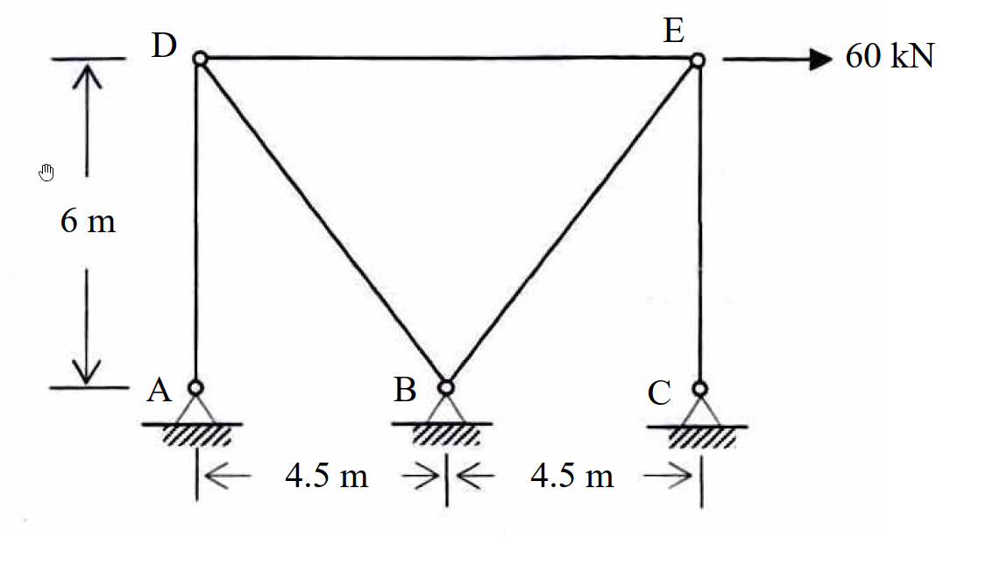
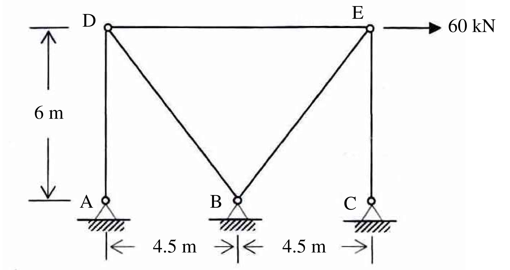

# SA-2007-1 題目正本

> 本檔只記錄考卷上寫了什麼、圖上畫了什麼，不含任何解法。解析見同資料夾 `SA-2007-1.md`。
> 判讀清單經使用者確認前，狀態為「待確認」；確認後本檔原則上不再修改（改動須回考卷原圖並記 log）。

| 項目 | 內容 |
|---|---|
| 考卷 | `raw/exams/SA-2007_結構學.pdf`，第 1 頁（正面），第一題（無圖號） |
| 考年 | 2007（民國 96 年）專技高考結構工程技師「結構學」 |
| 配分 | 25 分 |
| 附圖 | `SA-2007-1-fig-1.png`、`SA-2007-1-fig-2.png` |
| 判讀狀態 | **已確認**（2026-11-07 使用者確認；原轉錄：2026-11-07 轉錄；PyMuPDF 110 dpi 整頁＋400–1200 dpi 局部放大（附圖為掃描點陣圖）；盲讀於開啟解析前完成） |

## 1. 考卷原文（逐字）

一、如圖所示之桁架（truss），點A、B 及C 為鉸接（hinge）。若每根桿件之斷面積A = 1000 mm²，楊氏係數E = 200 GPa，當E 點有一水平載重60 kN 時，試計算支承反力及各桿內力。（25 分）

## 2. 考卷給的公式、附表與參數

- 考卷沒有給任何參考公式或附表。
- 給定：各桿 A＝1000 mm²、E＝200 GPa（各桿相同）。
- 卷首注意事項：㈠可以使用電子計算器。㈡不必抄題，作答時請將試題題號及答案依照順序寫在試卷上，於本試題上作答者，不予計分。
- 考試時間：2 小時。

## 3. 附圖

*證據圖 SA-2007-1-fig-1.png*

*證據圖 SA-2007-1-fig-2.png（2026-11-07 自考卷重新擷取 500 dpi，無游標）*

圖面文字照錄：D、E、60 kN、6 m、A、B、C、4.5 m、4.5 m

## 4. 判讀清單

| # | 項目 | 判讀 | 圖上／題文依據 | 把握 |
|---|---|---|---|---|
| 1 | A、B、C | 三個鉸支承（圓圈＋三角形＋剖線） | 350 dpi 放大；題文「點 A、B 及 C 為鉸接」 | 確定 |
| 2 | 節點 D、E | 桁架節點（小空心圓）；D 在 A 正上方、E 在 C 正上方 | 圖面：A–D、C–E 為垂直桿 | 確定 |
| 3 | 桿件 | A–D、D–E、D–B、B–E、E–C 共 5 根；B 為兩斜桿交會點 | 圖面 | 確定 |
| 4 | 尺寸 | 高 6 m（D、E 至地面支承）；A–B 4.5 m、B–C 4.5 m，D–E 長 9 m | 尺寸線端點對齊 A、B、C 圓圈中心；6 m 上下界線對齊 D、A | 確定 |
| 5 | 材料 | 各桿 A＝1000 mm²、E＝200 GPa | 題文 | 確定 |
| 6 | 載重 | E 點水平向右 60 kN | 箭頭自 E 向右 | 確定 |
| 7 | 所求 | 支承反力及各桿內力 | 題文 | 確定 |
| 8 | 靜不定度 | m＝5、r＝6、j＝5：m＋r＝11＞2j＝10，一度靜不定 | 計數 | 確定（解讀）；使用者確認 |
| 9 | 證據圖 | 舊 fig-1 有游標（6 m 尺寸線旁，未壓構件）；新增 fig-2（500 dpi） | — | 確定 |

---
*轉錄：2026-11-07（SA-U2-2 題目正本推廣・批 1）*
*確認：2026-11-07 使用者確認*
