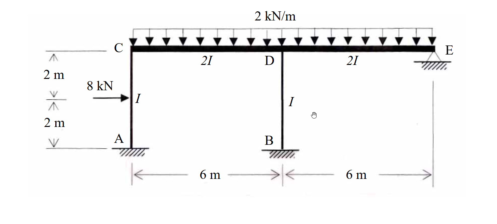

# SA-2007-2 題目正本

> 本檔只記錄考卷上寫了什麼、圖上畫了什麼，不含任何解法。解析見同資料夾 `SA-2007-2.md`。
> 判讀清單經使用者確認前，狀態為「待確認」；確認後本檔原則上不再修改（改動須回考卷原圖並記 log）。

| 項目 | 內容 |
|---|---|
| 考卷 | `raw/exams/SA-2007_結構學.pdf`，第 1 頁下半，第二題 |
| 考年 | 2007（民國 96 年）專技高考結構工程技師「結構學」 |
| 配分 | 25 分 |
| 附圖 | `SA-2007-2-fig-1.png` |
| 判讀狀態 | **已確認**（2026-11-04 使用者確認。原轉錄：2026-11-04 轉錄；PyMuPDF 150 dpi 整頁＋350–500 dpi 局部放大；盲讀於開啟解析前完成） |

## 1. 考卷原文（逐字）

二、如圖所示之剛架（frame），其構架高 4 m，跨距為 12 m，點 A、B 為固接（fixed），E 點為鉸接（hinge）。若每根桿件之彈性模數 E 為常數；各桿件之慣性矩（I 或 2I）分別標示如圖示，且 I 值亦為常數。則在圖示載重下，試求出每根桿件之結點彎矩。（25 分）

## 2. 考卷給的公式、附表與參數

- 考卷沒有給任何參考公式或附表；所需公式須自備。
- 卷首注意事項：㈠可以使用電子計算器。㈡不必抄題，作答時請將試題題號及答案依照順序寫在試卷上，於本試題上作答者，不予計分。
- 考試時間：2 小時。

## 3. 附圖

*證據圖 SA-2007-2-fig-1.png*

圖面文字照錄：2 kN/m、C、2I、D、2I、E、2 m、8 kN、I、I、2 m、A、B、6 m、6 m

## 4. 判讀清單

| # | 項目 | 判讀 | 圖上／題文依據 | 把握 |
|---|---|---|---|---|
| 1 | A、B | 柱底固接 | 400 dpi | 確定 |
| 2 | E | 梁右端鉸支承 | 三角形支承＋題文 | 確定 |
| 3 | 梁 | CD = DE = 6 m，2I | 圖標 | 確定 |
| 4 | 柱 | AC、BD 高 4 m，I | 圖標「I」；左側 2 m＋2 m | 確定 |
| 5 | 均布載重 | 2 kN/m 向下，C 至 E 全長 | 箭頭範圍由 C 至 E | 確定 |
| 6 | 集中載重 | 8 kN 水平向右，作用於 AC 距 A 2 m | 左側尺寸 2 m＋2 m | 確定 |
| 7 | 指定方法 | 未指定 | 題文 | 確定 |
| 8 | 所求 | 每根桿件之結點彎矩 | 題文 | 確定 |

---
*轉錄：2026-11-04（SA-U2-3 題目正本推廣・批 1；判讀沿用同日盲解稽核紀錄 wiki/queries/盲解紀錄-SA-U2-3a-2026-11-04.md，並回考卷原圖核對）*
*確認：2026-11-04 使用者確認*
