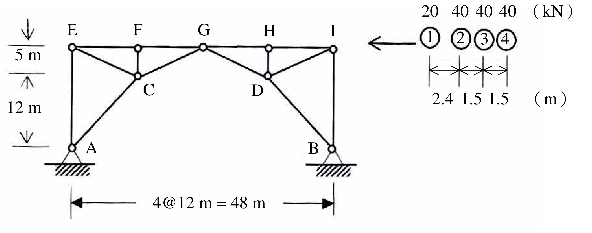

# SA-2007-3 題目正本

> 本檔只記錄考卷上寫了什麼、圖上畫了什麼，不含任何解法。解析見同資料夾 `SA-2007-3.md`。
> 判讀清單經使用者確認前，狀態為「待確認」；確認後本檔原則上不再修改（改動須回考卷原圖並記 log）。

| 項目 | 內容 |
|---|---|
| 考卷 | `raw/exams/SA-2007_結構學.pdf`，第 2 頁（背面），全一張，第三題 |
| 考年 | 2007（民國九十六年）專技高考結構工程技師「結構學」 |
| 配分 | 25 分 |
| 附圖 | `SA-2007-3-fig-2.png`（2026-11-07 重新擷取）；既有 `SA-2007-3-fig-1.png` |
| 判讀狀態 | **已確認**（2026-11-07 使用者確認；影響答案項目定案：#9「A 點反力」以垂直反力 A_y 為主、合力並列（使用者決定）。原轉錄：2026-11-07 轉錄；PyMuPDF 110 dpi 整頁＋450–1200 dpi 局部放大；考卷可抽文字，逐字原文以 PDF 文字層核對；盲讀於開啟解析前完成） |

## 1. 考卷原文（逐字）

三、如圖所示桁架（truss）在卡車系列載重作用下，求最大可能之 A 點反力及 FG 桿件內力。（25 分）

## 2. 考卷給的公式、附表與參數

- 考卷沒有給任何參考公式或附表。
- 卡車系列載重（圖上）：軸 ①②③④ 依序 20、40、40、40 kN，軸距 2.4、1.5、1.5 m。
- 考卷沒有給 EA；沒有明說卡車行駛於哪一弦（圖上卡車與上弦同高）。
- 卷首注意事項：㈠可以使用電子計算器。㈡不必抄題，作答時請將試題題號及答案依照順序寫在試卷上，於本試題上作答者，不予計分。
- 考試時間：2 小時。

## 3. 附圖

*證據圖 SA-2007-3-fig-2.png（2026-11-07 自考卷 500 dpi 重新擷取）；既有 SA-2007-3-fig-1.png 帶有滑鼠游標（手形小游標在兩支承之間空白處，未壓到構件），保留不改。*

圖面文字照錄：E、F、G、H、I、C、D、A、B、5 m、12 m、4@12 m = 48 m、20 40 40 40（kN）、①②③④、2.4 1.5 1.5（m）

## 4. 判讀清單

| # | 項目 | 判讀 | 圖上／題文依據 | 把握 |
|---|---|---|---|---|
| 1 | 座標（以 A 為原點） | A(0,0)、B(48,0)；E(0,17)、F(12,17)、G(24,17)、H(36,17)、I(48,17)；C(12,12)、D(36,12) | 左側 5 m、12 m 尺寸線；下方 4@12 m = 48 m；C 在 F 正下方、D 在 H 正下方（450–900 dpi） | 確定 |
| 2 | 上弦 | E–F–G–H–I 為一直線，G 處連續（不是斷開） | 900 dpi 局部：G 節點左右上弦皆接入同一節點圈 | 確定 |
| 3 | 桿件 | 上弦 EF、FG、GH、HI；豎桿 AE、IB、FC、HD；斜桿 AC、EC、CG、GD、DI、DB；共 14 桿 | 450 dpi 圖面 | 確定 |
| 4 | 支承 A、B | 皆為鉸支承（節點圈＋三角形＋剖線） | 圖上符號 | 確定 |
| 5 | 結構型式 | A、B 兩鉸、上弦節點 G 為左右兩半唯一共用節點：j = 9、m = 14、r = 4，2j = m + r（靜定，三鉸拱式桁架） | 計數＋構成 | 確定 |
| 6 | 卡車軸重與軸距 | ① 20、② 40、③ 40、④ 40 kN；2.4、1.5、1.5 m | 圖上數字 | 確定 |
| 7 | 行駛方向 | 由右往左，① 為車頭 | 箭頭「←」在 ① 左方 | 確定 |
| 8 | 載重作用弦 | 上弦 E–I（卡車畫在上弦高度） | 圖面位置 | 確定（解讀）；使用者確認 |
| 9 | A 點反力 | 題文只說「A 點反力」，A 為鉸支承有垂直與水平兩分量；考卷沒有指定哪一個 | 題文 | 不確定（影響答案，請確認）；使用者確認 |
| 10 | 所求 | 最大可能之 A 點反力、FG 桿件內力 | 題文 | 確定 |

---
*轉錄：2026-11-07（SA-U1-3 題目正本推廣・批 1）*
*確認：2026-11-07 使用者確認*
