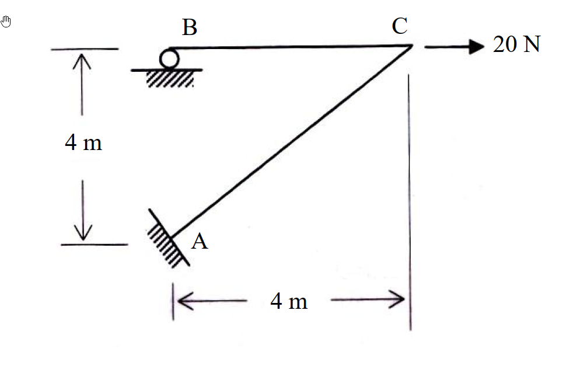

# SA-2007-4 題目正本

> 本檔只記錄考卷上寫了什麼、圖上畫了什麼，不含任何解法。解析見同資料夾 `SA-2007-4.md`。
> 判讀清單經使用者確認前，狀態為「待確認」；確認後本檔原則上不再修改（改動須回考卷原圖並記 log）。

| 項目 | 內容 |
|---|---|
| 考卷 | `raw/exams/SA-2007_結構學.pdf`，第 2 頁下半，第四題 |
| 考年 | 2007（民國 96 年）專技高考結構工程技師「結構學」 |
| 配分 | 25 分 |
| 附圖 | `SA-2007-4-fig-1.png` |
| 判讀狀態 | **已確認**（2026-11-04 使用者確認；影響答案項目定案：#5 B 在 A 正上方（使用者確認）。原轉錄：2026-11-04 轉錄；PyMuPDF 150 dpi 整頁＋350–500 dpi 局部放大；盲讀於開啟解析前完成） |

## 1. 考卷原文（逐字）

四、如圖所示之剛架（frame）系統，其構架高及跨距均為 4 m，B 點為滾支承（roller），A 點為固接（fixed）。若每根桿件之彈性模數 E 與慣性矩 I 為常數，則當 C 點有一水平載重 20 N 時，請以傾角變位法（slop-deflection method）分析此剛架，並繪製其剪力圖及彎矩圖。（若以他法計算，則不予以計分）（25 分）

## 2. 考卷給的公式、附表與參數

- 考卷沒有給任何參考公式或附表；所需公式須自備。
- 卷首注意事項：㈠可以使用電子計算器。㈡不必抄題，作答時請將試題題號及答案依照順序寫在試卷上，於本試題上作答者，不予計分。
- 考試時間：2 小時。

## 3. 附圖

*證據圖 SA-2007-4-fig-1.png*

圖面文字照錄：B、C、20 N、4 m、A、4 m

## 4. 判讀清單

| # | 項目 | 判讀 | 圖上／題文依據 | 把握 |
|---|---|---|---|---|
| 1 | A | 斜置固接 | 斜線填充（400 dpi） | 確定 |
| 2 | B | 滾支承於水平面（僅垂直反力） | 圓形滾輪壓在水平線上 | 確定 |
| 3 | C | AC 與 BC 剛接 | 交點無鉸圈 | 確定 |
| 4 | 幾何 | A→C 水平 4 m、垂直 4 m，AC = 4√2 m | 尺寸線 4 m、4 m | 確定 |
| 5 | B 水平位置 | 在 A 正上方，BC = 4 m | 圖面量測：B 滾輪中心與 A 端點 x 座標相同；考卷未標尺寸 | 確定（解讀）；使用者確認 |
| 6 | E、I | 常數 | 題文 | 確定 |
| 7 | 載重 | C 點水平 20 N 向右 | 箭頭 | 確定 |
| 8 | 指定方法 | 傾角變位法（他法不計分） | 題文；「slop-deflection」照考卷原文 | 確定 |
| 9 | 所求 | 分析剛架並繪剪力圖、彎矩圖 | 題文 | 確定 |

---
*轉錄：2026-11-04（SA-U2-3 題目正本推廣・批 1；判讀沿用同日盲解稽核紀錄 wiki/queries/盲解紀錄-SA-U2-3a-2026-11-04.md，並回考卷原圖核對）*
*確認：2026-11-04 使用者確認*
