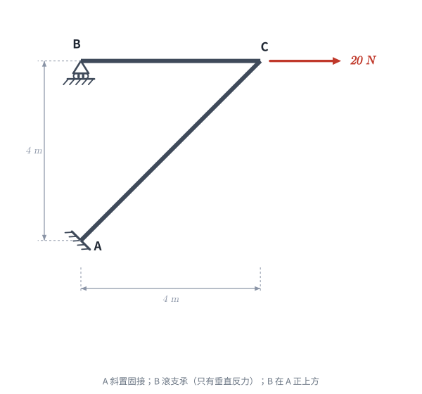
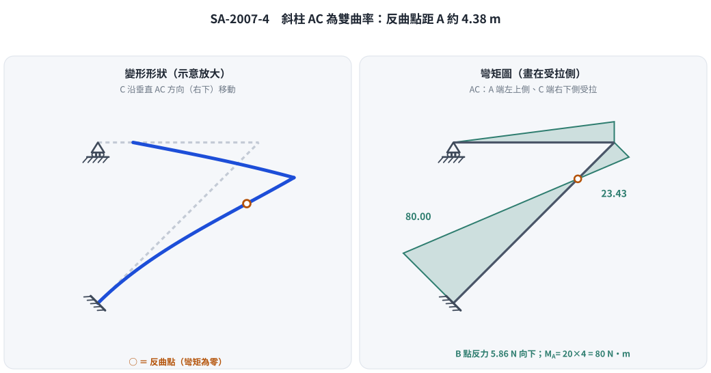

# 考題編號：[SA-2007-4]

**主分類：** `SA-U2-3` 靜不定結構之傾角變位法
**副分類：** 無
**分析法：** 傾角變位法
**標籤：** `有側移剛架` `虛功原理` `側移方程式`

---

## 1. 題目（考卷原文見題目正本）

> 考卷原文、公式／附表、附圖與判讀清單（已確認）見 [`SA-2007-4-problem.md`](SA-2007-4-problem.md)。本節只列解題時最容易讀錯的地方與本解使用的記號；題意以題目正本為準。

*重繪自考卷附圖，依判讀清單 #1–#7 重繪。攔：B 的水平位置、A 支承方向誤讀。*

### 常見誤讀
| 項目 | 正確判讀 | 常見誤讀 |
|---|---|---|
| B 水平位置 | A 正上方，BC = 4 m（使用者確認） | 未定位置 |
| AC 彎矩圖 | 雙曲率，反曲點距 A 4.38 m | 兩端同為逆時針便畫在同側、無反曲點（本題舊版解析） |
| 側移虛功式 | $\sum M\,\delta\psi + P\,\delta\Delta = 0$ | 外功＝內功，再臨場改號（本題舊版解析） |

**本解記號：** 桿端彎矩、節點轉角、弦位角一律順時針為正（傾角變位法慣例）。

## 2. 考題核心精神與出題者意圖 (Core Concepts & Examiner's Intent)

*   **側移幾何關係的推導：** 這是一題非常經典的「有側移」剛架。由於包含斜桿 AC 與水平滾支承 B，當 C 點受水平力向右移動時，AC 桿與 BC 桿皆會發生弦旋轉 (chord rotation)。考驗考生能否精確利用「軸向剛性」假設，畫出位移幾何關係並求出各桿的側移角 $\psi$。
*   **傾角變位法與虛功原理的結合：** 求出側移角關係後，需要建立一個額外的「側移平衡方程式 (Sway Equation)」。在有斜桿的系統中，單純使用靜力平衡 $\sum H = 0$ 較易出錯，最穩當且強大的方法是運用「虛功原理」建立方程式。
*   **剛架剪力與彎矩圖繪製：** 考驗求得端彎矩後，如何倒推各桿剪力，並繪製符合結構變形慣例的剪力圖與彎矩圖。

## 3. 解題戰略地圖與陷阱分析 (Strategic Roadmap & Trap Analysis)

*   **戰略一：分析側移機制並設定剛體旋轉角**
    *   給定 C 點一向右虛位移 $\Delta$。
    *   由 BC 桿軸向剛性推得 B 點亦向右位移 $\Delta$。
    *   由 AC 桿軸向剛性推得 C 點必須同時向下位移 $\Delta$。
    *   分別計算 BC 與 AC 的弦旋轉角 $\psi_{BC}$ 與 $\psi_{AC}$，發現兩者均為順時針 $\Delta/4$。令其為 $R$。
*   **戰略二：建立傾角變位方程式與節點平衡**
    *   列出 $M_{BC}, M_{CB}, M_{AC}, M_{CA}$ 的標準傾角變位式 (無跨度載重故 $FEM=0$)。
    *   利用節點 B、C 的力矩平衡 $\sum M = 0$，將 $\theta_B$ 消去，並將 $\theta_C$ 表達為 $R$ 的函數。
*   **戰略三：虛功法建立側移方程式**
    *   每根桿件作剛體虛位移時，作用其上的力虛功總和為零。
    *   外力 $20\text{ N}$ 作功 $20\,\delta\Delta$；桿端彎矩（作用在桿上、順時針為正）隨桿件轉 $\delta\psi$ 作功 $(M_{ij}+M_{ji})\,\delta\psi_{ij}$。
    *   導出側移方程式 $\sum (M_{ij} + M_{ji})\,\delta\psi_{ij} + P\,\delta\Delta = 0$。
*   **陷阱分析：**
    *   **陷阱 1 (側移關係誤判)：** 若未能準確利用變形相容條件 (垂直於桿件方向才有相對位移)，會導致 $\psi_{AC}$ 與 $\psi_{BC}$ 比例錯誤，後續方程式將全盤崩潰。
    *   **陷阱 2 (虛功符號錯誤)：** 把桿端彎矩想成「抗拒變形、作負功」再自己加負號，很容易加兩次。最安全的寫法是把桿件當剛體、把桿端彎矩當外力：$P\,\delta\Delta + \sum (M_{ij}+M_{ji})\,\delta\psi_{ij} = 0$，$M$ 與 $\psi$ 同採順時針為正。
    *   **陷阱 3 (靜力推導方向錯亂)：** 許多考生會試圖用切面求層剪力，但由於 AC 是斜桿，需要處理複雜的分力關係，極易出錯。虛功法是唯一救贖。

## 3.5 變數層次分析 (Variable Hierarchy Analysis)

### 最終目標
`求得結構各桿端彎矩，並繪製對應之剪力與彎矩圖`

### 本題關鍵公式（依計算順序）
- 變形幾何與弦旋轉角：
  $\psi = \frac{\Delta_{\text{transverse}}}{L}$
- 傾角變位方程式：
  $M_{ij} = \frac{2EI}{L} (2\theta_i + \theta_j - 3\boxed{\psi})$
- 節點力矩平衡：
  $\sum M_{\text{joint}} = 0$
- 虛功法側移方程式：
  $P \cdot \delta\Delta + \sum (M_{ij}+M_{ji})\,\delta\psi_{ij} = 0$

### L1：題目直接給定
| 符號 | 數值 | 說明 |
|---|---|---|
| $L_{BC}$ | $4 \text{ m}$ | 水平桿長度 |
| $L_{AC}$ | $4\sqrt{2} \text{ m}$ | 對角桿長度 |
| $P$ | $20 \text{ N}$ | C 點水平載重 (向右) |
| $EI$ | 常數 | 各桿件抗彎勁度 |

### L2：需知識點推導
**側移變形幾何**
| 符號 | 公式／來源 | 卡關? |
|---|---|---|
| $u_C, v_C$ | $\Delta, -\Delta$ (由軸向剛性推導) | |
| $\psi_{BC}$ | $\frac{v_C - v_B}{L_{BC}} = \frac{-\Delta}{4}$ (相對於幾何，實為順時針 $\Delta/4$) | |
| $\psi_{AC}$ | $\frac{\text{垂直於 AC 之位移}}{L_{AC}} = \frac{\sqrt{2}\Delta}{4\sqrt{2}} = \frac{\Delta}{4}$ (順時針) | |

**節點平衡關係**
| 符號 | 公式／來源 | 卡關? |
|---|---|---|
| $\theta_B$ | 由 $M_{BC} = 0 \implies \theta_B = 1.5R - 0.5\theta_C$ | |
| $\theta_C$ | 由 $M_{CB} + M_{CA} = 0 \implies 3(\sqrt{2}-1)R$ | |

### L3：深層知識（不懂就卡住）
| 知識點 | 說明 | 卡關? |
|---|---|---|
| 剛架虛功原理 | $20\delta\Delta + (M_{BC}+M_{CB})\,\delta\psi_{BC} + (M_{AC}+M_{CA})\,\delta\psi_{AC} = 0$，藉此解出 $M_{AC}=-80$ | |
| 桿端彎矩 → 梁彎矩 | 以桿軸 $i\to j$ 為梁，$M(i)=M_{ij}$、$M(j)=-M_{ji}$（順時針為正的桿端彎矩換成正彎矩下側受拉）；兩端異號才是雙曲率 | |

## 4. 步驟化詳細計算過程 (Step-by-Step Detailed Calculation)

### Step 1: 分析剛架側移幾何
設節點 C 向右位移 $\Delta$ ($u_C = \Delta$)。
*   **BC 桿：** 軸向剛性 $\implies u_B = u_C = \Delta$。已知 B 為滾支承限制垂直位移，故 $v_B = 0$。
*   **AC 桿：** C 點相對於 A(固接點) 之位移必須垂直於 AC 軸線，以維持長度不變。AC 斜率為 1 (角度 $45^\circ$)，其法線方向為 $-45^\circ$。位移向量需為 $(\Delta, -\Delta)$。故 $v_C = -\Delta$。
*   **弦旋轉角 (順時針為正)：**
    BC 桿相對兩端垂直位移：右端 C 相對於左端 B 向下 $\Delta$。
    $\implies \psi_{BC} = \frac{\Delta}{4}$ (順時針)
    AC 桿兩端相對垂直於桿件位移：C 點位移向量 $(\Delta, -\Delta)$ 在法線 $(-45^\circ)$ 上之投影為 $\sqrt{2}\Delta$。
    $\implies \psi_{AC} = \frac{\sqrt{2}\Delta}{4\sqrt{2}} = \frac{\Delta}{4}$ (順時針)
    
令 $\boxed{R = \psi_{BC} = \psi_{AC} = \frac{\Delta}{4}}$。

### Step 2: 建立傾角變位方程式
已知 $\theta_A = 0$ (固定端)，且無跨度載重 ($FEM=0$)。
*   $M_{BC} = \frac{2EI}{4} (2\theta_B + \theta_C - 3R) = 0.5 EI (2\theta_B + \theta_C - 3R)$
*   $M_{CB} = \frac{2EI}{4} (2\theta_C + \theta_B - 3R) = 0.5 EI (2\theta_C + \theta_B - 3R)$
*   $M_{AC} = \frac{2EI}{4\sqrt{2}} (\theta_C - 3R) = \frac{\sqrt{2}EI}{4} (\theta_C - 3R)$
*   $M_{CA} = \frac{2EI}{4\sqrt{2}} (2\theta_C - 3R) = \frac{\sqrt{2}EI}{4} (2\theta_C - 3R)$

### Step 3: 節點平衡與關係簡化
*   **節點 B 平衡 (滾支承鉸接)：**
    $\sum M_B = 0 \implies M_{BC} = 0 \implies 2\theta_B + \theta_C - 3R = 0 \implies \boxed{\theta_B = 1.5R - 0.5\theta_C}$
    代回 $M_{CB}$：
    $M_{CB} = 0.5EI \left( 2\theta_C + (1.5R - 0.5\theta_C) - 3R \right) = \boxed{\frac{3EI}{4} (\theta_C - R)}$
*   **節點 C 平衡：**
    $\sum M_C = 0 \implies M_{CB} + M_{CA} = 0$
    $\frac{3EI}{4} (\theta_C - R) + \frac{\sqrt{2}EI}{4} (2\theta_C - 3R) = 0$
    同乘 $4/EI$：
    $3(\theta_C - R) + \sqrt{2}(2\theta_C - 3R) = 0$
    $(3 + 2\sqrt{2})\theta_C = (3 + 3\sqrt{2})R \implies \theta_C = \frac{3+3\sqrt{2}}{3+2\sqrt{2}} R = \boxed{3(\sqrt{2}-1)R}$

### Step 4: 虛功法建立側移平衡方程式
*策略註解：施加一符合機制之虛位移 $\delta\Delta$（C 向右），把每根桿件當剛體。*
外力 $20\text{ N}$ 在 C 點作正功：$20\,\delta\Delta$
桿端彎矩作用在桿件上（順時針為正），桿件順時針轉 $\delta\psi$，作功 $(M_{ij}+M_{ji})\,\delta\psi_{ij}$；其中 $\delta\psi_{BC} = \delta\psi_{AC} = \frac{\delta\Delta}{4}$
剛體虛位移，總虛功為零：
$$20\,\delta\Delta + (M_{BC} + M_{CB} + M_{AC} + M_{CA}) \frac{\delta\Delta}{4} = 0$$
同乘 $\frac{4}{\delta\Delta}$：
$$\boxed{M_{BC} + M_{CB} + M_{AC} + M_{CA} = -80}$$

### Step 5: 求解與代回
將節點平衡條件 $M_{BC} = 0$ 及 $M_{CB} + M_{CA} = 0$ 代入側移方程式：
$$0 + (M_{CB} + M_{CA}) + M_{AC} = -80 \implies \boxed{M_{AC} = -80 \text{ N-m}}\ (\text{逆時針})$$

由傾角變位式：
$$M_{AC} = \frac{\sqrt{2}EI}{4}(\theta_C - 3R) = \frac{\sqrt{2}EI}{4}(3\sqrt{2}R - 3R - 3R) = \frac{3(1-\sqrt{2})EI}{2} R$$
求解 $R$：
$$-80 = \frac{3(1-\sqrt{2})EI}{2} R \implies R = \frac{-160}{3(1-\sqrt{2})EI} = \frac{160(\sqrt{2}+1)}{3EI}\ (>0，C\text{ 確實向右下移})$$
代回求解其餘彎矩：
*   $M_{CB} = \frac{3EI}{4} (3\sqrt{2} - 4) R = \frac{3}{4} (3\sqrt{2}-4) \frac{160(\sqrt{2}+1)}{3} = 40(6+3\sqrt{2}-4\sqrt{2}-4) = \boxed{80 - 40\sqrt{2} \approx 23.43 \text{ N-m}}$
*   $M_{CA} = -M_{CB} = \boxed{40\sqrt{2} - 80 \approx -23.43 \text{ N-m}}$
*   $M_{BC} = 0$

### Step 6: 支承反力與桿件剪力
*   BC 桿：$V_{BC} = \frac{M_{BC}+M_{CB}}{4} = \frac{23.43}{4} = 5.86\text{ N}$ → B 點垂直反力 $B_y = 5.86\text{ N}$ **向下**（滾支承受拉）
*   A 點：$A_x = 20\text{ N}$（向左）、$A_y = 5.86\text{ N}$（向上）、$M_A = 80\text{ N-m}$（逆時針）
*   AC 桿垂直桿軸的剪力：$V_{AC} = \frac{|M_{AC}| + |M_{CA}|}{4\sqrt{2}} = \frac{80 + 23.43}{4\sqrt{2}} = 18.28\text{ N}$（全桿常數）
*   檢核：A、B 兩點的垂直反力大小相等、方向相反，與水平力 20 N 形成平衡；B 在 A 正上方，對 A 取矩 $M_A = 20 \times 4 = 80$，與 $B_y$ 無關 ✓

## 5. 關鍵爭議點與進階探討 (Critical Issues & Advanced Discussion)

*圖解：左：C 沿垂直 AC 方向（右下）移動；右：AC 兩端梁彎矩異號，反曲點距 A 約 4.38 m。攔：把兩端同為逆時針的桿端彎矩畫成同側。*

*   **靜力平衡驗證：** 本題若直接以全靜力平衡求解，亦可證明結果無誤。因 $B_x=0$，可知 $A_x=-20$ (向左)。B 在 A 正上方，對 B 取力矩 $\sum M_B = 0 \implies M_A + A_x(4) = 0 \implies M_A = 80$ (逆時針)，故桿端彎矩 $M_{AC} = -80\text{ N-m}$。此捷徑能秒殺虛功法的繁瑣推導，但題目限用傾角變位法，答題仍應完整寫出側移方程式，並可用此式作為檢核。
*   **剪力與彎矩圖繪製重點：**
    *   **BC 桿：** 常數剪力 $5.86\text{ N}$。彎矩由 B 端 $0$ 線性變化至 C 端 $23.43\text{ N-m}$，**上側受拉**（BMD 畫在上方）。
    *   **AC 桿：** 常數剪力 $18.28\text{ N}$。以 A→C 為梁軸換成梁彎矩：A 端 $M(A)=M_{AC}=-80\text{ N-m}$（左上側受拉），C 端 $M(C)=-M_{CA}=+23.43\text{ N-m}$（右下側受拉）。**兩端異號 → 雙曲率**，彎矩線性變化並在距 A 點
      $$x_0 = \frac{80}{80+23.43} \times 4\sqrt{2} = 4.38\text{ m}$$
      處穿過零點（**反曲點**，約在 AC 全長的 77%）。
    *   **C 節點：** BC 上側與 AC 右下側都是角隅外側，兩桿在 C 點同為外側受拉、彎矩 23.43 N-m 連續轉過角隅 ✓
*   **符號提醒：** 兩個桿端彎矩同為「逆時針」（$M_{AC}$、$M_{CA}$ 皆為負）恰好表示梁彎矩兩端**異號**，不是同側；若 BMD 畫成同側，剪力就只有 $(80-23.43)/4\sqrt{2}=10.0\text{ N}$，與桿端彎矩算出的 18.28 N 矛盾。

---

*修正日期：2026-11-04（數值未變。① §5 彎矩圖：AC 桿原寫「兩端皆為負彎矩、BMD 同側、無反曲點」，更正為雙曲率、距 A 4.38 m 有反曲點，剪力式由 (80−23.43)/4√2 更正為 (80+23.43)/4√2；② Step 4–5 側移虛功式改為 $\sum M\delta\psi + P\delta\Delta = 0$ 直接得 −80，刪除臨場改號的草稿文字，§3、§3.5 同步；③ §1 刪除「題目未附圖」註記，改依考卷附圖判讀並補附圖連結；新增 Step 6 反力。驗證：平面剛架勁度法（EA→∞）重算端彎矩、剪力、反力與反曲點位置，MISMATCHES: 0；來源：wiki/queries/盲解比對-SA-U2-3a-2026-11-04.md）*

*修正日期：2026-11-04（§1 改為指向題目正本並放重繪附圖（figs/SA-2007-4-fig-1-problem.svg）、加常見誤讀；§5 補解題圖解 figs/SA-2007-4-fig-2-deflected-bmd.svg；圖由 gen_SA-2007-4.py 產生，可重跑）*
