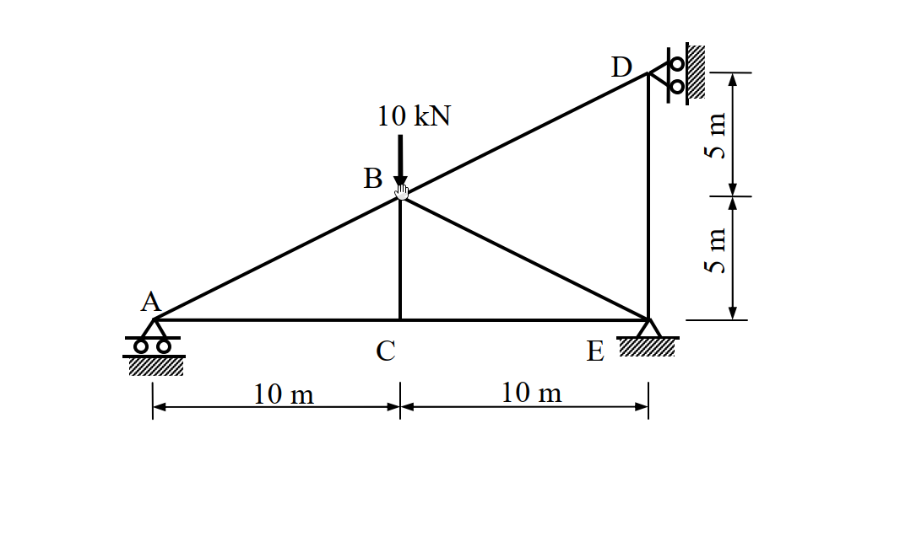
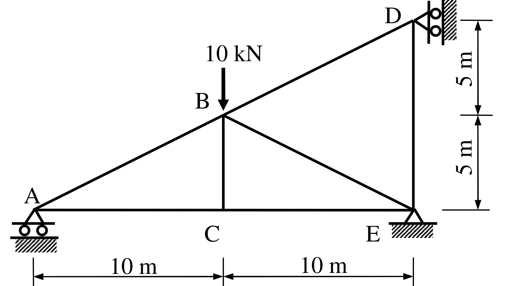

# SA-2008-1 題目正本

> 本檔只記錄考卷上寫了什麼、圖上畫了什麼，不含任何解法。解析見同資料夾 `SA-2008-1.md`。
> 判讀清單經使用者確認前，狀態為「待確認」；確認後本檔原則上不再修改（改動須回考卷原圖並記 log）。

| 項目 | 內容 |
|---|---|
| 考卷 | `raw/exams/SA-2008_結構學.pdf`，第 1 頁（正面），第一題（無圖號） |
| 考年 | 2008（民國 97 年）專技高考結構工程技師「結構學」 |
| 配分 | 25 分 |
| 附圖 | `SA-2008-1-fig-1.png`、`SA-2008-1-fig-2.png` |
| 判讀狀態 | **已確認**（2026-11-07 使用者確認；原轉錄：2026-11-07 轉錄；PyMuPDF 110 dpi 整頁＋400–1200 dpi 局部放大；PDF 向量繪圖；盲讀於開啟解析前完成） |

## 1. 考卷原文（逐字）

一、如圖所示桁架（truss），A、D 兩點為滾支承（roller），E 點為鉸接（hinge）。若每根桿件的彈性模數E 與斷面積A 為常數，當B 點有一垂直載重10 kN 時，計算支承之反力及各桿件內力。（25 分）

## 2. 考卷給的公式、附表與參數

- 考卷沒有給任何參考公式或附表。
- E、A 只說是常數，沒有數值（各桿相同）。
- 卷首注意事項：㈠不必抄題，作答時請將試題題號及答案依照順序寫在試卷上，於本試題上作答者，不予計分。㈡可以使用電子計算器，但需詳列解答過程。
- 考試時間：2 小時。

## 3. 附圖

*證據圖 SA-2008-1-fig-1.png*

*證據圖 SA-2008-1-fig-2.png（2026-11-07 自考卷重新擷取 500 dpi，無游標）*

圖面文字照錄：D、10 kN、B、5 m、5 m、A、C、E、10 m、10 m

## 4. 判讀清單

| # | 項目 | 判讀 | 圖上／題文依據 | 把握 |
|---|---|---|---|---|
| 1 | A | 滾支承於水平地面（三角形下兩個滾輪＋剖線）→ 垂直反力 | 400 dpi 放大；題文 | 確定 |
| 2 | D | 滾支承於右側直立牆（三角形尖端朝 D、兩滾輪靠牆）→ 水平反力 | 400 dpi 放大：剖線在右側直立 | 確定 |
| 3 | E | 鉸支承（三角形＋剖線，無滾輪） | 400 dpi 放大；題文「E 點為鉸接」 | 確定 |
| 4 | 節點座標 | A(0,0)、C(10,0)、E(20,0)、B(10,5)、D(20,10) | 下方 10 m｜10 m 尺寸線對齊 A、C、E；右側 5 m｜5 m 自 E 量至 B 高、再至 D 高 | 確定 |
| 5 | 上弦 | A、B、D 共線（斜率 1/2） | 座標 | 確定 |
| 6 | 桿件 | A–B、B–D、A–C、C–E、B–C、B–E、D–E 共 7 根 | 圖面 | 確定 |
| 7 | 材料 | 各桿 E、A 為常數（相同） | 題文 | 確定 |
| 8 | 載重 | B 點垂直向下 10 kN | 箭頭指向 B | 確定 |
| 9 | 所求 | 支承反力及各桿內力 | 題文 | 確定 |
| 10 | 靜不定度 | m＝7、r＝4、j＝5：11＞10，一度靜不定 | 計數 | 確定（解讀）；使用者確認 |
| 11 | 證據圖 | 舊 fig-1 游標壓在 B 節點（看不清 B 是否為節點）；新增 fig-2（500 dpi） | — | 確定 |

---
*轉錄：2026-11-07（SA-U2-2 題目正本推廣・批 1）*
*確認：2026-11-07 使用者確認*
