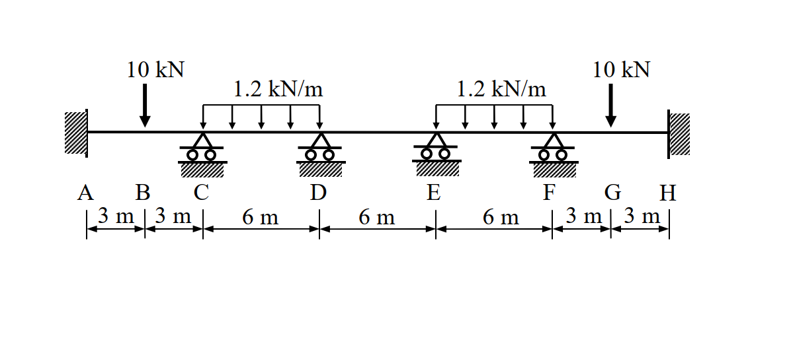

# SA-2008-2 題目正本

> 本檔只記錄考卷上寫了什麼、圖上畫了什麼，不含任何解法。解析見同資料夾 `SA-2008-2.md`。
> 判讀清單經使用者確認前，狀態為「待確認」；確認後本檔原則上不再修改（改動須回考卷原圖並記 log）。

| 項目 | 內容 |
|---|---|
| 考卷 | `raw/exams/SA-2008_結構學.pdf`，第 1 頁中下，第二題 |
| 考年 | 2008（民國 97 年）專技高考結構工程技師「結構學」 |
| 配分 | 25 分 |
| 附圖 | `SA-2008-2-fig-1.png` |
| 判讀狀態 | **已確認**（2026-11-04 使用者確認。原轉錄：2026-11-04 轉錄；PyMuPDF 150 dpi 整頁＋350–500 dpi 局部放大；盲讀於開啟解析前完成） |

## 1. 考卷原文（逐字）

二、試以傾角變位法（slope-deflection method）計算圖示連續梁各結點處之彎矩與剪力，並繪彎矩圖與剪力圖。圖中 A、H 兩點為固接（fixed），其餘支承均為滾支承（roller）。已知梁之彈性模數 E 與慣性矩 I 為常數。（25 分）

## 2. 考卷給的公式、附表與參數

- 考卷沒有給任何參考公式或附表；所需公式須自備。
- 卷首注意事項：㈠不必抄題，作答時請將試題題號及答案依照順序寫在試卷上，於本試題上作答者，不予計分。㈡可以使用電子計算器，但需詳列解答過程。
- 考試時間：2 小時。

## 3. 附圖

*證據圖 SA-2008-2-fig-1.png*

圖面文字照錄：10 kN、1.2 kN/m、1.2 kN/m、10 kN、A、B、C、D、E、F、G、H、3 m、3 m、6 m、6 m、6 m、3 m、3 m

## 4. 判讀清單

| # | 項目 | 判讀 | 圖上／題文依據 | 把握 |
|---|---|---|---|---|
| 1 | 支承 | A、H 固接；C、D、E、F 滾支 | 350 dpi | 確定 |
| 2 | 跨距 | AB 3、BC 3、CD 6、DE 6、EF 6、FG 3、GH 3 m | 尺寸線 | 確定 |
| 3 | 集中載重 | B、G 各 10 kN 向下 | 箭頭 | 確定 |
| 4 | 均布載重 | CD、EF 全跨 1.2 kN/m；DE 無載重 | 箭頭範圍兩端對齊支承 | 確定 |
| 5 | E、I | 常數 | 題文 | 確定 |
| 6 | 指定方法 | 傾角變位法 | 題文 | 確定 |
| 7 | 所求 | 各結點彎矩與剪力，繪彎矩圖、剪力圖 | 題文 | 確定 |

---
*轉錄：2026-11-04（SA-U2-3 題目正本推廣・批 1；判讀沿用同日盲解稽核紀錄 wiki/queries/盲解紀錄-SA-U2-3a-2026-11-04.md，並回考卷原圖核對）*
*確認：2026-11-04 使用者確認*
