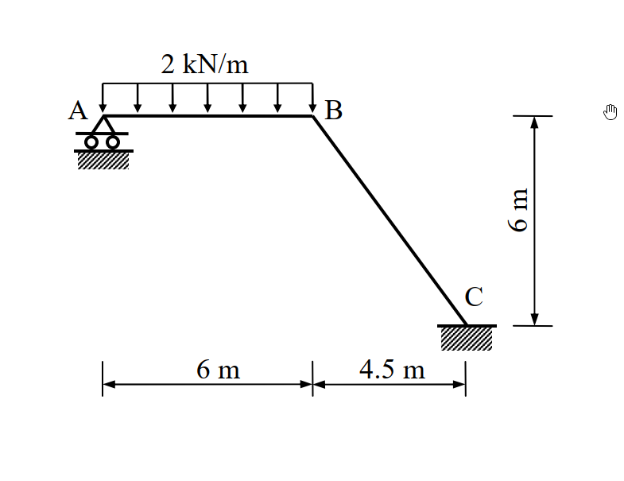
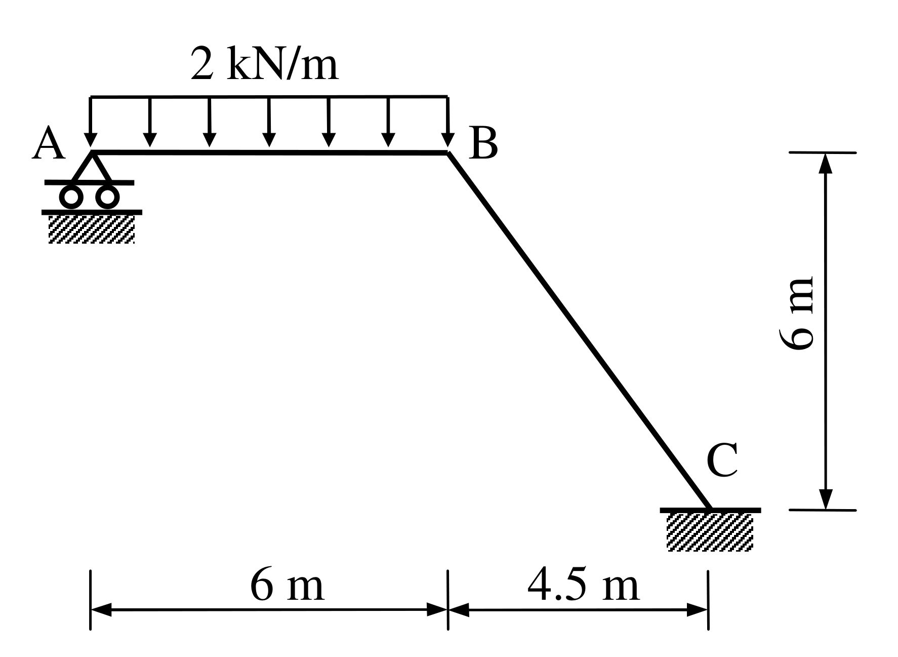

# SA-2008-3 題目正本

> 本檔只記錄考卷上寫了什麼、圖上畫了什麼，不含任何解法。解析見同資料夾 `SA-2008-3.md`。
> 判讀清單經使用者確認前，狀態為「待確認」；確認後本檔原則上不再修改（改動須回考卷原圖並記 log）。

| 項目 | 內容 |
|---|---|
| 考卷 | `raw/exams/SA-2008_結構學.pdf`，第 2 頁（背面），第三題（無圖號） |
| 考年 | 2008（民國 97 年）專技高考結構工程技師「結構學」 |
| 配分 | 25 分 |
| 附圖 | `SA-2008-3-fig-1.png`、`SA-2008-3-fig-2.png` |
| 判讀狀態 | **已確認**（2026-11-07 使用者確認。原轉錄：2026-11-07 轉錄；PyMuPDF 110 dpi 整頁＋300–500 dpi 局部放大、PDF 向量座標核對；盲讀於開啟解析前完成） |

## 1. 考卷原文（逐字）

三、試以最小功法（least work）計算圖示剛架（frame）各桿件之彎矩，並繪彎矩圖。圖中A 點為滾支承（roller），C 點為固接（fixed）。已知各桿件之彈性模數E 與慣性矩I 為常數（25 分）

## 2. 考卷給的公式、附表與參數

- 考卷沒有給任何參考公式或附表。
- E、I 只說是常數，沒有數值。
- 考卷沒有說是否忽略軸向變形。
- 指定方法：最小功法（未寫他法不計分）。
- 卷首注意事項：㈠不必抄題，作答時請將試題題號及答案依照順序寫在試卷上，於本試題上作答者，不予計分。㈡可以使用電子計算器，但需詳列解答過程。
- 考試時間：2 小時。

## 3. 附圖

*證據圖 SA-2008-3-fig-1.png*

*證據圖 SA-2008-3-fig-2.png（2026-11-07 自考卷重新擷取 500 dpi，無游標）*

圖面文字照錄：2 kN/m、A、B、6 m、C、6 m、4.5 m

## 4. 判讀清單

| # | 項目 | 判讀 | 圖上／題文依據 | 把握 |
|---|---|---|---|---|
| 1 | 構件 | A–B 水平；B–C 斜桿；B 為剛接 | 圖面 | 確定 |
| 2 | A | 滾支承：水平滾動、提供垂直反力 | 題文；三角形下兩圓輪 | 確定 |
| 3 | C | 固定端 | 題文；剖線方塊 | 確定 |
| 4 | 幾何 | AB＝6 m；C 在 B 右方 4.5 m、下方 6 m；BC 長 7.5 m | 下方尺寸 x=258.0｜359.6｜433.7；右側 6 m 尺寸 y=308.3｜410.0 對齊 B 與 C 底線 | 確定 |
| 5 | 載重 | 2 kN/m 向下，只作用在 A–B 全長；BC 沒有載重 | 載重框兩端箭頭在 x=258、359.6 | 確定 |
| 6 | 剛度 | 各桿 E、I 常數（相同） | 題文 | 確定 |
| 7 | 考卷沒有給 | 軸向變形是否忽略 | 題文 | 確定 |
| 8 | 靜不定度 | 滾 1＋固定 3＝4 反力：一度靜不定 | 計數 | 確定 |
| 9 | 所求 | 各桿彎矩＋彎矩圖；最小功法 | 題文 | 確定 |
| 10 | 證據圖 | 舊 fig-1 右上空白處有滑鼠游標；新增 fig-2（500 dpi） | — | 確定 |

---
*轉錄：2026-11-07（SA-U2-1 題目正本推廣・批 1）*
*確認：2026-11-07 使用者確認*
