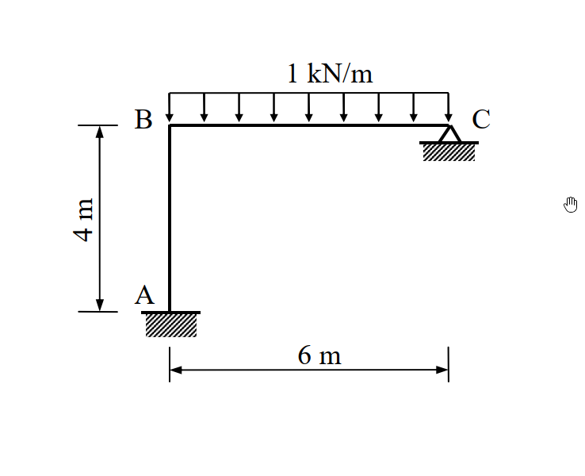
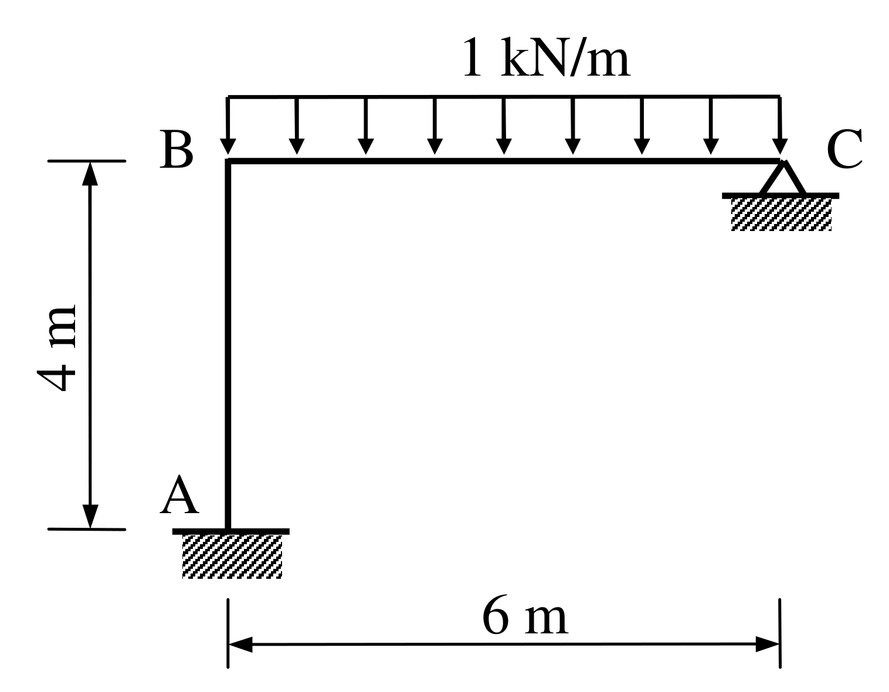

# SA-2008-4 題目正本

> 本檔只記錄考卷上寫了什麼、圖上畫了什麼，不含任何解法。解析見同資料夾 `SA-2008-4.md`。
> 判讀清單經使用者確認前，狀態為「待確認」；確認後本檔原則上不再修改（改動須回考卷原圖並記 log）。

| 項目 | 內容 |
|---|---|
| 考卷 | `raw/exams/SA-2008_結構學.pdf`，第 2 頁（背面）下半，第四題 |
| 考年 | 2008（民國 97 年）專技高考結構工程技師「結構學」 |
| 配分 | 25 分 |
| 附圖 | `SA-2008-4-fig-1.png`、`SA-2008-4-fig-2.png` |
| 判讀狀態 | **已確認**（2026-11-05 使用者確認。原轉錄：2026-11-05 轉錄；PyMuPDF 110 dpi 整頁＋250–800 dpi 局部放大、PDF 向量座標；盲讀於開啟解析前完成） |

## 1. 考卷原文（逐字）

四、如圖所示剛架（frame），A 點為固接（fixed），C 點為鉸接（hinge）。若每根桿件的彈性模數 E 與慣性矩 I 為常數，當 BC 桿件有一垂直均佈載重 1 kN/m 時，以矩陣直接勁度法計算各桿件之彎矩，繪彎矩圖並標示最大與最小值。（25 分）

## 2. 考卷給的公式、附表與參數

- 考卷沒有給任何參考公式或附表。
- 考卷沒有給 E、I 的數值（只說常數）。
- 考卷沒有說是否忽略軸向變形，也沒有給 A（斷面積）。
- 卷首注意事項：不必抄題，作答時請將試題題號及答案依照順序寫在試卷上，於本試題上作答者，不予計分。可以使用電子計算器，但需詳列解答過程。
- 考試時間：2 小時。

## 3. 附圖

*證據圖 SA-2008-4-fig-1.png*

*證據圖 SA-2008-4-fig-2.png（2026-11-05 自考卷重新擷取 500 dpi，無游標）*

圖面文字照錄：1 kN/m、B、C、4 m、A、6 m

## 4. 判讀清單

| # | 項目 | 判讀 | 圖上／題文依據 | 把握 |
|---|---|---|---|---|
| 1 | 座標（A 為原點） | A(0,0)、B(0,4)、C(6,4) | PDF 向量座標；4 m 與 6 m 尺寸線 | 確定 |
| 2 | 構件 | AB（柱）、BC（梁），B 剛接 | 附圖 B 角無鉸圈 | 確定 |
| 3 | 支承 A | 固定端 | 題文；剖線方塊 | 確定 |
| 4 | 支承 C | 鉸支承（三角形） | 題文；附圖 | 確定 |
| 5 | 載重 | 1 kN/m 向下，BC 全長 | 附圖箭頭 B 到 C | 確定 |
| 6 | EI | 各桿 EI 為常數（相同） | 題文 | 確定 |
| 7 | 所求 | 各桿彎矩、彎矩圖並標示最大與最小值；限矩陣直接勁度法 | 題文 | 確定 |
| 8 | 考卷沒有給 | E、I 數值；軸向變形條件（是否忽略） | — | 確定 |
| 9 | 證據圖 | 舊截圖 fig-1：滑鼠游標（手形）在 C 右方空白處，未壓到圖；新增 fig-2（2026-11-05 自考卷重新擷取 500 dpi） | — | 確定 |

---
*轉錄：2026-11-05（SA-U2-4 題目正本推廣・批 1）*
*確認：2026-11-05 使用者確認*
