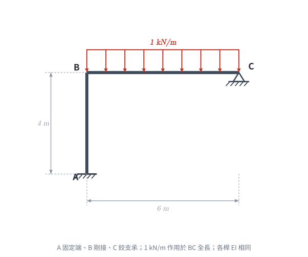
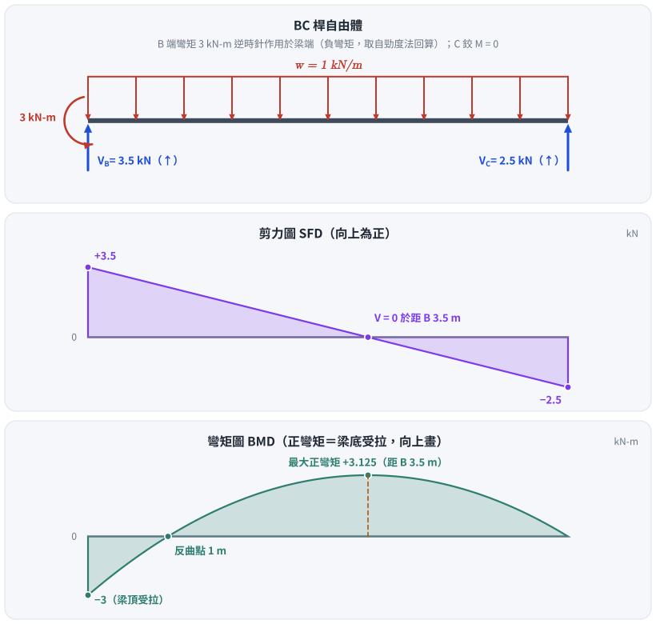
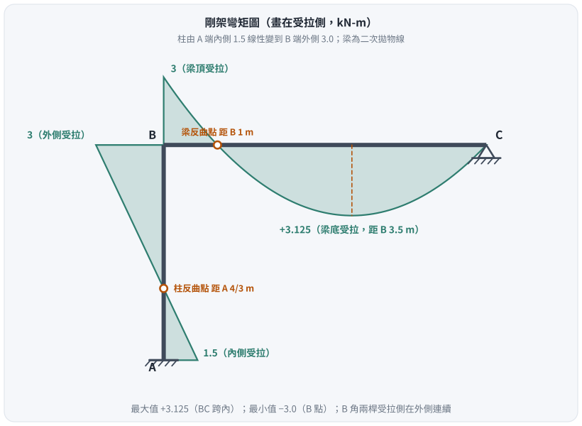

# 97年結構工程技師高考 結構學 第四題

## 1. 題目（考卷原文見題目正本）

> 考卷原文、公式／附表、附圖與判讀清單（已確認）見 [`SA-2008-4-problem.md`](SA-2008-4-problem.md)。本節只列解題時最容易讀錯的地方與本解使用的記號；題意以題目正本為準。

*重繪自考卷附圖，依判讀清單 #1–#7 重繪。攔：C 讀成滾支承、均布載重範圍讀錯。*

### 常見誤讀
| 項目 | 正確判讀 | 常見誤讀 |
|---|---|---|
| C 支承 | 鉸支承（水平、垂直皆束制） | 滾支承 |
| 軸向變形 | 考卷沒寫；考卷也沒給 A | 當成題目條件 |
| BC 端剪力 | B 端負彎矩使 V_B = 3 + 0.5 = 3.5 kN | 方向弄反得 2.5 kN（極值錯成 0.125 kN-m @ 2.5 m） |

**本解記號：** 本解假設不計軸向與剪力變形（考卷未寫，也沒給斷面積 A，只能如此假設）；記號與正負號約定沿用 §4。

## 2. 考題核心精神與出題者意圖 (Core Concepts & Examiner's Intent)

本題為基本的**無側移剛架**分析，但明確限制必須使用**矩陣直接勁度法**求解。出題者的核心意圖在於：
1. **矩陣勁度法的標準化流程**：測驗考生是否能有條理地定義自由度 (Degree of Freedom, DOF)，並組裝元素勁度矩陣 (Element Stiffness Matrix) 與整體勁度矩陣 (Global Stiffness Matrix)。
2. **載重向量的處理**：測驗考生如何計算固端力向量 (Fixed End Forces, $\{P_F\}$) 並將其轉換為等效節點載重。
3. **內力回算與彎矩極值**：在求得節點變位後，考驗考生能否正確回算各桿端彎矩，並利用剪力為零的條件找出均佈載重跨的最大彎矩。

## 3. 解題戰略地圖與陷阱分析 (Strategic Roadmap & Trap Analysis)

**解題戰略：**
1. **第一步：定義系統自由度 (DOF)**：
   - A 點固接，無位移與旋轉。
   - B 點為剛性節點，忽略軸向變形下，水平與垂直位移皆受制於 A、C 支承 ($u_B = v_B = 0$)。僅剩旋轉自由度 $\theta_B$。
   - C 點為鉸支承，允許旋轉，故有旋轉自由度 $\theta_C$。
   - 定義系統未作束制之自由度向量 $\{D\} = \begin{bmatrix} \theta_B \\ \theta_C \end{bmatrix}$。
2. **第二步：建立元素勁度矩陣 ($k$)**：
   - 桿件 1 (AB)：長度 $L=4$，考慮 $\theta_A, \theta_B$。
   - 桿件 2 (BC)：長度 $L=6$，考慮 $\theta_B, \theta_C$。
3. **第三步：組裝整體勁度矩陣 ($K$)**：
   根據 DOF 定義，將元素矩陣之對應項疊加，形成 $2 \times 2$ 的整體勁度矩陣 $K$。
4. **第四步：建立載重向量 ($\{P\}$ 與 $\{P_F\}$)**：
   計算 BC 桿因均佈載重產生的固端彎矩 (FEM)，並依 DOF 方向填入 $\{P_F\}$ 向量。節點無外加力矩，故 $\{P\} = \{0\}$。
5. **第五步：求解未知變位與桿端彎矩**：
   - 解 $K \{D\} + \{P_F\} = \{P\}$ 得到 $\theta_B$ 與 $\theta_C$。
   - 利用元素勁度方程式 $\{m\} = k \{d\} + \{m_F\}$ 求得 $M_{AB}, M_{BA}, M_{BC}, M_{CB}$。
6. **第六步：尋找跨中彎矩極值並繪圖**：
   利用 B 點端彎矩求出 BC 跨之剪力，找出剪力為零的位置，計算最大正彎矩。

**陷阱分析：**
- **陷阱 1：未遵照指定方法**。若使用傾角變位法或彎矩分配法，即使答案正確也可能面臨大幅扣分，必須以矩陣形式呈現算式。
- **陷阱 2：漏列 C 點自由度**。C 點為鉸支承，若未將 $\theta_C$ 列入系統 DOF，則必須在建立 BC 桿勁度矩陣時使用「修正勁度」(Modified Stiffness, $3EI/L$)。兩種做法皆可，但明列 $\theta_C$ 更符合標準矩陣勁度法的通用運作邏輯。
- **陷阱 3：最大彎矩位置的誤判**。BC 桿受均佈載重，最大彎矩不一定發生在正中央，必須精確求出剪力為零的位置 ($V=0$)。

## 3.5 變數層次分析 (Variable Hierarchy Analysis)

### 最終目標
求出各桿件之彎矩值，特別是 BC 跨的最大彎矩，並繪製彎矩圖。

### 本題關鍵公式（依計算順序）
- 元素勁度矩陣 (僅考慮抗彎)：$k = \frac{EI}{L} \begin{bmatrix} 4 & 2 \\ 2 & 4 \end{bmatrix}$
- 整體平衡方程式：$K \{D\} = \{P\} - \{P_F\}$
- 桿端力回算方程式：$\{m\} = k \{d\} + \{m_F\}$

### L1：題目直接給定
| 符號 | 數值 | 說明 |
|---|---|---|
| $L_1, L_2$ | $4\text{ m}, 6\text{ m}$ | AB 桿與 BC 桿長度 |
| $w$ | $1\text{ kN/m}$ | BC 桿均佈載重 |

### L2：需知識點推導
**一、矩陣與向量組裝**
| 符號 | 公式／來源 | 卡關? |
|---|---|---|
| $\{D\}$ | $\begin{bmatrix} \theta_B & \theta_C \end{bmatrix}^T$ | 系統獨立自由度 |
| $K$ | $\Sigma k_{global}$ | 系統整體勁度矩陣 |
| $\{P_F\}$ | 由 $FEM$ 組成之向量 | $FEM = \pm wL^2 / 12$ |

## 4. 步驟化詳細計算過程 (Step-by-Step Detailed Calculation)

### 步驟 1：定義自由度與建立元素勁度矩陣
忽略軸向變形，節點 B 無平移。定義未作束制之自由度為：$D_1 = \theta_B, D_2 = \theta_C$。
各桿件之局部元素勁度矩陣 $k$ (對應於桿端旋轉 $\theta_i, \theta_j$)：
- **桿件 1 (AB 桿)**：$L_1 = 4\text{ m}$
  $$ k_1 = \frac{EI}{4} \begin{bmatrix} 4 & 2 \\ 2 & 4 \end{bmatrix} \begin{array}{l} \leftarrow \theta_A \\ \leftarrow \theta_B \end{array} $$
- **桿件 2 (BC 桿)**：$L_2 = 6\text{ m}$
  $$ k_2 = \frac{EI}{6} \begin{bmatrix} 4 & 2 \\ 2 & 4 \end{bmatrix} \begin{array}{l} \leftarrow \theta_B \\ \leftarrow \theta_C \end{array} = EI \begin{bmatrix} 2/3 & 1/3 \\ 1/3 & 2/3 \end{bmatrix} \begin{array}{l} \leftarrow \theta_B \\ \leftarrow \theta_C \end{array} $$

### 步驟 2：組裝整體勁度矩陣 $K$
將對應到 $D_1(\theta_B)$ 與 $D_2(\theta_C)$ 的勁度係數疊加：
- $K_{11} = k_{1(2,2)} + k_{2(1,1)} = \frac{4EI}{4} + \frac{4EI}{6} = EI (1 + \frac{2}{3}) = \frac{5}{3}EI$
- $K_{12} = k_{2(1,2)} = \frac{2EI}{6} = \frac{1}{3}EI$
- $K_{21} = k_{2(2,1)} = \frac{1}{3}EI$
- $K_{22} = k_{2(2,2)} = \frac{4EI}{6} = \frac{2}{3}EI$

$$ K = EI \begin{bmatrix} 5/3 & 1/3 \\ 1/3 & 2/3 \end{bmatrix} $$

### 步驟 3：建立載重向量
計算 BC 桿均佈載重之固端彎矩 (順時針為正)：
- $FEM_{BC} = -\frac{wL^2}{12} = -\frac{1 \times 6^2}{12} = -3\text{ kN-m}$
- $FEM_{CB} = +\frac{wL^2}{12} = +3\text{ kN-m}$

固端力向量 $\{P_F\}$ (對應 $D_1, D_2$)：
$$ \{P_F\} = \begin{bmatrix} FEM_{BC} \\ FEM_{CB} \end{bmatrix} = \begin{bmatrix} -3 \\ 3 \end{bmatrix} $$
節點外加載重向量 $\{P\}$：
$$ \{P\} = \begin{bmatrix} 0 \\ 0 \end{bmatrix} $$

### 步驟 4：解矩陣方程式求變位
利用 $K \{D\} = \{P\} - \{P_F\}$：
$$ EI \begin{bmatrix} 5/3 & 1/3 \\ 1/3 & 2/3 \end{bmatrix} \begin{bmatrix} \theta_B \\ \theta_C \end{bmatrix} = \begin{bmatrix} 0 \\ 0 \end{bmatrix} - \begin{bmatrix} -3 \\ 3 \end{bmatrix} = \begin{bmatrix} 3 \\ -3 \end{bmatrix} $$
兩邊同乘 3：
$$ EI \begin{bmatrix} 5 & 1 \\ 1 & 2 \end{bmatrix} \begin{bmatrix} \theta_B \\ \theta_C \end{bmatrix} = \begin{bmatrix} 9 \\ -9 \end{bmatrix} $$
矩陣反轉：
$$ \begin{bmatrix} \theta_B \\ \theta_C \end{bmatrix} = \frac{1}{EI (10-1)} \begin{bmatrix} 2 & -1 \\ -1 & 5 \end{bmatrix} \begin{bmatrix} 9 \\ -9 \end{bmatrix} = \frac{1}{9 EI} \begin{bmatrix} 18 + 9 \\ -9 - 45 \end{bmatrix} = \frac{1}{9 EI} \begin{bmatrix} 27 \\ -54 \end{bmatrix} $$
得出：
$$ \theta_B = \frac{3}{EI}, \quad \theta_C = -\frac{6}{EI} $$

### 步驟 5：回算各端彎矩
利用 $\{m\} = k \{d\} + \{m_F\}$（順時針為正），$\frac{2EI}{L}(2\theta_i + \theta_j) + FEM_{ij}$：
- **AB 桿** ($\theta_A = 0, \theta_B = 3/EI$，$2EI/L = EI/2$)：
  $$ M_{AB} = \frac{EI}{2} \left[ 2(0) + \frac{3}{EI} \right] = \mathbf{1.5\text{ kN-m}} \ (\text{順時針}) $$
  $$ M_{BA} = \frac{EI}{2} \left[ 2\cdot\frac{3}{EI} + 0 \right] = \mathbf{3.0\text{ kN-m}} \ (\text{順時針}) $$
- **BC 桿** ($\theta_B = 3/EI, \theta_C = -6/EI$，$2EI/L = EI/3$)：
  $$ M_{BC} = \frac{EI}{3} \left[ 2\cdot\frac{3}{EI} - \frac{6}{EI} \right] - 3 = 0 - 3 = \mathbf{-3.0\text{ kN-m}} \ (\text{逆時針}) $$
  $$ M_{CB} = \frac{EI}{3} \left[ 2\left(-\frac{6}{EI}\right) + \frac{3}{EI} \right] + 3 = -3 + 3 = \mathbf{0} $$
- **檢核**：節點 B $M_{BA} + M_{BC} = 3.0 - 3.0 = 0$ ✓；C 為鉸 $M_{CB} = 0$ ✓。

### 步驟 6：計算彎矩極值
**BC 桿剪力**：B 端彎矩 $M_{BC} = -3$（作用在梁左端為逆時針，即負彎矩、梁頂受拉）。取 BC 桿自由體，對 C 取力矩（逆時針為正）：
$$ \Sigma M_C = 0:\quad -6V_B + 3 + (1\times6)\times3 + 0 = 0 \implies V_B = \frac{21}{6} = \mathbf{3.5\text{ kN}}\ (\uparrow),\qquad V_C = 6 - 3.5 = 2.5\text{ kN}\ (\uparrow) $$
（簡支剪力 3 kN，加上端彎矩造成的 $3/6 = 0.5$ kN：B 端負彎矩使 B 端剪力**變大**。）

*圖 2　BC 桿自由體、剪力圖與彎矩圖。B 端 3 kN-m 為負彎矩，使 B 端剪力由簡支的 3 kN 增為 $V_B = 3.5$ kN，剪力零點與最大正彎矩都落在距 B 3.5 m。這張圖攔的是端彎矩對剪力的正負號帶反——帶反時剪力零點左移、極值變得很小，且 C 點彎矩算不回 0。*

**梁的彎矩式**（距 B 為 $x$，正彎矩下側受拉）：
$$ M(x) = -3 + 3.5x - \frac{1}{2}x^2 $$
- 檢核：$M(0) = -3$、$M(6) = -3 + 21 - 18 = 0$ ✓（C 鉸）。
- 剪力零點：$V(x) = 3.5 - x = 0 \implies x = \mathbf{3.5\text{ m}}$（自 B 點向右）。
- 最大正彎矩：
  $$ M_{max} = -3 + 3.5(3.5) - \frac{1}{2}(3.5)^2 = -3 + 12.25 - 6.125 = \mathbf{3.125\text{ kN-m}} $$
- 梁的反曲點：$M(x) = 0 \implies x^2 - 7x + 6 = 0 \implies x = 1\text{ m}$（另一根 6 m 即 C）。

**柱 AB**（無橫向載重，直線分佈）：柱頂 B 3.0 kN-m（外側／左側受拉，與梁 B 端梁頂受拉在角點連續）、柱底 A 1.5 kN-m（內側／右側受拉）；兩端反向，反曲點距 A $\frac{1.5}{1.5+3.0}\times4 = \frac{4}{3}\text{ m}$。柱剪力 $(1.5+3.0)/4 = 1.125$ kN，A 與 C 的水平反力各 1.125 kN、方向相反。

*圖 3　剛架彎矩圖（畫在受拉側）。B 角的柱外側與梁頂受拉在角點連續，柱底改為內側受拉、柱身有一個反曲點。這張圖攔的是受拉側畫反，以及把柱頂與柱底畫在同一側（柱兩端彎矩反向，不是同號）。*

## 5. 關鍵爭議點與進階探討 (Critical Issues & Advanced Discussion)

- **自由度縮減 (Static Condensation) 技巧**：本題中 C 點為鉸接，彎矩必為零。若想加速計算，可直接宣告 DOF 僅有 $\theta_B$ ($1 \times 1$ 矩陣)，並將 BC 桿改用修正勁度 $k'_{BC} = 3EI/L = EI/2$，FEM 修正為 $wL^2/8 = 4.5$：$(EI + EI/2)\theta_B = 4.5 \implies \theta_B = 3/EI$，與上面兩自由度解相同。
- **端彎矩對剪力的影響（本題最易錯處）**：梁端負彎矩 $M$ 使該端剪力增加 $M/L$、另一端減少 $M/L$。方向弄反時極值的大小與位置都會錯（見 §1 常見誤讀）；用 $M(6) = 0$ 一檢就能發現。
- **彎矩圖的繪製細節**：
  - AB 桿：頂部 $3.0\text{ kN-m}$（外側受拉）、底部 $1.5\text{ kN-m}$（內側受拉），直線、反曲點距 A 4/3 m。
  - BC 桿：B 端 $-3.0\text{ kN-m}$（梁頂受拉）、C 端 0，拋物線；反曲點距 B 1 m；**最大正彎矩 $3.125\text{ kN-m}$ 於距 B $3.5\text{ m}$**（梁底受拉）。
  - **最大值 +3.125 kN-m（BC 跨內）；最小值 −3.0 kN-m（B 點）**。圖上須標 1.5、3.0、3.125、0 及 3.5 m、反曲點位置。

*修正日期：2026-11-05（§1 改為指向題目正本並放重繪附圖（figs/SA-2008-4-fig-1-problem.svg）、加常見誤讀；圖由 gen_SA-2008-4.py 產生，可重跑）*

*修正日期：2026-11-05（勘誤：§4 步驟 5 柱端彎矩 M_AB、M_BA 0.75、1.5 → 1.5、3.0 kN-m（2EI/L 係數誤寫為 EI/4）；步驟 6 BC 桿 V_B 2.5 → 3.5 kN、最大正彎矩 0.125 kN-m @ 距 B 2.5 m → 3.125 kN-m @ 3.5 m（端彎矩對剪力的正負號帶反）；刪除生成殘留文字；§5 彎矩圖數值與受拉側改寫；§1 常見誤讀加一列。驗證：勁度法回算與靜力 M(x) 兩條路徑、腳本重算 14 個數值 MISMATCHES: 0（wiki/queries/勘誤驗算-SA-U2-4-批1/errata_check.py）；來源 wiki/queries/盲解比對-SA-U2-4-批1-2026-11-05.md）*

*圖解補繪：2026-11-05（向量圖，腳本 `gen_SA-2008-4_bmd.py`，以 2×2 勁度矩陣重解後 assert 解析數值，可重跑）*
