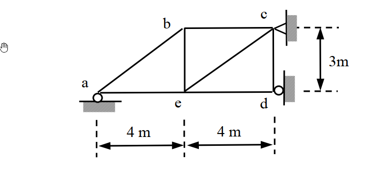
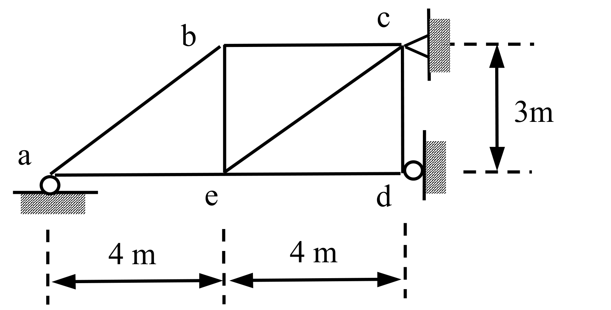

# SA-2009-1 題目正本

> 本檔只記錄考卷上寫了什麼、圖上畫了什麼，不含任何解法。解析見同資料夾 `SA-2009-1.md`。
> 判讀清單經使用者確認前，狀態為「待確認」；確認後本檔原則上不再修改（改動須回考卷原圖並記 log）。

| 項目 | 內容 |
|---|---|
| 考卷 | `raw/exams/SA-2009_結構學.pdf`，第 1 頁（正面），第一題（無圖號） |
| 考年 | 2009（民國 98 年）專技高考結構工程技師「結構學」 |
| 配分 | 25 分 |
| 附圖 | `SA-2009-1-fig-1.png`、`SA-2009-1-fig-2.png` |
| 判讀狀態 | **已確認**（2026-11-07 使用者確認；原轉錄：2026-11-07 轉錄；PyMuPDF 110 dpi 整頁＋400–1200 dpi 局部放大；PDF 向量繪圖；盲讀於開啟解析前完成） |

## 1. 考卷原文（逐字）

一、如圖所示之桁架（truss）結構，其支承點a 與d 為滾支承（roller），支承點c 則為鉸支承（hinge）。若已知支承點a 向下沈陷0.1 m，試計算各支承點之反力。假設各構件之E 值（彈性模數）與A 值（斷面積）皆為常數，且AE = 10⁴ kN。（25 分）

## 2. 考卷給的公式、附表與參數

- 考卷沒有給任何參考公式或附表。
- 給定：AE＝10⁴ kN（各桿相同）；支承 a 向下沉陷 0.1 m。
- 沒有外加載重（只有支承沉陷）。
- 「沈陷」照考卷原文。
- 卷首注意事項：㈠可以使用電子計算器，但需詳列解答過程。㈡不必抄題，作答時請將試題題號及答案依照順序寫在試卷上，於本試題上作答者，不予計分。
- 考試時間：2 小時。

## 3. 附圖

*證據圖 SA-2009-1-fig-1.png*

*證據圖 SA-2009-1-fig-2.png（2026-11-07 自考卷重新擷取 500 dpi，無游標）*

圖面文字照錄：b、c、3m、a、e、d、4 m、4 m

## 4. 判讀清單

| # | 項目 | 判讀 | 圖上／題文依據 | 把握 |
|---|---|---|---|---|
| 1 | a | 滾支承於水平地面（圓圈＋剖線）→ 垂直反力 | 500 dpi 放大；題文 | 確定 |
| 2 | c | 鉸支承於右側直立牆（三角形尖端朝 c）→ 水平與垂直反力 | 500 dpi 放大；題文 | 確定 |
| 3 | d | 滾支承於右側直立牆（圓圈靠牆）→ 水平反力 | 500 dpi 放大：圓圈貼直立剖線 | 確定 |
| 4 | 節點座標 | a(0,0)、e(4,0)、d(8,0)、b(4,3)、c(8,3) | 4 m｜4 m 虛線界線對齊 a、e、d；3 m 虛線界線對齊 c、d | 確定 |
| 5 | b 的高度 | 與 c 同高（b–c 水平） | b–c 為水平線 | 確定 |
| 6 | 桿 a–b | 連到 b 節點（圖上斜線末端與 b 有約 0.1 m 的繪圖缺口） | 1200 dpi 放大：斜線在 b 垂直桿左側中斷 | 確定（解讀）；使用者確認 |
| 7 | 桿件 | a–b、b–c、b–e、e–c、c–d、a–e、e–d 共 7 根 | 圖面 | 確定 |
| 8 | 支承沉陷 | a 向下 0.1 m；其他支承無位移 | 題文 | 確定 |
| 9 | 材料 | 各桿 AE＝10⁴ kN | 題文 | 確定 |
| 10 | 所求 | 各支承點反力 | 題文 | 確定 |
| 11 | 靜不定度 | m＝7、r＝4、j＝5：11＞10，一度靜不定 | 計數 | 確定（解讀）；使用者確認 |
| 12 | 證據圖 | 舊 fig-1 有游標（圖左空白處）；新增 fig-2（500 dpi） | — | 確定 |

---
*轉錄：2026-11-07（SA-U2-2 題目正本推廣・批 1）*
*確認：2026-11-07 使用者確認*
