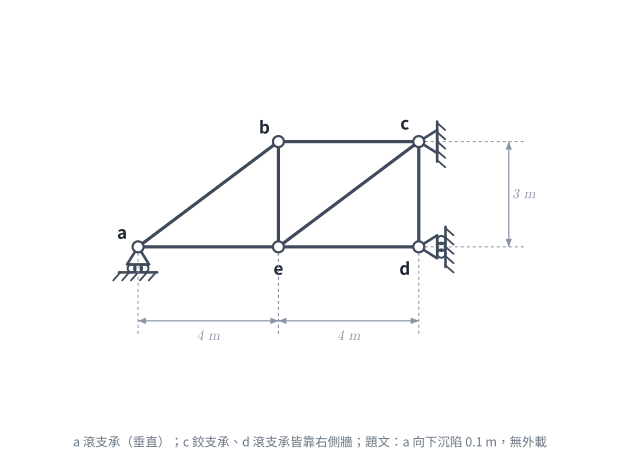
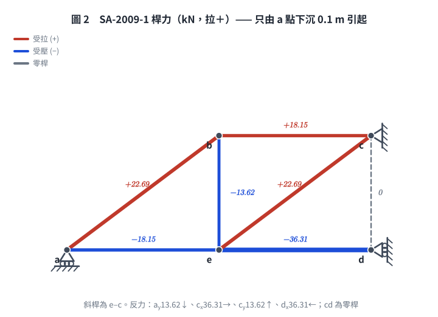

# 考題編號：SA-2009-1

**主分類：** `SA-U2-2` 靜不定結構諧合變位
**副分類：** 無
**分析法：** 單位力法 (Force Method) / 最小功法
**標籤：** `靜不定桁架`, `支承沉陷`, `柔度法`

---

## 1. 題目（考卷原文見題目正本）

> 考卷原文、公式／附表、附圖與判讀清單（已確認）見 [`SA-2009-1-problem.md`](SA-2009-1-problem.md)。本節只列解題時最容易讀錯的地方與本解使用的記號；題意以題目正本為準。

*重繪自考卷附圖，依判讀清單重繪。攔：d 讀成垂直反力、c 讀成滾支承、漏掉 a–b 桿。*

### 常見誤讀
| 項目 | 正確判讀 | 常見誤讀 |
|---|---|---|
| d 支承 | 滾支承靠右側牆 → 水平反力 | 垂直反力 |
| c 支承 | 鉸支承靠右側牆 → 水平＋垂直反力 | 滾支承 |
| 桿 a–b | 連到 b（考卷圖上有繪圖缺口） | 漏掉此桿 |
| 作用 | 只有 a 向下沉陷 0.1 m，無外加載重 | 另加載重 |
| 右側面板斜桿 | e–c（e 在下弦中點、c 在右上鉸支承） | b–d（本題舊版解析；兩對角線等長，反力碰巧相同，但桿力全錯） |

**本解記號：** 座標以 a 為原點（m）；AE＝10⁴ kN；贅力 X₁＝d 點水平反力；支承沉陷 Δa＝−0.1 m（向下）。

## 2. 考題核心精神與出題者意圖 (Core Concepts & Examiner's Intent)
本題的核心精神在於評量考生對**一次靜不定桁架**在「**無外力、僅有支承沉陷**」作用下的內力與反力分析能力。
出題者的意圖包含：
1. **靜不定度判別**：要求考生能正確計算桁架的靜不定度（$m+r-2j$），並正確選擇適當的贅力（Redundant Force）。
2. **力法（柔度法）的應用**：在給定支承沉陷的情況下，考驗考生是否能靈活運用單位虛力法計算基本結構的變位（0-系統），以及單位力作用下的柔度係數（1-系統）。
3. **相容方程式的建立**：將實際變位與計算變位結合，求解贅力。

## 3. 解題戰略地圖與陷阱分析 (Strategic Roadmap & Trap Analysis)
**戰略地圖：**
1. **系統判別與贅力選擇**：判斷系統為一次靜不定。為簡化計算，選擇節點 d 的水平反力 $R_{dx}$ 為贅力 $X_1$。
2. **0-系統（基本結構）分析**：在移除贅力後，計算已知支承沉陷對 d 點水平方向造成的相對位移 $\Delta_{10}$。
3. **1-系統（單位力系統）分析**：在 d 點施加單位水平力，利用節點法求出各桿件內力 $u_i$，並計算柔度係數 $f_{11}$。
4. **相容方程式求解**：利用 $\Delta_{10} + f_{11}X_1 = 0$ 解出 $X_1$。
5. **疊加法求最終反力**：將 0-系統的反力與 1-系統反力乘以 $X_1$ 進行疊加。

**陷阱分析：**
- ⚠ **支承沉陷方向的符號約定**：沉陷為向下（負），若在計算虛功時未與反力方向對應正確，極易造成正負號錯亂。
- ⚠ **0-系統的內力誤判**：因為 0-系統僅有支承沉陷而無外力，且基本結構為靜定結構，因此桿件**無內力產生**，這點常被考生忽略而進行無謂的計算。

## 3.5 變數層次分析 (Variable Hierarchy Analysis)

### 最終目標
`利用力法與變位諧合條件，求出各支承點在沉陷作用下的所有真實反力。`

### 本題關鍵公式（依計算順序）
1. 計算靜不定度：
   $$ i = m + r - 2j $$
2. 單位虛力法求 0-系統位移（僅受沉陷影響）：
   $$ 1 \cdot \Delta_{10} + \sum R^{(u)} \cdot \Delta_{support} = \sum u_i \cdot \Delta L_i $$
3. 柔度係數（1-系統變位）：
   $$ \boxed{f_{11}} = \sum \frac{u_i^2 L_i}{AE} $$
4. 變位相容方程式求贅力：
   $$ \boxed{\Delta_{10}} + \boxed{f_{11}} X_1 = 0 $$
5. 疊加法求最終反力：
   $$ R = R^{(0)} + R^{(u)} \cdot \boxed{X_1} $$

### L1：題目直接給定
| 符號 | 數值 | 說明 |
| --- | --- | --- |
| $m$ | $7$ | 桿件總數 |
| $r$ | $4$ | 反力總數 |
| $j$ | $5$ | 節點總數 |
| $AE$ | $10^4\text{ kN}$ | 桿件軸向剛度 |
| $\Delta_a$ | $-0.1\text{ m}$ | 節點 a 的垂直沉陷量 |

### L2：需知識點推導
**系統判別與 1-系統**
| 符號 | 公式／來源 | 卡關? |
| --- | --- | --- |
| $i$ | $m + r - 2j$ |  |
| $u_i$ | 節點法 / $\sum F_x = 0, \sum F_y = 0$ |  |

**變位計算與相容**
| 符號 | 公式／來源 | 卡關? |
| --- | --- | --- |
| $\Delta_{10}$ | $1 \cdot \Delta_{10} + R_{ay}^{(u)} \cdot \Delta_a = 0$ |  |
| $f_{11}$ | $\sum (u_i^2 L_i) / AE$ |  |
| $X_1$ | $\Delta_{10} + f_{11} X_1 = 0$ |  |

### L3：深層知識（不懂就卡住）
| 知識點 | 說明 | 卡關? |
| --- | --- | --- |
| 0-系統受沉陷之虛功原理 | 靜定基本結構受沉陷時，無內力產生，虛功方程式左側為外力作功，包含單位力作功與虛反力在真實沉陷上的作功。 |  |

## 4. 步驟化詳細計算過程 (Step-by-Step Detailed Calculation)

**Step 1: 靜不定度分析與建立基本結構**
*   總桿件數 $m=7$，總反力數 $r=4$（$R_{ay}, R_{cx}, R_{cy}, R_{dx}$），節點數 $j=5$。
*   總方程式數：$2j = 10$。
*   靜不定度：$i = (m+r) - 2j = (7+4) - 10 = 1$ （一度靜不定系統）。
*   **策略註解**：我們選擇解除節點 d 的水平約束，將向左的 $d$ 點水平反力 $X_1$ 視為贅力。此時基本結構為一靜定桁架。

**Step 2: 0-系統分析與位移 $\Delta_{10}$ 計算**
0-系統為靜定結構，僅受到 a 點支承沉陷 $\Delta_a = -0.1\text{ m}$ 的影響。
*   由於無外加荷重，各桿件內力為零，因此桿件變形 $\Delta L_i = 0$。
*   **策略註解**：利用虛功原理計算 $\Delta_{10}$，公式中需考慮 1-系統在 a 點的虛反力於真實沉陷上所作的功。
1-系統（見 Step 3）在 a 點的垂直反力為 $R_{ay}^{(u)} = -\frac{3}{8}$（向下）。
$$ 1 \times \Delta_{10} + R_{ay}^{(u)} \times \Delta_a = \sum u_i \Delta L_i = 0 $$
$$ \Delta_{10} + \left(-\frac{3}{8}\right) \times (-0.1) = 0 \implies \Delta_{10} = -0.0375\text{ m} = -\frac{3}{80}\text{ m} $$
此負號表示基本系統在 a 點發生沉陷時，d 點實際上會向右移動 $0.0375\text{ m}$（與假設向左的單位力方向相反）。

**Step 3: 1-系統分析（單位虛力系統）**
在基本結構 d 點施加向左的單位水平力（$X_1 = 1$）。
首先計算 1-系統的支承反力：
*   對 c 點取力矩平衡 ($\sum M_c = 0$)：
    $R_{ay}^{(u)} \times (4\text{ m} + 4\text{ m}) + 1 \times 3\text{ m} = 0 \implies R_{ay}^{(u)} = -\frac{3}{8}$ （即向下）
*   水平力平衡 ($\sum F_x = 0$)：
    $R_{cx}^{(u)} - 1 = 0 \implies R_{cx}^{(u)} = 1$ （向右）
*   垂直力平衡 ($\sum F_y = 0$)：
    $R_{cy}^{(u)} + R_{ay}^{(u)} = 0 \implies R_{cy}^{(u)} = \frac{3}{8}$ （向上）

接下來，使用節點法求出各桿件內力 $u_i$（右側面板斜桿為 **e–c**，見題目正本判讀 #7）：
*   **節點 a**：
    *   $\sum F_y = 0 \implies u_{ab} \times \frac{3}{5} - \frac{3}{8} = 0 \implies u_{ab} = \frac{5}{8}$ (張力)
    *   $\sum F_x = 0 \implies u_{ae} + u_{ab} \times \frac{4}{5} = 0 \implies u_{ae} = -\frac{1}{2}$ (壓力)
*   **節點 d**（只接 ed、cd 兩桿，受向左單位力）：
    *   $\sum F_x = 0 \implies -u_{ed} - 1 = 0 \implies u_{ed} = -1$ (壓力)
    *   $\sum F_y = 0 \implies u_{cd} = 0$
*   **節點 e**：
    *   $\sum F_x = 0 \implies -u_{ae} + u_{ed} + u_{ec} \times \frac{4}{5} = 0 \implies \frac{1}{2} - 1 + 0.8\,u_{ec} = 0 \implies u_{ec} = \frac{5}{8}$ (張力)
    *   $\sum F_y = 0 \implies u_{be} + u_{ec} \times \frac{3}{5} = 0 \implies u_{be} = -\frac{3}{8}$ (壓力)
*   **節點 b**：
    *   $\sum F_x = 0 \implies u_{bc} - u_{ab} \times \frac{4}{5} = 0 \implies u_{bc} = \frac{1}{2}$ (張力)
    *   $\sum F_y = 0 \implies -u_{be} - u_{ab} \times \frac{3}{5} = \frac{3}{8} - \frac{3}{8} = 0$ ✓（檢核）
*   **節點 c**（檢核）：$\sum F_x = -u_{bc} - u_{ec} \times \frac{4}{5} + R_{cx}^{(u)} = -\frac{1}{2} - \frac{1}{2} + 1 = 0$ ✓；$\sum F_y = -u_{ec} \times \frac{3}{5} - u_{cd} + R_{cy}^{(u)} = -\frac{3}{8} - 0 + \frac{3}{8} = 0$ ✓

各桿件長度 $L_i$ 與內力 $u_i$ 整理：
$L_{ab} = 5\text{ m}, L_{ae} = 4\text{ m}, L_{be} = 3\text{ m}, L_{bc} = 4\text{ m}, L_{ec} = 5\text{ m}, L_{cd} = 3\text{ m}, L_{ed} = 4\text{ m}$

**Step 4: 柔度係數 $f_{11}$ 與相容方程式求解**
$$ f_{11} = \sum \frac{u_i^2 L_i}{AE} $$
*   ab: $(5/8)^2 \times 5 = 125/64$
*   ae: $(-1/2)^2 \times 4 = 64/64$
*   be: $(-3/8)^2 \times 3 = 27/64$
*   bc: $(1/2)^2 \times 4 = 64/64$
*   ec: $(5/8)^2 \times 5 = 125/64$
*   cd: $0$
*   ed: $(-1)^2 \times 4 = 256/64$

$$ \sum u_i^2 L_i = \frac{125 + 64 + 27 + 64 + 125 + 0 + 256}{64} = \frac{661}{64}\text{ m} $$
$$ f_{11} = \frac{661}{64 AE}\text{ m/kN} $$
代入已知條件 $AE = 10^4\text{ kN}$，得 $f_{11} = \frac{661}{640000}\text{ m/kN}$。

**相容方程式 (Compatibility Equation)：**
因實際結構 d 點水平位移為零，故：
$$ \Delta_{10} + f_{11} X_1 = 0 $$
$$ -0.0375 + \left(\frac{661}{640000}\right) X_1 = 0 $$
$$ X_1 = \frac{0.0375 \times 640000}{661} = \frac{24000}{661} \approx 36.3086\text{ kN} $$
（$X_1$ 為正，代表實際方向向左）。

**Step 5: 計算最終反力**
利用疊加原理 $R = R^{(0)} + R^{(u)} X_1$ 計算所有反力：
1.  **d 點反力：**
    $$ R_{dx} = \boxed{36.31\text{ kN} (\leftarrow)} $$
2.  **a 點反力：**
    $$ R_{ay} = 0 + \left(-\frac{3}{8}\right) \times \left(\frac{24000}{661}\right) = -\frac{9000}{661}\text{ kN} \implies \boxed{13.62\text{ kN} (\downarrow)} $$
3.  **c 點反力：**
    $$ R_{cx} = 0 + 1 \times \frac{24000}{661} = \frac{24000}{661}\text{ kN} \implies \boxed{36.31\text{ kN} (\rightarrow)} $$
    $$ R_{cy} = 0 + \frac{3}{8} \times \left(\frac{24000}{661}\right) = \frac{9000}{661}\text{ kN} \implies \boxed{13.62\text{ kN} (\uparrow)} $$

4.  **各桿最終內力**（題目未問，供核對；0-系統桿力為 0，故 $N_i = u_i X_1$，$X_1 = \frac{24000}{661}$ kN）：
    $N_{ab} = N_{ec} = \frac{15000}{661} = +22.69$ kN（拉）、$N_{bc} = \frac{12000}{661} = +18.15$ kN（拉）、$N_{ae} = -18.15$ kN（壓）、$N_{be} = -\frac{9000}{661} = -13.62$ kN（壓）、$N_{ed} = -36.31$ kN（壓）、$N_{cd} = 0$。

*圖 2　桿力（$N = u\,X_1$；全節點平衡含反力殘差為 0 才繪製）。靜不定桁架受支承沉陷會產生桿力；斜桿是 e–c 而不是 b–d——換成 b–d 反力不變但桿力全變，這張圖攔的就是這個看圖錯。*

## 5. 關鍵爭議點與進階探討 (Critical Issues & Advanced Discussion)
- **虛功原理的符號處理**：許多考生在列虛功方程式時，會將 $R_{ay}^{(u)} \times \Delta_a$ 移至等式右邊，此時應注意其為外力作功的一部分，建議維持標準式 `外力虛功 = 內力虛功` 以避免混淆。即 $1 \cdot \Delta + \sum R \cdot \Delta_{support} = \sum u \cdot \Delta L$。
- **贅力選擇的優劣**：本題選擇 $d$ 點水平反力為贅力，得到的 1-系統反力及內力計算相對直觀。若選擇其它內力（如某一桿件的軸力）作為贅力，亦可求解，但在基本結構的計算上較容易發生錯誤。考場上以「盡量維持靜定但易於計算的外反力」為贅力首選。
- **斜桿取錯為何反力不變**：右側面板 b–c–d–e 為 4 m × 3 m 矩形，兩條對角線都是 5 m。單位力系統中，斜桿只負責把節點 e 與 b、c、d 間的剪力傳過面板；改用 b–d 斜桿時各桿 $u_i$ 的絕對值會在 be／cd、bc／ed 之間互換，$\sum u_i^2 L_i$ 仍為 661/64，贅力與反力因此完全相同——但桿力不同（例：$N_{cd}$ 由 0 變 13.62 kN）。只問反力的題目，答案對不代表模型對。
- **剛架 vs 桁架的支承沉陷**：桁架在靜定狀態下發生支承沉陷不產生內力，此與剛架特性相同。對於此類題目，利用力法計算遠比矩陣位移法來得有效率。

*修正日期：2026-11-07（§1 改為指向題目正本並放重繪附圖（figs/SA-2009-1-fig-1-problem.svg）、加常見誤讀（舊版未引用證據圖）；圖由 gen_SA-2009-1.py 產生，可重跑）*
*修正日期：2026-11-07（FIX-SA-2009-1 解析勘誤：§4 Step 3–4 右側面板斜桿由 bd 改為 ec（題目正本判讀 #7；考卷第 1 頁第一題附圖 450 dpi），u 值與 f₁₁ 逐桿表重列，Σu²L 仍為 661/64，X₁、四個反力與 boxed 不變；補最終桿力；§1 常見誤讀、§5 補說明。驗證：recalc_SA-2009-1.py 柔度法＋直接勁度法兩路徑，MISMATCHES: 0）*
*修正日期：2026-11-07（非勘誤）圖解補繪：圖 2（gen_SA-2009-1.py，可重跑）*
