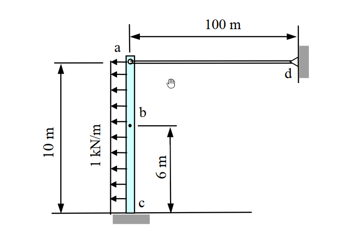
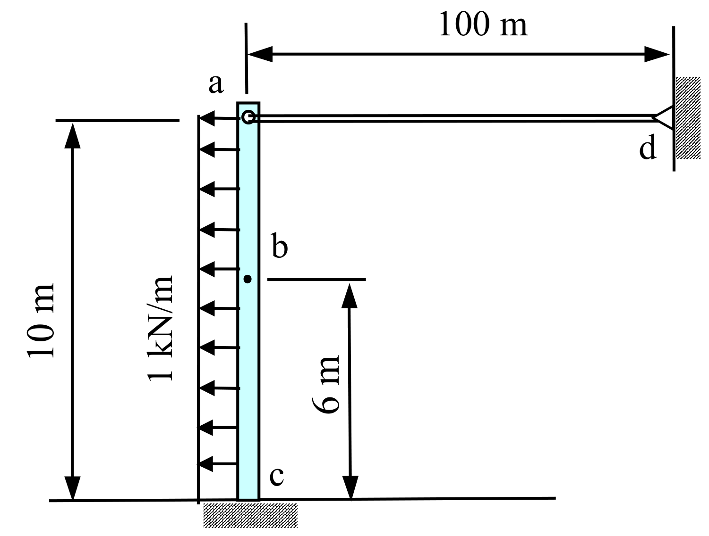

# SA-2009-2 題目正本

> 本檔只記錄考卷上寫了什麼、圖上畫了什麼，不含任何解法。解析見同資料夾 `SA-2009-2.md`。
> 判讀清單經使用者確認前，狀態為「待確認」；確認後本檔原則上不再修改（改動須回考卷原圖並記 log）。

| 項目 | 內容 |
|---|---|
| 考卷 | `raw/exams/SA-2009_結構學.pdf`，第 1 頁（正面），第二題（無圖號） |
| 考年 | 2009（民國 98 年）專技高考結構工程技師「結構學」 |
| 配分 | 25 分 |
| 附圖 | `SA-2009-2-fig-1.png`、`SA-2009-2-fig-2.png` |
| 判讀狀態 | **已確認**（2026-11-07 使用者確認；原轉錄：2026-11-07 轉錄；PyMuPDF 110 dpi 整頁＋400–1200 dpi 局部放大；PDF 向量繪圖；盲讀於開啟解析前完成） |

## 1. 考卷原文（逐字）

二、如圖所示之結構受一 1 kN/m 之均佈力作用，其中ac為梁（beam）構件，ad為連桿（linkage），c點為固定端（fixed end），請計算b點之水平位移Δb。假設ac梁之EI = 1000 kN-m²，ad連桿之AE = 1000 kN，其中E為構件之彈性模數，I為斷面慣性矩，A為斷面積。（25 分）

## 2. 考卷給的公式、附表與參數

- 考卷沒有給任何參考公式或附表。
- 給定：梁 ac 的 EI＝1000 kN-m²；連桿 ad 的 AE＝1000 kN。
- 考卷沒有說是否忽略梁 ac 的軸向變形（梁只給 EI）。
- 卷首注意事項：㈠可以使用電子計算器，但需詳列解答過程。㈡不必抄題，作答時請將試題題號及答案依照順序寫在試卷上，於本試題上作答者，不予計分。
- 考試時間：2 小時。

## 3. 附圖

*證據圖 SA-2009-2-fig-1.png*

*證據圖 SA-2009-2-fig-2.png（2026-11-07 自考卷重新擷取 500 dpi，無游標）*

圖面文字照錄：100 m、a、d、b、10 m、1 kN/m、6 m、c

## 4. 判讀清單

| # | 項目 | 判讀 | 圖上／題文依據 | 把握 |
|---|---|---|---|---|
| 1 | c | 固定端（梁底接剖線，無三角形） | 450 dpi 放大；題文「c 點為固定端」 | 確定 |
| 2 | d | 鉸支承於右側直立牆（三角形尖端朝連桿） | 450 dpi 放大 | 確定 |
| 3 | a | 連桿與梁頂的鉸接（小空心圓） | 450 dpi 放大 | 確定 |
| 4 | b | 梁上一點（小實心點），不是鉸 | 圖上為實心點，非空心圓 | 確定 |
| 5 | 尺寸 | 梁高 10 m（c 至 a）；b 在 c 上方 6 m；連桿長 100 m（a 至 d） | 10 m、6 m 尺寸界線對齊 a、b、c；100 m 界線對齊梁右緣與牆 | 確定 |
| 6 | 連桿方向 | 水平，與梁垂直 | 圖面 | 確定 |
| 7 | 載重 | 水平向左 1 kN/m，作用 c 至 a 全高（背離 d 的方向） | 箭頭朝左，自 c 排到 a | 確定 |
| 8 | 剛度 | 梁 EI＝1000 kN-m²；連桿 AE＝1000 kN | 題文 | 確定 |
| 9 | 所求 | b 點水平位移 Δb | 題文 | 確定 |
| 10 | 靜不定度 | 固定 3＋連桿 1＝4 個未知力，方程式 3，一度靜不定 | 計數 | 確定（解讀）；使用者確認 |
| 11 | 證據圖 | 舊 fig-1 有游標（連桿下方空白處）；新增 fig-2（500 dpi） | — | 確定 |

---
*轉錄：2026-11-07（SA-U2-2 題目正本推廣・批 1）*
*確認：2026-11-07 使用者確認*
