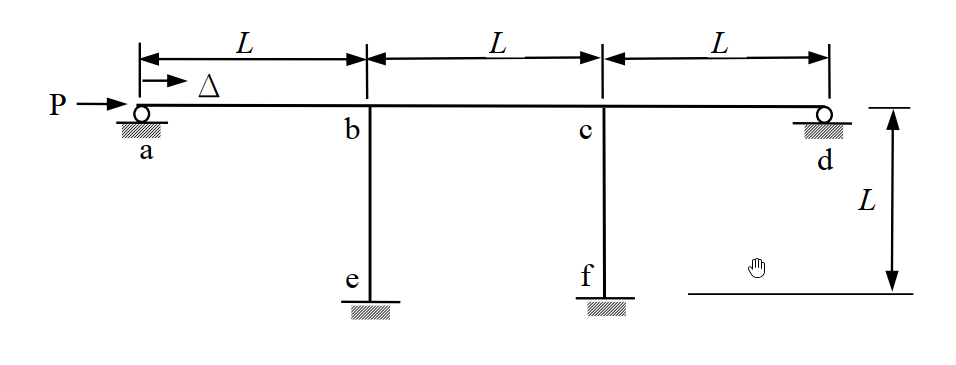

# SA-2009-3 題目正本

> 本檔只記錄考卷上寫了什麼、圖上畫了什麼，不含任何解法。解析見同資料夾 `SA-2009-3.md`。
> 判讀清單經使用者確認前，狀態為「待確認」；確認後本檔原則上不再修改（改動須回考卷原圖並記 log）。

| 項目 | 內容 |
|---|---|
| 考卷 | `raw/exams/SA-2009_結構學.pdf`，第 1 頁下方，第三題 |
| 考年 | 2009（民國 98 年）專技高考結構工程技師「結構學」 |
| 配分 | 25 分 |
| 附圖 | `SA-2009-3-fig-1.png` |
| 判讀狀態 | **已確認**（2026-11-04 使用者確認。原轉錄：2026-11-04 轉錄；PyMuPDF 150 dpi 整頁＋350–500 dpi 局部放大；盲讀於開啟解析前完成） |

## 1. 考卷原文（逐字）

三、下圖中之π型構架（frame）受一水平力 P 之作用，並產生一水平位移Δ。假設全部構件之 E 值（彈性模數）與 I 值（慣性矩）均相同，且不計構件之軸向變形。試以傾角變位法（slope-deflection method）計算以下問題：㈠若令 P = K_H Δ，其中 K_H 稱為構架之總體水平勁度（horizontal stiffness），請計算 K_H。㈡若令 P = 100 kN，L = 10m，請計算構架各結點處之彎矩，並繪製彎矩圖。（25 分）

## 2. 考卷給的公式、附表與參數

- 考卷沒有給任何參考公式或附表；所需公式須自備。
- 卷首注意事項：㈠可以使用電子計算器，但需詳列解答過程。㈡不必抄題，作答時請將試題題號及答案依照順序寫在試卷上，於本試題上作答者，不予計分。
- 考試時間：2 小時。

## 3. 附圖

*證據圖 SA-2009-3-fig-1.png*

圖面文字照錄：L、L、L、P、Δ、a、b、c、d、L、e、f

## 4. 判讀清單

| # | 項目 | 判讀 | 圖上／題文依據 | 把握 |
|---|---|---|---|---|
| 1 | a、d | 滾支承於水平面（僅垂直反力） | 圓形滾輪（400 dpi） | 確定 |
| 2 | e、f | 柱底固接 | 平板＋斜線 | 確定 |
| 3 | 梁 | a-b、b-c、c-d 各 L | 尺寸線 | 確定 |
| 4 | 柱 | be、cf 高 L | 右側尺寸 L | 確定 |
| 5 | E、I | 全部相同、不計軸向變形 | 題文 | 確定 |
| 6 | 載重 | a 點水平 P 向右 | 箭頭 | 確定 |
| 7 | 指定方法 | 傾角變位法 | 題文 | 確定 |
| 8 | 所求 | ㈠ K_H；㈡ P=100 kN、L=10 m 之各結點彎矩與彎矩圖 | 題文 | 確定 |

---
*轉錄：2026-11-04（SA-U2-3 題目正本推廣・批 1；判讀沿用同日盲解稽核紀錄 wiki/queries/盲解紀錄-SA-U2-3a-2026-11-04.md，並回考卷原圖核對）*
*確認：2026-11-04 使用者確認*
