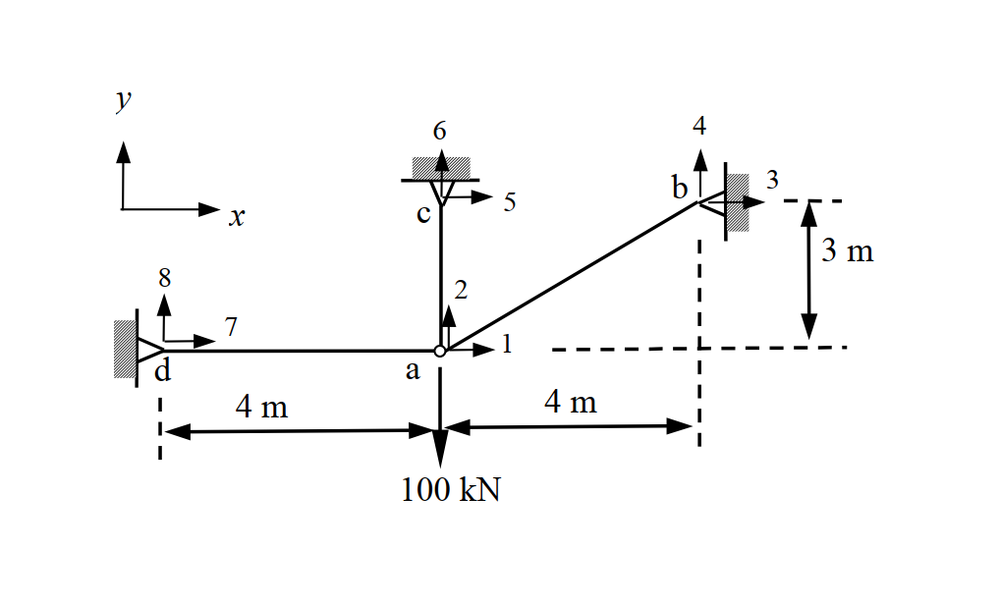
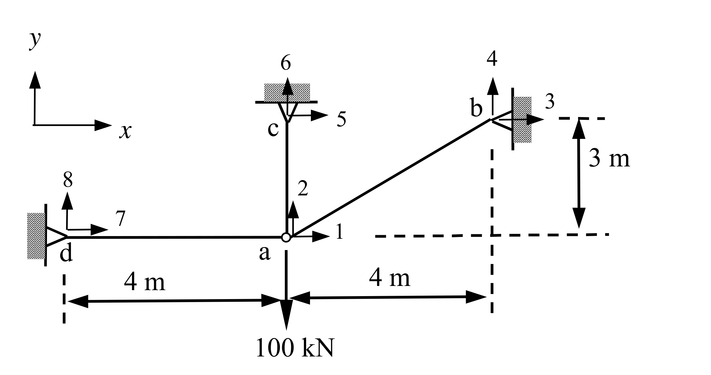

# SA-2009-4 題目正本

> 本檔只記錄考卷上寫了什麼、圖上畫了什麼，不含任何解法。解析見同資料夾 `SA-2009-4.md`。
> 判讀清單經使用者確認前，狀態為「待確認」；確認後本檔原則上不再修改（改動須回考卷原圖並記 log）。

| 項目 | 內容 |
|---|---|
| 考卷 | `raw/exams/SA-2009_結構學.pdf`，第 2 頁（背面），第四題 |
| 考年 | 2009（民國 98 年）專技高考結構工程技師「結構學」 |
| 配分 | 25 分 |
| 附圖 | `SA-2009-4-fig-1.png`、`SA-2009-4-fig-2.png` |
| 判讀狀態 | **已確認**（2026-11-05 使用者確認；影響答案項目定案：#3 ac = 3 m（c 與 b 同高，考卷未標；使用者確認）。原轉錄：2026-11-05 轉錄；PyMuPDF 110 dpi 整頁＋250–800 dpi 局部放大、PDF 向量座標；盲讀於開啟解析前完成） |

## 1. 考卷原文（逐字）

四、如圖示三支構件之桁架（truss）系統，受向下 100 kN 之作用力。試以矩陣直接勁度法（direct stiffness method）分析 a 點之水平變位 d₁ 與垂直變位 d₂，並計算各構件之內力。假設各構件之 E 值（彈性模數）與 A 值（斷面積）皆為常數，且 AE = 1000 kN。圖中帶有箭頭之數字為結點位移編號，x-y 為總體座標系統（global coordinates）。（25 分）

## 2. 考卷給的公式、附表與參數

- 考卷沒有給任何參考公式或附表。
- AE = 1000 kN（題文，PDF 文字層為公式物件，依頁面影像補回）。
- 考卷沒有標 ac 桿的長度（見判讀清單 #3）。
- 卷首注意事項：可以使用電子計算器，但需詳列解答過程。不必抄題，作答時請將試題題號及答案依照順序寫在試卷上，於本試題上作答者，不予計分。
- 考試時間：2 小時。

## 3. 附圖

*證據圖 SA-2009-4-fig-1.png*

*證據圖 SA-2009-4-fig-2.png（2026-11-05 自考卷重新擷取 500 dpi，無游標）*

圖面文字照錄：y、x、6、5、c、4、3、b、3 m、8、7、2、1、d、a、4 m、4 m、100 kN

## 4. 判讀清單

| # | 項目 | 判讀 | 圖上／題文依據 | 把握 |
|---|---|---|---|---|
| 1 | 座標（a 為原點） | a(0,0)、d(−4,0)、b(4,3) | 尺寸線 4 m｜4 m、3 m（3 m 尺寸線上端對齊 b，下端對齊 a 高程的虛線） | 確定 |
| 2 | 構件 | ad、ab、ac 三桿 | 題文「三支構件」；附圖 | 確定 |
| 3 | ac 桿長度 | **附圖沒有標註**；c 畫在 a 正上方、與 b 同高程（PDF 向量座標 c 支承 y = 374.5 pt、b y = 373.5 pt、a y = 430 pt）→ ac = 3 m | PDF 向量座標；圖面垂直向未依比例（水平 4 m 約 96–107 pt，垂直 3 m 只畫 56 pt），只能以「與 b 同高」推定 | 確定（解讀）；使用者確認 |
| 4 | 支承 b、c、d | 皆為鉸支承（三角形接牆／天花板，b、d 接垂直牆，c 接水平天花板） | 500 dpi 附圖 | 確定 |
| 5 | 位移編號 | a：1（+x）、2（+y）；b：3、4；c：5、6；d：7、8 | 附圖箭頭 | 確定 |
| 6 | 載重 | a 點 100 kN 向下 | 附圖；題文 | 確定 |
| 7 | AE | 1000 kN，各桿相同 | 題文 | 確定 |
| 8 | 所求 | d₁、d₂ 與各構件內力；限矩陣直接勁度法 | 題文 | 確定 |
| 9 | 證據圖 | 舊截圖 fig-1：無游標，但解析度偏低（1018×617）；新增 fig-2（2026-11-05 自考卷重新擷取 500 dpi） | — | 確定 |

---
*轉錄：2026-11-05（SA-U2-4 題目正本推廣・批 1）*
*確認：2026-11-05 使用者確認*
