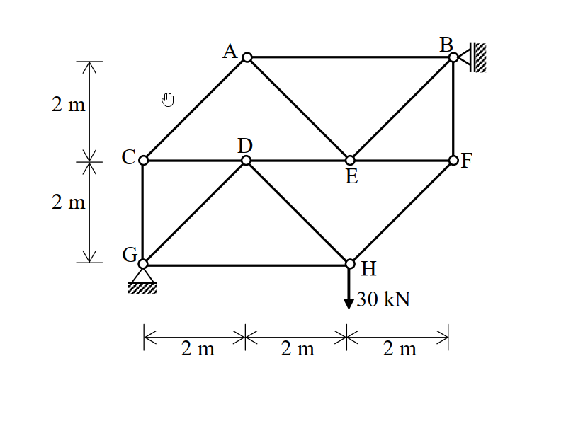
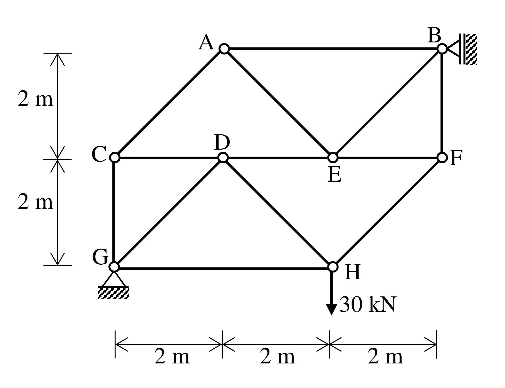

# SA-2010-1 題目正本

> 本檔只記錄考卷上寫了什麼、圖上畫了什麼，不含任何解法。解析見同資料夾 `SA-2010-1.md`。
> 判讀清單經使用者確認前，狀態為「待確認」；確認後本檔原則上不再修改（改動須回考卷原圖並記 log）。

| 項目 | 內容 |
|---|---|
| 考卷 | `raw/exams/SA-2010_結構學.pdf`，第 1 頁（正面）上半，第一題 |
| 考年 | 2010（民國 99 年）專技高考結構工程技師「結構學」 |
| 配分 | 20 分 |
| 附圖 | `SA-2010-1-fig-1.png`、`SA-2010-1-fig-2.png` |
| 判讀狀態 | **已確認**（2026-11-05 使用者確認。原轉錄：2026-11-05 轉錄；PyMuPDF 110 dpi 整頁＋350–1000 dpi 局部放大；盲讀於開啟解析前完成） |

## 1. 考卷原文（逐字）

一、如圖所示之桁架（truss）結構，其支承點 B 為滾支承（roller），而支承點 G 則為鉸支承（hinge）。當 H 點承受一垂直向下載重 30 kN 時，請計算 AC、BF 與 DE 三根桿件之軸力。（20 分）

## 2. 考卷給的公式、附表與參數

- 考卷沒有給任何參考公式或附表。
- 考卷沒有給 EA（靜定桁架不需要）。
- 卷首注意事項：㈠可以使用電子計算器。㈡不必抄題，作答時請將試題題號及答案依照順序寫在試卷上，於本試題上作答者，不予計分。
- 考試時間：2 小時。

## 3. 附圖

*證據圖 SA-2010-1-fig-1.png*

*證據圖 SA-2010-1-fig-2.png（2026-11-05 自考卷重新擷取 500 dpi，無游標）*

圖面文字照錄：A、B、2 m、C、D、E、F、2 m、G、H、30 kN、2 m、2 m、2 m

## 4. 判讀清單

| # | 項目 | 判讀 | 圖上／題文依據 | 把握 |
|---|---|---|---|---|
| 1 | 座標（以 G 為原點） | G(0,0)、H(4,0)、C(0,2)、D(2,2)、E(4,2)、F(6,2)、A(2,4)、B(6,4) | PDF 向量座標：水平刻度間距 55.2 pt＝2 m；左側 2 m｜2 m | 確定 |
| 2 | 桿件 | AB、AC、AE、EB、BF、CD、DE、EF、CG、GD、DH、GH、HF；共 13 桿（E–H 之間沒有桿） | 350 dpi 圖面 | 確定 |
| 3 | 支承 B | 滾支承，貼右側垂直牆，反力水平 | 題文；圖上三角形指向 B、雙線＋剖線牆在右 | 確定 |
| 4 | 支承 G | 鉸支承 | 題文；三角形＋剖線 | 確定 |
| 5 | 靜定性 | j = 8、m = 13、r = 3 | 計數 | 確定 |
| 6 | 載重 | H 點 30 kN 向下 | 題文；箭頭 | 確定 |
| 7 | 所求 | AC、BF、DE 軸力 | 題文 | 確定 |
| 8 | 證據圖 | 舊 fig-1 滑鼠游標在 A 左下空白處；新增 fig-2（500 dpi） | — | 確定 |

---
*轉錄：2026-11-05（SA-U1-2 題目正本推廣・批 1）*
*確認：2026-11-05 使用者確認*
