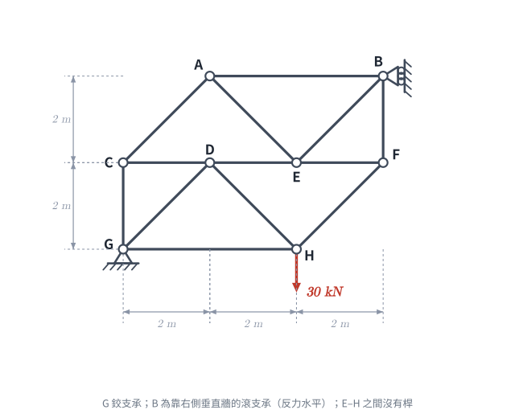
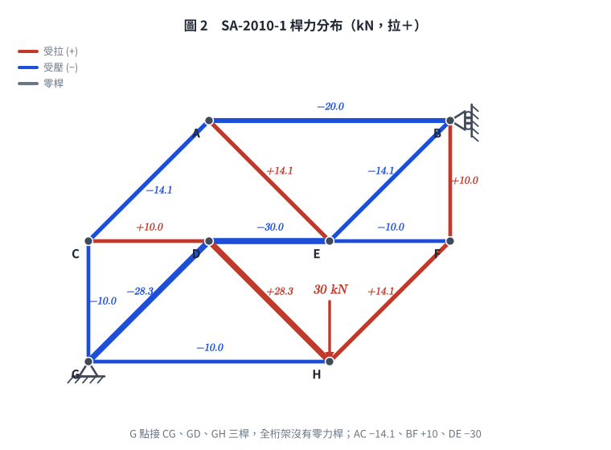

# 考題編號：SA-2010-1

**主分類：** `SA-U1-2` 靜定結構之分析
**副分類：** 無
**分析法：** 節點法 (Method of Joints) / 斷面法 (Method of Sections)
**標籤：** `節點法`, `斷面法`, `靜定桁架`, `滾支承反力方向`

---

## 1. 題目（考卷原文見題目正本）

> 考卷原文、公式／附表、附圖與判讀清單（已確認）見 [`SA-2010-1-problem.md`](SA-2010-1-problem.md)。本節只列解題時最容易讀錯的地方與本解使用的記號；題意以題目正本為準。

*重繪自考卷附圖，依判讀清單 #1–#6 重繪。攔：B 的反力方向讀錯、多畫 E–H 豎桿、節點 G 漏掉 GH 桿。*

### 常見誤讀
| 項目 | 正確判讀 | 常見誤讀 |
|---|---|---|
| B 支承 | 靠右側垂直牆的滾支承，只有水平反力 | 只有垂直反力 |
| E–H | 兩點之間沒有桿 | 有豎桿 |
| 節點 G | 連接 CG、GD、**GH** 三根桿 | 只看到 CG、GD 兩桿，誤得 CG＝0、AC＝0 的「零桿連鎖」（舊版解析即錯在此：AC 0、BF 30、DE −60 kN，2026-11-05 勘誤） |

**本解記號：** 軸力以拉力為正；節點座標以 G 為原點（m）；力矩逆時針為正。

## 2. 考題核心精神與出題者意圖 (Core Concepts & Examiner's Intent)

本題測驗**靜定桁架的節點法與斷面法**，以及**滾支承反力方向**的判讀。

桁架共 8 節點、13 桿、3 個反力（2j = m + r = 16），而且**每個節點都至少接三根桿**，本題在 30 kN 作用下**沒有任何零力桿**。考生若想靠「找零桿」化簡，很容易像舊版解析一樣在節點 G 漏看水平桿 GH，誤判出一串零桿。正確破局點是：找出只牽涉同一組未知數的節點鏈——節點 A、E 的垂直平衡把 AE、AB、EB 都寫成 AC 的倍數，再到節點 B 用已知的水平反力一次解出 AC。

## 3. 解題戰略地圖與陷阱分析 (Strategic Roadmap & Trap Analysis)

**解題戰略地圖：**
1. **全域平衡**：對 G 取矩求 B 的水平反力，再由 ΣFx、ΣFy 求 G 的兩個反力。
2. **節點 A**（AB、AC、AE，無外力）：ΣFy 得 AE＝−AC，ΣFx 得 AB＝√2·AC。
3. **節點 E 的垂直平衡**（AE、EB 兩斜桿有垂直分量，DE、EF 水平）：得 EB＝−AE＝AC。
4. **節點 B**（AB、EB、BF＋水平反力 30 kN←）：ΣFx 解出 **AC**，ΣFy 解出 **BF**。
5. **DE**：節點 F 求 EF，再回節點 E 的 ΣFx；或以垂直斷面取左半部對 H 取矩驗算。

**陷阱分析與應對策略：**
- 💥 **陷阱 1：支承反力方向誤判（致命陷阱）**。B 點為靠在右側「垂直牆面」上的滾支承，只能提供**水平向**反力 $B_x$。若依慣性當成垂直反力，全盤皆錯。**應對：** 看滾支承接觸面的法線方向。
- 💥 **陷阱 2：漏看桿件而誤判零力桿**。G 點除了 CG、GD 外還有水平底弦 GH；漏掉它會得到「G 兩桿 → CG＝0 → AC＝0 → AB＝AE＝0」的錯誤連鎖。**應對：** 判斷零力桿前，先逐一點清該節點所有桿件；本題每個節點都是三桿以上，零桿法則（兩桿無載重節點、三桿兩共線節點）一條都不適用。
- 💥 **陷阱 3：斷面法未知數太多**。過 D–E 之間的垂直斷面會切到 AB、AE、DE、DH、GH 五根桿，單用一條力矩式解不出 DE；必須先由節點鏈求出 AB、AE，再對 H 取矩（DH、GH 通過 H）。

## 3.5 變數層次分析 (Variable Hierarchy Analysis)

### 最終目標
`運用整體平衡與節點法（輔以斷面法驗算），求出靜定桁架中 AC、BF 與 DE 三根桿件之軸力大小與拉壓性質。`

### 本題關鍵公式（依計算順序）
Step 1：整體結構取力矩平衡求滾支承反力
$$ \sum M_G = 0 \implies B_x \cdot 4 - P \cdot 4 = 0 $$
Step 2：整體結構取水平/垂直力平衡求鉸支承反力
$$ \sum F_x = 0, \sum F_y = 0 \implies \boxed{G_x}, \boxed{G_y} $$
Step 3：節點 A、E 的平衡把 AE、AB、EB 寫成 AC 的倍數
$$ F_{AE} = -F_{AC},\quad F_{AB} = \sqrt{2}\,F_{AC},\quad F_{EB} = -F_{AE} = F_{AC} $$
Step 4：節點 B 的平衡解出 AC 與 BF
$$ -\boxed{F_{AB}} - \frac{\boxed{F_{EB}}}{\sqrt{2}} - \boxed{B_x} = 0,\qquad -\frac{\boxed{F_{EB}}}{\sqrt{2}} - F_{BF} = 0 $$
Step 5：節點 F、E 的水平平衡解出 DE（斷面法對 H 取矩驗算）
$$ F_{DE} = \boxed{F_{EF}} - \frac{\boxed{F_{AE}}}{\sqrt{2}} + \frac{\boxed{F_{EB}}}{\sqrt{2}} $$

### L1：題目直接給定
| 符號 | 數值 | 說明 |
|---|---|---|
| $P$ | $30\text{ kN}$ | 作用於 H 點之垂直向下載重 |
| $\Delta x$ | $2\text{ m}$ | 結構水平向每格尺寸 |
| $\Delta y$ | $2\text{ m}$ | 結構垂直向每格尺寸 |

### L2：需知識點推導
**整體反力分析**
| 符號 | 公式／來源 | 卡關? |
|---|---|---|
| $B_x$ | 滾支承於垂直牆面之反力，由 $\sum M_G = 0$ 求得 | |
| $G_x$ | 鉸支承之水平反力，由 $\sum F_x = 0$ 求得 | |
| $G_y$ | 鉸支承之垂直反力，由 $\sum F_y = 0$ 求得 | |

**內力分析（節點法鏈）**
| 符號 | 公式／來源 | 卡關? |
|---|---|---|
| $F_{AE}, F_{AB}$ | 節點 A 之 $\sum F_y = 0$、$\sum F_x = 0$，以 $F_{AC}$ 表示 | |
| $F_{EB}$ | 節點 E 之 $\sum F_y = 0$ | |
| $F_{AC}$ | 節點 B 之 $\sum F_x = 0$（代入 $B_x$） | |
| $F_{BF}$ | 節點 B 之 $\sum F_y = 0$ | |
| $F_{EF}$ | 節點 F 之 $\sum F_y$、$\sum F_x$ | |
| $F_{DE}$ | 節點 E 之 $\sum F_x = 0$；斷面對 H 取矩驗算 | |

### L3：深層知識（不懂就卡住）
| 知識點 | 說明 | 卡關? |
|---|---|---|
| **滾支承反力方向** | 滾支承的反力必垂直於接觸面，若接觸面為垂直牆，則反力為水平向。 | |
| **零力桿件判斷法則的適用前提** | 「兩桿無載重節點兩桿皆零」「三桿兩共線無載重節點第三桿為零」都要先點清節點上**所有**桿件；本題各節點皆三桿以上且無兩共線＋單一斜桿的組合，法則不適用。 | |
| **節點鏈選擇** | 每個節點只有兩條方程式；挑「未知數能互相表示」的節點串（A → E → B），讓最後一個節點的已知反力一次解出。 | |

## 4. 步驟化詳細計算過程 (Step-by-Step Detailed Calculation)

### 步驟 1：計算支承反力 (Global Equilibrium)
各節點座標（以 G 為原點）：G(0,0)、H(4,0)、C(0,2)、D(2,2)、E(4,2)、F(6,2)、A(2,4)、B(6,4)。
- $G(0,0)$，鉸支承，有 $G_x, G_y$ 兩反力分量。
- $B(6,4)$，滾支承於垂直牆面，僅有水平反力 $B_x$。
- 外力：$H(4,0)$ 處有垂直向下之載重 $P = 30\text{ kN}$。

對全結構取 G 點力矩平衡（逆時針為正）：
$$ \sum M_G = 0 \implies B_x \times 4\text{ m} - 30\text{ kN} \times 4\text{ m} = 0 \implies B_x = 30\text{ kN} \text{ (向左, }\leftarrow\text{)} $$
水平力平衡：
$$ \sum F_x = 0 \implies G_x - B_x = 0 \implies G_x = 30\text{ kN} \text{ (向右, }\rightarrow\text{)} $$
垂直力平衡：
$$ \sum F_y = 0 \implies G_y - 30 = 0 \implies G_y = 30\text{ kN} \text{ (向上, }\uparrow\text{)} $$

### 步驟 2：節點 A（AB、AC、AE，無外力）
AC 由 A 指向 C 的單位向量 $(-1,-1)/\sqrt{2}$；AE 指向 E 為 $(1,-1)/\sqrt{2}$；AB 指向 B 為 $(1,0)$。
$$ \sum F_y = 0 \implies -\frac{F_{AC}}{\sqrt{2}} - \frac{F_{AE}}{\sqrt{2}} = 0 \implies F_{AE} = -F_{AC} $$
$$ \sum F_x = 0 \implies F_{AB} - \frac{F_{AC}}{\sqrt{2}} + \frac{F_{AE}}{\sqrt{2}} = 0 \implies F_{AB} = \sqrt{2}\,F_{AC} $$

### 步驟 3：節點 E 的垂直平衡
E 點連接 DE、EF（水平）與 AE（指向 A：$(-1,1)/\sqrt{2}$）、EB（指向 B：$(1,1)/\sqrt{2}$），無外力（E–H 之間沒有桿）。
$$ \sum F_y = 0 \implies \frac{F_{AE}}{\sqrt{2}} + \frac{F_{EB}}{\sqrt{2}} = 0 \implies F_{EB} = -F_{AE} = F_{AC} $$

### 步驟 4：節點 B 求 AC 與 BF
B 點連接 AB（指向 A：$(-1,0)$）、EB（指向 E：$(-1,-1)/\sqrt{2}$）、BF（指向 F：$(0,-1)$），並受牆面反力 $B_x = 30\text{ kN}\ (\leftarrow)$。
$$ \sum F_x = 0 \implies -F_{AB} - \frac{F_{EB}}{\sqrt{2}} - 30 = 0 \implies -\sqrt{2}F_{AC} - \frac{F_{AC}}{\sqrt{2}} = 30 \implies -\frac{3}{\sqrt{2}}F_{AC} = 30 $$
$$ \boxed{F_{AC} = -10\sqrt{2} \approx -14.14\text{ kN} \text{ (壓力, C)}} $$
連帶：$F_{AE} = +10\sqrt{2}$（拉）、$F_{AB} = -20$（壓）、$F_{EB} = -10\sqrt{2}$（壓）kN。
$$ \sum F_y = 0 \implies -\frac{F_{EB}}{\sqrt{2}} - F_{BF} = 0 \implies F_{BF} = -\frac{-10\sqrt{2}}{\sqrt{2}} $$
$$ \boxed{F_{BF} = 10\text{ kN} \text{ (拉力, T)}} $$

### 步驟 5：節點 F、E 求 DE
**節點 F**（BF 指向 B：$(0,1)$；EF 指向 E：$(-1,0)$；HF 指向 H：$(-1,-1)/\sqrt{2}$）：
$$ \sum F_y = 0 \implies F_{BF} - \frac{F_{HF}}{\sqrt{2}} = 0 \implies F_{HF} = 10\sqrt{2}\text{ kN} $$
$$ \sum F_x = 0 \implies -F_{EF} - \frac{F_{HF}}{\sqrt{2}} = 0 \implies F_{EF} = -10\text{ kN} $$
**節點 E 水平平衡**（DE 指向 D：$(-1,0)$；EF 指向 F：$(1,0)$）：
$$ \sum F_x = 0 \implies -F_{DE} + F_{EF} - \frac{F_{AE}}{\sqrt{2}} + \frac{F_{EB}}{\sqrt{2}} = 0 \implies F_{DE} = -10 - 10 - 10 $$
$$ \boxed{F_{DE} = -30\text{ kN} \text{ (壓力, C)}} $$

**斷面法驗算**：在 D、E 之間（x ≈ 3 m）切一垂直斷面，切斷 AB、AE、DE、DH、GH，取左半部（G、C、A、D）對 H(4,0) 取矩；DH、GH 通過 H 不產生力矩：
$$ \sum M_H = \underbrace{-30\times4}_{G_y} \underbrace{-\,4F_{AB}}_{AB\ (y=4)} \underbrace{+\,(2-4)\left(-\tfrac{F_{AE}}{\sqrt2}\right) - 4\cdot\tfrac{F_{AE}}{\sqrt2}}_{AE\ \text{於 A}} \underbrace{-\,2F_{DE}}_{DE\ (y=2)} = 0 $$
$$ -120 + 80 - 20 - 2F_{DE} = 0 \implies F_{DE} = -30\text{ kN} \ \checkmark $$

### 全桿件軸力一覽（kN，拉為正）
| 桿 | AB | AC | AE | EB | BF | CD | DE | EF | CG | GD | DH | GH | HF |
|---|---|---|---|---|---|---|---|---|---|---|---|---|---|
| 軸力 | −20 | −10√2 | +10√2 | −10√2 | +10 | +10 | −30 | −10 | −10 | −20√2 | +20√2 | −10 | +10√2 |

各節點（含 G：$G_x + F_{GH} + F_{GD}/\sqrt2 = 30 - 10 - 20 = 0$、$G_y + F_{CG} + F_{GD}/\sqrt2 = 30 - 10 - 20 = 0$）平衡殘差皆為 0；本題沒有零力桿。

*圖 2　桿力分布（紅拉、藍壓，線寬隨軸力大小）。腳本先檢查 8 個節點平衡殘差為 0 才畫。圖上 G 點明顯接三根受力桿，全桁架沒有一根灰色零桿，能攔下「節點 G 漏看 GH、誤判出一串零桿」的錯。*

## 5. 關鍵爭議點與進階探討 (Critical Issues & Advanced Discussion)

- **圖示符號的解讀與機構陷阱**：若把滾支承 B 誤當成提供垂直反力，整體結構在水平方向只剩 G 一個束制、但對 G 的轉動仍有束制，結構雖可求解，力流完全不同。考卷上 B 的三角形尖端指向節點、背後是垂直剖線牆，反力必為水平。
- **零力桿判斷的前提是「點清桿件」**：本題舊版解析在節點 G 只列 CG、GD 兩桿，漏掉水平桿 GH，於是得到 CG＝0 → AC＝0 → AB＝AE＝0 的連鎖，三個答案全錯（舊值見 §1 常見誤讀）。那組舊答案本身也不自洽：照它往下推到節點 C，會要求 AC 不為零，與起點矛盾。考場上算出一串零桿時，回頭在另一個節點做平衡檢核，就能攔下這類錯誤。
- **節點鏈 vs. 斷面法**：本題各斷面都切到四根以上未知桿，斷面法單獨用不上；反而 A → E → B 的節點鏈只有一個未知數 $F_{AC}$，最省事。斷面法留作 DE 的驗算。

---

*修正日期：2026-11-05（解析勘誤：節點 G 漏算 GH 桿致零桿誤判；AC 0 → −10√2 kN（壓）、BF 30 → 10 kN（拉）、DE −60 → −30 kN（壓）；§1 常見誤讀、§2、§3、§3.5、§4 步驟 2–5、§5 改寫；驗證：全桁架 13 桿＋3 反力聯立與節點鏈手算、斷面對 H 取矩三路徑一致，MISMATCHES: 0）*
*修正日期：2026-11-05（§1 改為指向題目正本並放重繪附圖（figs/SA-2010-1-fig-1-problem.svg）、加常見誤讀；圖由 gen_SA-2010-1.py 產生，可重跑）*
*圖解補繪：2026-11-05（圖 2 桁架力流圖，向量圖，腳本 `gen_SA-2010-1_truss.py`，可重跑）*
