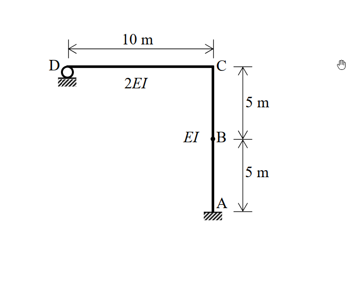

# SA-2010-2 題目正本

> 本檔只記錄考卷上寫了什麼、圖上畫了什麼，不含任何解法。解析見同資料夾 `SA-2010-2.md`。
> 判讀清單經使用者確認前，狀態為「待確認」；確認後本檔原則上不再修改（改動須回考卷原圖並記 log）。

| 項目 | 內容 |
|---|---|
| 考卷 | `raw/exams/SA-2010_結構學.pdf`，第 1 頁下方，第二題 |
| 考年 | 2010（民國 99 年）專技高考結構工程技師「結構學」 |
| 配分 | 30 分 |
| 附圖 | `SA-2010-2-fig-1.png` |
| 判讀狀態 | **已確認**（2026-11-04 使用者確認。原轉錄：2026-11-04 轉錄；PyMuPDF 150 dpi 整頁＋350–500 dpi 局部放大；盲讀於開啟解析前完成） |

## 1. 考卷原文（逐字）

二、如圖所示之剛架（frame），其支承點A為固定端（fixed end），而支承點D則為滾支承。另外，構件AC與構件CD之彈性模數與慣性矩乘積分別為EI及 2EI，且EI = 1000 kN-m²。請計算：㈠當B點承受一水平向左載重 200 kN時，C點之轉角；㈡當C點承受一逆時針方向力矩 50 kN-m時，B點之水平變位。（30 分）

## 2. 考卷給的公式、附表與參數

- 考卷沒有給任何參考公式或附表；所需公式須自備。
- 卷首注意事項：㈠可以使用電子計算器。㈡不必抄題，作答時請將試題題號及答案依照順序寫在試卷上，於本試題上作答者，不予計分。
- 考試時間：2 小時。

## 3. 附圖

*證據圖 SA-2010-2-fig-1.png*

圖面文字照錄：10 m、D、C、2EI、5 m、EI、B、5 m、A

## 4. 判讀清單

| # | 項目 | 判讀 | 圖上／題文依據 | 把握 |
|---|---|---|---|---|
| 1 | A | 柱底固接 | 400 dpi | 確定 |
| 2 | D | 滾支承於水平面（僅垂直反力） | 圓形滾輪 | 確定 |
| 3 | B | 柱中點（實心點，非鉸） | 實心小圓點 | 確定 |
| 4 | C | 剛接角點 | 無鉸圈 | 確定 |
| 5 | AC | 10 m，EI | 5 m＋5 m、標 EI | 確定 |
| 6 | CD | 10 m，2EI | 標 10 m、2EI | 確定 |
| 7 | EI | 1000 kN-m² | 題文 | 確定 |
| 8 | 載重 | ㈠ B 點水平 200 kN 向左；㈡ C 點逆時針 50 kN-m（兩個獨立載重情況） | 題文 | 確定 |
| 9 | 指定方法 | 未指定 | 題文 | 確定 |
| 10 | 所求 | ㈠ θ_C；㈡ B 點水平變位 | 題文 | 確定 |

---
*轉錄：2026-11-04（SA-U2-3 題目正本推廣・批 1；判讀沿用同日盲解稽核紀錄 wiki/queries/盲解紀錄-SA-U2-3a-2026-11-04.md，並回考卷原圖核對）*
*確認：2026-11-04 使用者確認*
