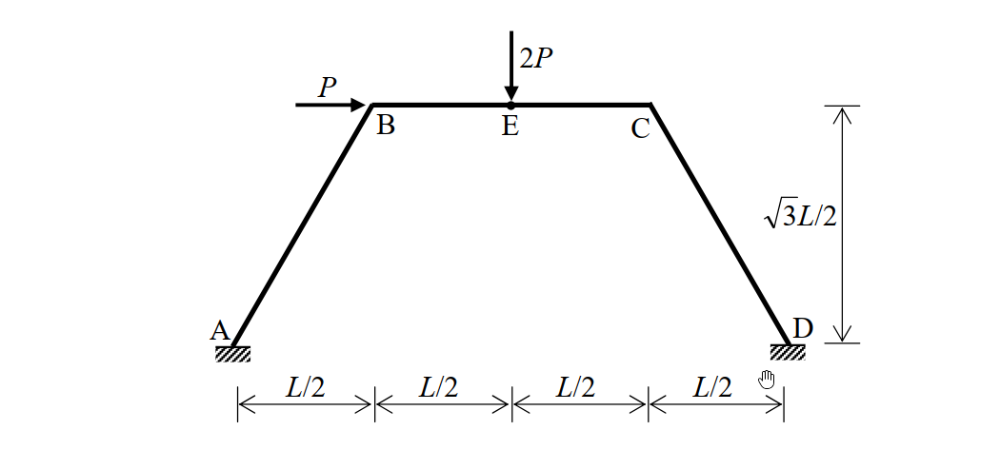
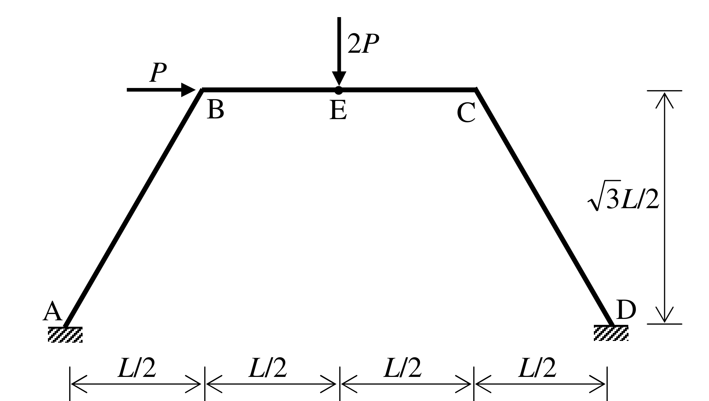

# SA-2010-3 題目正本

> 本檔只記錄考卷上寫了什麼、圖上畫了什麼，不含任何解法。解析見同資料夾 `SA-2010-3.md`。
> 判讀清單經使用者確認前，狀態為「待確認」；確認後本檔原則上不再修改（改動須回考卷原圖並記 log）。

| 項目 | 內容 |
|---|---|
| 考卷 | `raw/exams/SA-2010_結構學.pdf`，第 2 頁上半，第三題 |
| 考年 | 2010（民國 99 年）專技高考結構工程技師「結構學」 |
| 配分 | 25 分 |
| 附圖 | `SA-2010-3-fig-1.png`、`SA-2010-3-fig-2.png` |
| 判讀狀態 | **已確認**（2026-11-04 使用者確認。原轉錄：2026-11-04 轉錄；PyMuPDF 150 dpi 整頁＋350–500 dpi 局部放大；盲讀於開啟解析前完成） |

## 1. 考卷原文（逐字）

三、如圖所示之剛架，其支承點 A 與 D 均為固定端，同時每根構件之彈性模數與慣性矩乘積均為常數值 EI。當 B 點承受一水平載重 P 且 E 點承受一垂直載重 2P 時，請以傾角變位法（slope-deflection method）計算 A、B、C、D 各節點之彎矩。（若以其他方法計算不予計分）（25 分）

## 2. 考卷給的公式、附表與參數

- 考卷沒有給任何參考公式或附表；所需公式須自備。
- 卷首注意事項：㈠可以使用電子計算器。㈡不必抄題，作答時請將試題題號及答案依照順序寫在試卷上，於本試題上作答者，不予計分。
- 考試時間：2 小時。

## 3. 附圖

*證據圖 SA-2010-3-fig-1.png*

*證據圖 SA-2010-3-fig-2.png（2026-11-04 由考卷重新擷取 500 dpi；原 fig-1 截圖含游標圖示）*

圖面文字照錄：P、2P、B、E、C、√3L/2、A、D、L/2、L/2、L/2、L/2

## 4. 判讀清單

| # | 項目 | 判讀 | 圖上／題文依據 | 把握 |
|---|---|---|---|---|
| 1 | A、D | 固接 | 斜線填充 | 確定 |
| 2 | 幾何 | A(0,0)、B(L/2, √3L/2)、C(3L/2, √3L/2)、D(2L,0)；AB、CD 長 L（傾角 60°），BC 長 L | 水平 4 段 L/2、高 √3L/2 | 確定 |
| 3 | E | BC 中點 | E 位於第二、三段 L/2 交界 | 確定 |
| 4 | EI | 各桿相同 | 題文 | 確定 |
| 5 | 載重 | B 點水平 P 向右；E 點垂直 2P 向下 | 箭頭 | 確定 |
| 6 | 指定方法 | 傾角變位法（他法不計分） | 題文 | 確定 |
| 7 | 所求 | A、B、C、D 各節點之彎矩（桿端彎矩） | 題文 | 確定 |

---
*轉錄：2026-11-04（SA-U2-3 題目正本推廣・批 1；判讀沿用同日盲解稽核紀錄 wiki/queries/盲解紀錄-SA-U2-3a-2026-11-04.md，並回考卷原圖核對）*
*確認：2026-11-04 使用者確認*
