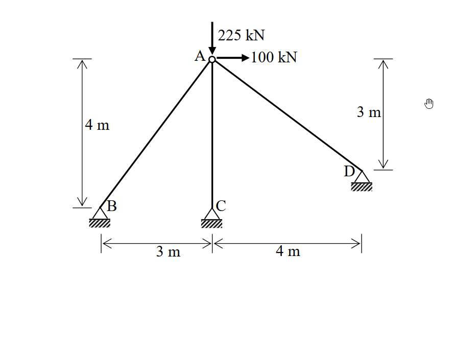
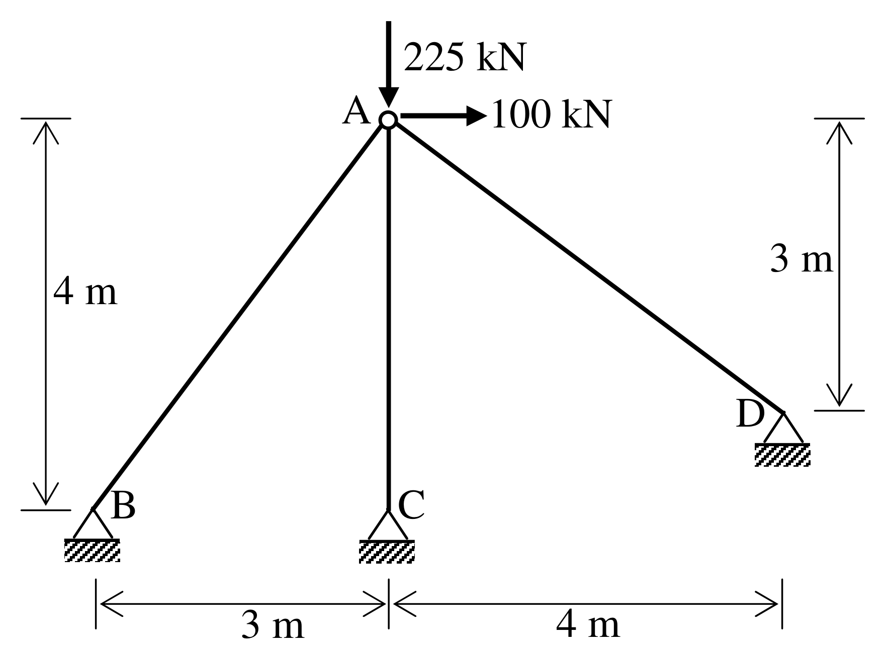

# SA-2010-4 題目正本

> 本檔只記錄考卷上寫了什麼、圖上畫了什麼，不含任何解法。解析見同資料夾 `SA-2010-4.md`。
> 判讀清單經使用者確認前，狀態為「待確認」；確認後本檔原則上不再修改（改動須回考卷原圖並記 log）。

| 項目 | 內容 |
|---|---|
| 考卷 | `raw/exams/SA-2010_結構學.pdf`，第 2 頁（背面）下半，第四題 |
| 考年 | 2010（民國 99 年）專技高考結構工程技師「結構學」 |
| 配分 | 25 分 |
| 附圖 | `SA-2010-4-fig-1.png`、`SA-2010-4-fig-2.png` |
| 判讀狀態 | **已確認**（2026-11-05 使用者確認。原轉錄：2026-11-05 轉錄；PyMuPDF 110 dpi 整頁＋250–800 dpi 局部放大、PDF 向量座標；盲讀於開啟解析前完成） |

## 1. 考卷原文（逐字）

四、如圖所示之桁架結構，其三個支承點 B、C、D 均為鉸支承，且 A 點承受一垂直向下載重 225 kN 及一水平向右載重 100 kN。假設各桿件之彈性模數與斷面積乘積均為常數值 EA = 10000 kN，請以直接勁度法（direct stiffness method）計算 A 點之水平變位與垂直變位，並解出桿件 BA 之軸力。（若以其他方法計算不予計分）（25 分）

## 2. 考卷給的公式、附表與參數

- 考卷沒有給任何參考公式或附表。
- EA = 10000 kN，各桿相同。
- 考卷沒有標 AC 桿長度（見判讀清單 #2）。
- 卷首注意事項：可以使用電子計算器。不必抄題，作答時請將試題題號及答案依照順序寫在試卷上，於本試題上作答者，不予計分。
- 考試時間：2 小時。

## 3. 附圖

*證據圖 SA-2010-4-fig-1.png*

*證據圖 SA-2010-4-fig-2.png（2026-11-05 自考卷重新擷取 500 dpi，無游標）*

圖面文字照錄：225 kN、A、100 kN、4 m、3 m、D、B、C、3 m、4 m

## 4. 判讀清單

| # | 項目 | 判讀 | 圖上／題文依據 | 把握 |
|---|---|---|---|---|
| 1 | 座標（A 為原點） | B(−3,−4)、C(0,−4)、D(4,−3) | 尺寸線 3 m｜4 m（水平）、左側 4 m 由 A 到 B、右側 3 m 由 A 到 D；PDF 向量座標依比例（約 28.4 pt/m） | 確定 |
| 2 | AC 桿長度 | 附圖沒有直接標註；C 支承與 B 同高程（PDF 向量座標 B、C 下端 y 同為 722.2 pt）→ AC = 4 m | PDF 向量座標 | 確定（解讀）；使用者確認 |
| 3 | 構件 | AB、AC、AD 三桿 | 附圖 | 確定 |
| 4 | 支承 | B、C、D 皆為鉸支承 | 題文；附圖三角形 | 確定 |
| 5 | 載重 | A 點 225 kN 向下、100 kN 向右 | 題文；附圖 | 確定 |
| 6 | 所求 | A 點水平、垂直變位；BA 軸力；限直接勁度法 | 題文 | 確定 |
| 7 | 證據圖 | 舊截圖 fig-1：滑鼠游標（手形）在 D 右上方空白處，未壓到圖；新增 fig-2（2026-11-05 自考卷重新擷取 500 dpi） | — | 確定 |

---
*轉錄：2026-11-05（SA-U2-4 題目正本推廣・批 1）*
*確認：2026-11-05 使用者確認*
