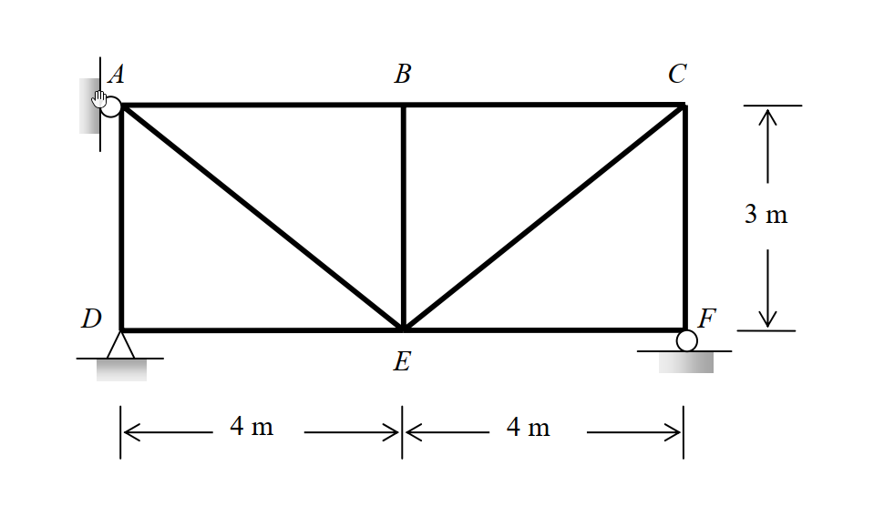
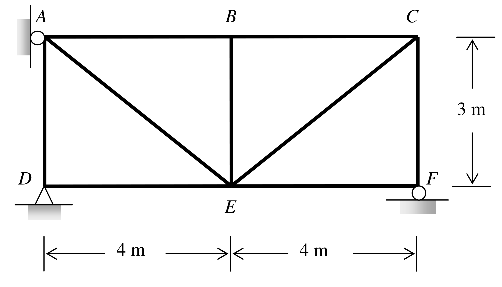

# SA-2011-1 題目正本

> 本檔只記錄考卷上寫了什麼、圖上畫了什麼，不含任何解法。解析見同資料夾 `SA-2011-1.md`。
> 判讀清單經使用者確認前，狀態為「待確認」；確認後本檔原則上不再修改（改動須回考卷原圖並記 log）。

| 項目 | 內容 |
|---|---|
| 考卷 | `raw/exams/SA-2011_結構學.pdf`，第 1 頁（正面），第一題（無圖號） |
| 考年 | 2011（民國 100 年）專技高考結構工程技師「結構學」 |
| 配分 | 25 分 |
| 附圖 | `SA-2011-1-fig-1.png`、`SA-2011-1-fig-2.png` |
| 判讀狀態 | **已確認**（2026-11-07 使用者確認；原轉錄：2026-11-07 轉錄；PyMuPDF 110 dpi 整頁＋400–1200 dpi 局部放大；PDF 向量繪圖；盲讀於開啟解析前完成） |

## 1. 考卷原文（逐字）

一、如圖所示之桁架結構，假設AB 及BE 桿件溫度增加60℃，DE 及EF 桿件施作時分別短了1.5 cm 及1.0 cm，支承A 被建造於原定位置的左方2.4 cm，且支承F 低於原既定位置1.2 cm。已知溫度膨脹係數α＝1.08×10⁻⁵/℃，假設各桿件之彈性模數E 值與斷面積A 值皆為常數，且EA＝8×10⁴ kN。試計算各支承之反力。（25 分）

## 2. 考卷給的公式、附表與參數

- 考卷沒有給任何參考公式或附表。
- 給定：α＝1.08×10⁻⁵/℃；EA＝8×10⁴ kN（各桿相同）。
- 沒有外加載重；作用為溫度（AB、BE ＋60℃）、製造誤差（DE 短 1.5 cm、EF 短 1.0 cm）、支承位置誤差（A 偏左 2.4 cm、F 偏低 1.2 cm）。
- 卷首注意事項：㈠可以使用電子計算器。㈡不必抄題，作答時請將試題題號及答案依照順序寫在試卷上，於本試題上作答者，不予計分。㈢本試題之相關公式，請自行合理推知。
- 考試時間：2 小時。

## 3. 附圖

*證據圖 SA-2011-1-fig-1.png*

*證據圖 SA-2011-1-fig-2.png（2026-11-07 自考卷重新擷取 500 dpi，無游標）*

圖面文字照錄：A、B、C、3 m、D、F、E、4 m、4 m

## 4. 判讀清單

| # | 項目 | 判讀 | 圖上／題文依據 | 把握 |
|---|---|---|---|---|
| 1 | A | 滾支承靠左側直立牆（圓圈貼直立剖線）→ 水平反力 | 450 dpi 放大：圓圈在 A 節點左側、緊貼直立牆 | 確定 |
| 2 | D | 鉸支承（三角形＋剖線） | 450 dpi 放大 | 確定 |
| 3 | F | 滾支承於水平地面（圓圈＋剖線）→ 垂直反力 | 450 dpi 放大 | 確定 |
| 4 | 節點座標 | D(0,0)、E(4,0)、F(8,0)、A(0,3)、B(4,3)、C(8,3) | 4 m｜4 m 界線對齊 D、E、F；3 m 界線對齊 C、F | 確定 |
| 5 | 桿件 | A–B、B–C、D–E、E–F、A–D、B–E、C–F、A–E、C–E 共 9 根 | 圖面 | 確定 |
| 6 | 溫度 | AB、BE 兩桿升溫 60℃ | 題文 | 確定 |
| 7 | 製造誤差 | DE 短 1.5 cm、EF 短 1.0 cm | 題文 | 確定 |
| 8 | 支承誤差 | A 建造位置在原定位置左方 2.4 cm（A 支承只約束水平向）；F 低於原定位置 1.2 cm（F 只約束垂直向） | 題文；支承方向 | 確定 |
| 9 | 材料 | EA＝8×10⁴ kN；α＝1.08×10⁻⁵/℃ | 題文 | 確定 |
| 10 | 所求 | 各支承反力 | 題文 | 確定 |
| 11 | 靜不定度 | m＝9、r＝4、j＝6：13＞12，一度靜不定 | 計數 | 確定（解讀）；使用者確認 |
| 12 | 證據圖 | 舊 fig-1 游標壓在 A 支承上（看不清是滾還是鉸）；新增 fig-2（500 dpi） | — | 確定 |

---
*轉錄：2026-11-07（SA-U2-2 題目正本推廣・批 1）*
*確認：2026-11-07 使用者確認*
