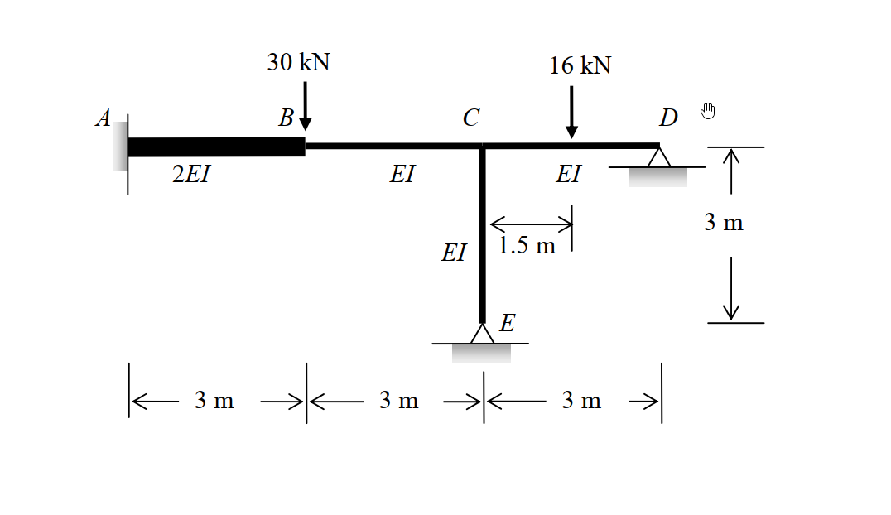

# SA-2011-2 題目正本

> 本檔只記錄考卷上寫了什麼、圖上畫了什麼，不含任何解法。解析見同資料夾 `SA-2011-2.md`。
> 判讀清單經使用者確認前，狀態為「待確認」；確認後本檔原則上不再修改（改動須回考卷原圖並記 log）。

| 項目 | 內容 |
|---|---|
| 考卷 | `raw/exams/SA-2011_結構學.pdf`，第 1 頁中下，第二題 |
| 考年 | 2011（民國 100 年）專技高考結構工程技師「結構學」 |
| 配分 | 25 分 |
| 附圖 | `SA-2011-2-fig-1.png` |
| 判讀狀態 | **已確認**（2026-11-04 使用者確認。原轉錄：2026-11-04 轉錄；PyMuPDF 150 dpi 整頁＋350–500 dpi 局部放大；盲讀於開啟解析前完成） |

## 1. 考卷原文（逐字）

二、如圖所示之剛架，支承 A 為固定端（fixed）、D 與 E 為鉸接。各桿件之彈性模數與慣性矩乘積（EI）如圖所示，且 EI＝10000 kN-m²。當 B 點承受一 30 kN 垂直載重，CD 桿件之中點亦承受一 16 kN 之垂直載重作用時，試以傾角變位法計算各端點彎矩，並繪出彎矩圖。（若以其他方法計算不予計分）（25 分）

## 2. 考卷給的公式、附表與參數

- 考卷沒有給任何參考公式或附表；所需公式須自備。
- 卷首注意事項：㈠可以使用電子計算器。㈡不必抄題，作答時請將試題題號及答案依照順序寫在試卷上，於本試題上作答者，不予計分。㈢本試題之相關公式，請自行合理推知。
- 考試時間：2 小時。

## 3. 附圖

*證據圖 SA-2011-2-fig-1.png*

圖面文字照錄：30 kN、16 kN、A、B、C、D、2EI、EI、EI、EI、1.5 m、E、3 m、3 m、3 m、3 m

## 4. 判讀清單

| # | 項目 | 判讀 | 圖上／題文依據 | 把握 |
|---|---|---|---|---|
| 1 | A | 梁左端固接 | 牆面 | 確定 |
| 2 | D | 梁右端鉸支 | 三角形支承 | 確定 |
| 3 | E | 柱底鉸支 | 三角形支承 | 確定 |
| 4 | B | AB 與 BC 斷面變化點，剛接連續 | 粗細線交界，無鉸圈 | 確定 |
| 5 | C | 梁與柱 CE 剛接 | 節點 | 確定 |
| 6 | 尺寸 | AB = BC = CD = 3 m；CE = 3 m | 尺寸線 | 確定 |
| 7 | 剛度 | AB 2EI；BC、CD、CE EI；EI = 10000 kN-m² | 圖標＋題文 | 確定 |
| 8 | 載重 | B 點 30 kN 向下；CD 中點（距 C 1.5 m）16 kN 向下 | 箭頭＋1.5 m 尺寸 | 確定 |
| 9 | 指定方法 | 傾角變位法（他法不計分） | 題文 | 確定 |
| 10 | 所求 | 各端點彎矩並繪彎矩圖 | 題文 | 確定 |

---
*轉錄：2026-11-04（SA-U2-3 題目正本推廣・批 1；判讀沿用同日盲解稽核紀錄 wiki/queries/盲解紀錄-SA-U2-3a-2026-11-04.md，並回考卷原圖核對）*
*確認：2026-11-04 使用者確認*
