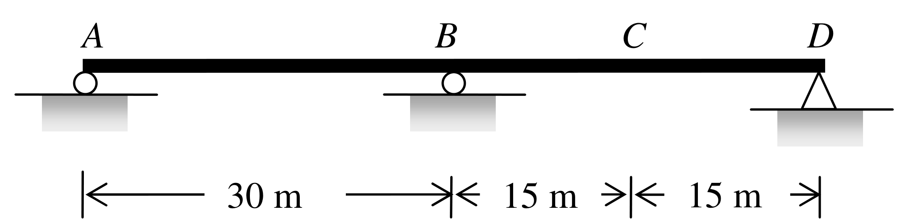

# SA-2011-3 題目正本

> 本檔只記錄考卷上寫了什麼、圖上畫了什麼，不含任何解法。解析見同資料夾 `SA-2011-3.md`。
> 判讀清單經使用者確認前，狀態為「待確認」；確認後本檔原則上不再修改（改動須回考卷原圖並記 log）。

| 項目 | 內容 |
|---|---|
| 考卷 | `raw/exams/SA-2011_結構學.pdf`，第 2 頁（背面），全一張，第三題 |
| 考年 | 2011（民國一百年）專技高考結構工程技師「結構學」 |
| 配分 | 25 分 |
| 附圖 | `SA-2011-3-fig-2.png`（2026-11-07 重新擷取）；既有 `SA-2011-3-fig-1.png` |
| 判讀狀態 | **已確認**（2026-11-07 使用者確認。原轉錄：2026-11-07 轉錄；PyMuPDF 110 dpi 整頁＋450–1200 dpi 局部放大；考卷可抽文字，逐字原文以 PDF 文字層核對；盲讀於開啟解析前完成） |

## 1. 考卷原文（逐字）

三、如圖所示梁結構：㈠請使用穆勒法（Müller-Breslau method）繪出支承 A 點反力 (R_A)、支承 B 點反力 (R_B)、支承 B 點負彎矩 (M_B-)、C 點彎矩 (M_C) 及其剪力 (V_C) 之影響線圖；㈡假設該梁承受 2 kN/m 之均布載重可作用於全長或部分跨長，請計算 C 點之最大彎矩 (M_max,C)。（25 分）

## 2. 考卷給的公式、附表與參數

- 考卷沒有給任何參考公式或附表；卷首註明「本試題之相關公式，請自行合理推知。」
- 均布載重 2 kN/m，可作用於全長或部分跨長。
- 考卷沒有給 E、I，也沒有說 EI 為常數。
- 卷首注意事項：可以使用電子計算器。不必抄題，作答時請將試題題號及答案依照順序寫在試卷上，於本試題上作答者，不予計分。本試題之相關公式，請自行合理推知。
- 考試時間：2 小時。

## 3. 附圖

*證據圖 SA-2011-3-fig-2.png（2026-11-07 自考卷 500 dpi 重新擷取）；既有 SA-2011-3-fig-1.png 帶有滑鼠游標（手形游標壓在 B 支承右側），保留不改。*

圖面文字照錄：A、B、C、D、30 m、15 m、15 m

## 4. 判讀清單

| # | 項目 | 判讀 | 圖上／題文依據 | 把握 |
|---|---|---|---|---|
| 1 | 座標 | A(0)、B(30)、C(45)、D(60)，單位 m | 尺寸線 30 m｜15 m｜15 m，端點對齊 A、B 滾輪中心、C、D 三角形頂點（500 dpi） | 確定 |
| 2 | 支承 A | 滾支承（圓圈） | 500 dpi | 確定 |
| 3 | 支承 B | 滾支承（圓圈） | 500 dpi；既有 fig-1 的游標壓在此處，以新擷取 fig-2 為準 | 確定 |
| 4 | 支承 D | 鉸支承（三角形） | 500 dpi | 確定 |
| 5 | C 點 | BD 中點，不是支承也不是內鉸 | 圖上 C 只有字母，梁線連續 | 確定 |
| 6 | 梁 | A–D 連續，無內鉸；一度靜不定 | 圖面 | 確定 |
| 7 | EI | 考卷沒有給，也沒有說常數；圖上全梁同一線寬 | 題文、圖面 | 確定（解讀）：視為 EI 常數；使用者確認 |
| 8 | 所求 ㈠ | 以穆勒法繪 R_A、R_B、M_B-（B 點負彎矩）、M_C、V_C 影響線 | 題文 | 確定 |
| 9 | 所求 ㈡ | 2 kN/m 均布載重可佈於全長或任意部分跨長，求 C 點最大彎矩 | 題文（未指定正或負最大） | 確定（解讀）；使用者確認 |

---
*轉錄：2026-11-07（SA-U1-3 題目正本推廣・批 1）*
*確認：2026-11-07 使用者確認*
