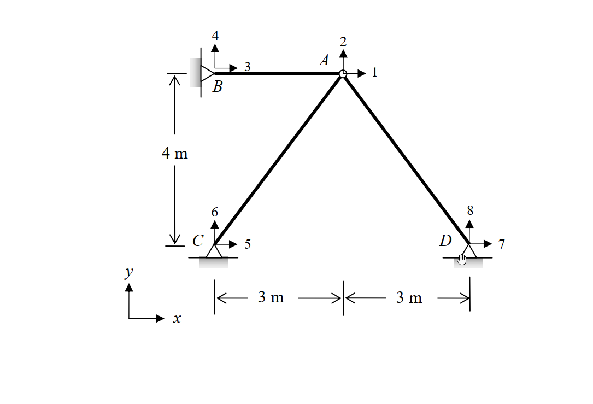
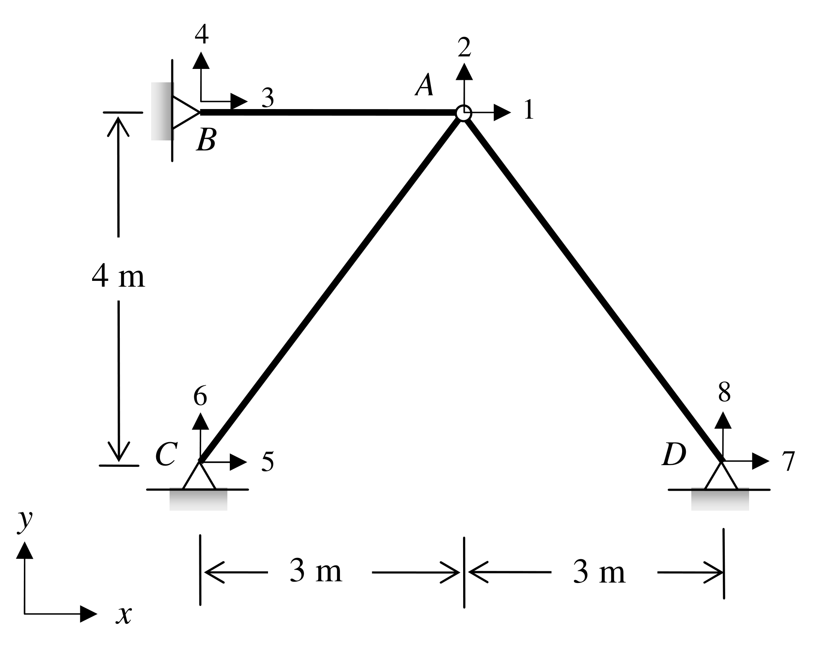

# SA-2011-4 題目正本

> 本檔只記錄考卷上寫了什麼、圖上畫了什麼，不含任何解法。解析見同資料夾 `SA-2011-4.md`。
> 判讀清單經使用者確認前，狀態為「待確認」；確認後本檔原則上不再修改（改動須回考卷原圖並記 log）。

| 項目 | 內容 |
|---|---|
| 考卷 | `raw/exams/SA-2011_結構學.pdf`，第 2 頁（背面）下半，第四題 |
| 考年 | 2011（民國 100 年）專技高考結構工程技師「結構學」 |
| 配分 | 25 分 |
| 附圖 | `SA-2011-4-fig-1.png`、`SA-2011-4-fig-2.png` |
| 判讀狀態 | **已確認**（2026-11-05 使用者確認。原轉錄：2026-11-05 轉錄；PyMuPDF 110 dpi 整頁＋250–800 dpi 局部放大、PDF 向量座標；盲讀於開啟解析前完成） |

## 1. 考卷原文（逐字）

四、如圖所示之桁架結構，若 AC 桿件在組裝前因製造瑕疵短了 0.02 m，試以矩陣直接勁度法（direct stiffness method）計算 A 點之水平變位與垂直變位，並計算各桿件之內力。假設各桿件之彈性模數 E 與斷面積 A 皆為常數，且 EA＝10⁴ kN。x-y 為全域座標系統（global coordinates），圖中帶有箭頭之數字代表節點全域自由度之編號。（若以其他方法計算不予計分）（25 分）

## 2. 考卷給的公式、附表與參數

- 考卷沒有給任何參考公式或附表。
- EA = 10⁴ kN。
- PDF 文字層第三、四題交錯排列，以頁面影像核對後照錄。
- 考卷沒有任何外加載重，唯一作用是 AC 桿短 0.02 m。
- 卷首注意事項：可以使用電子計算器。不必抄題，作答時請將試題題號及答案依照順序寫在試卷上，於本試題上作答者，不予計分。本試題之相關公式，請自行合理推知。
- 考試時間：2 小時。

## 3. 附圖

*證據圖 SA-2011-4-fig-1.png*

*證據圖 SA-2011-4-fig-2.png（2026-11-05 自考卷重新擷取 500 dpi，無游標）*

圖面文字照錄：4、3、2、A、1、B、4 m、6、8、C、5、D、7、y、x、3 m、3 m

## 4. 判讀清單

| # | 項目 | 判讀 | 圖上／題文依據 | 把握 |
|---|---|---|---|---|
| 1 | 座標（C 為原點） | C(0,0)、D(6,0)、A(3,4)、B(0,4) | 尺寸線 3 m｜3 m、4 m（由 B 到 C 高程） | 確定 |
| 2 | 構件 | BA（水平 3 m）、CA（5 m）、DA（5 m） | 附圖 | 確定 |
| 3 | 支承 B | 鉸支承，接左側垂直牆 | 附圖三角形＋牆 | 確定 |
| 4 | 支承 C、D | 鉸支承 | 附圖三角形；舊 fig-1 的 D 處有手形游標，看起來像滾輪，500 dpi 重擷為三角形 | 確定 |
| 5 | 自由度編號 | A：1（+x）、2（+y）；B：3、4；C：5、6；D：7、8 | 附圖箭頭 | 確定 |
| 6 | 製造誤差 | AC 桿短 0.02 m（組裝前） | 題文 | 確定 |
| 7 | 外力 | 無 | 題文、附圖 | 確定 |
| 8 | 所求 | A 點水平、垂直變位；各桿內力；限矩陣直接勁度法 | 題文 | 確定 |
| 9 | 證據圖 | 舊截圖 fig-1：滑鼠游標（手形）**壓在 D 支承上**，使鉸支承看似滾支承；新增 fig-2（2026-11-05 自考卷重新擷取 500 dpi） | — | 確定 |

---
*轉錄：2026-11-05（SA-U2-4 題目正本推廣・批 1）*
*確認：2026-11-05 使用者確認*
