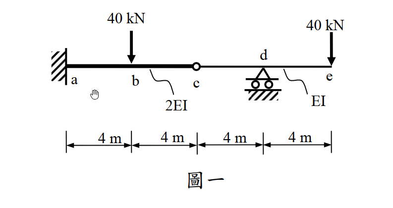
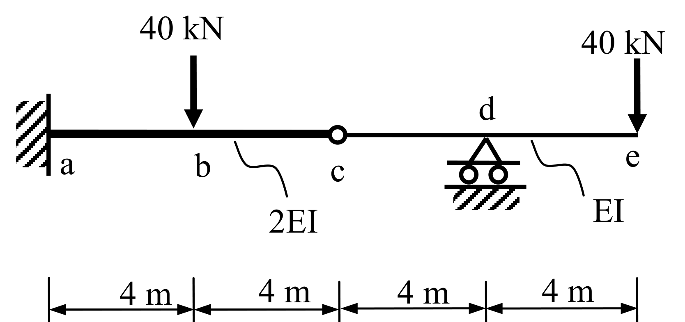

# SA-2012-1 題目正本

> 本檔只記錄考卷上寫了什麼、圖上畫了什麼，不含任何解法。解析見同資料夾 `SA-2012-1.md`。
> 判讀清單經使用者確認前，狀態為「待確認」；確認後本檔原則上不再修改（改動須回考卷原圖並記 log）。

| 項目 | 內容 |
|---|---|
| 考卷 | `raw/exams/SA-2012_結構學.pdf`，第 1 頁（正面）上半，第一題（圖一） |
| 考年 | 2012（民國 101 年）專技高考結構工程技師「結構學」 |
| 配分 | 25 分（每小題 5 分） |
| 附圖 | `SA-2012-1-fig-1.png`、`SA-2012-1-fig-2.png` |
| 判讀狀態 | **已確認**（2026-11-05 使用者確認。原轉錄：2026-11-05 轉錄；PyMuPDF 110 dpi 整頁＋350–1000 dpi 局部放大；盲讀於開啟解析前完成） |

## 1. 考卷原文（逐字）

一、如圖一所示梁，a 點為固接，c 點為內鉸接，d 點為滾支承。梁 ac 段之彈性模數與慣性矩乘積為 2EI，ce 段之彈性模數與慣性矩乘積為 EI：（每小題 5 分，共 25 分）

㈠繪彎矩圖；

㈡試求 e 點之垂直位移；

㈢試求 e 點之轉角；

㈣試求 c 點之垂直位移；

㈤繪變形曲線，並須標示反曲點之約略位置（若有反曲點）。

## 2. 考卷給的公式、附表與參數

- 考卷沒有給任何參考公式或附表。
- EI 只以符號給，沒有數值（答案以 EI 表示）。
- 卷首注意事項：㈠可以使用電子計算器。㈡不必抄題，作答時請將試題題號及答案依照順序寫在試卷上，於本試題上作答者，不予計分。㈢本試題之相關公式、物理常數、符號意義及設計參數未提及時，請自行合理推斷與假設。
- 考試時間：2 小時。

## 3. 附圖

*證據圖 SA-2012-1-fig-1.png*

*證據圖 SA-2012-1-fig-2.png（2026-11-05 自考卷重新擷取 500 dpi，無游標）*

圖面文字照錄：40 kN、40 kN、d、a、b、c、e、2EI、EI、4 m、4 m、4 m、4 m、圖一

## 4. 判讀清單

| # | 項目 | 判讀 | 圖上／題文依據 | 把握 |
|---|---|---|---|---|
| 1 | a | 固定端 | 題文；剖線牆 | 確定 |
| 2 | c | 內鉸 | 題文；空心圓 | 確定 |
| 3 | d | 滾支承 | 題文；雙輪 | 確定 |
| 4 | e | 自由端（懸臂端） | 圖上無支承 | 確定 |
| 5 | 尺寸 | ab、bc、cd、de 各 4 m | 下方尺寸線，刻度對齊 b、c、d、e | 確定 |
| 6 | 剛度 | a–c 段 2EI、c–e 段 EI | 題文；圖上引線 | 確定 |
| 7 | 載重 | b 點 40 kN 向下、e 點 40 kN 向下 | 箭頭對齊 b 與 e 刻度 | 確定 |
| 8 | 所求 | ㈠彎矩圖；㈡e 垂直位移；㈢e 轉角；㈣c 垂直位移；㈤變形曲線並標反曲點 | 題文 | 確定 |
| 9 | 證據圖 | 舊 fig-1 滑鼠游標在 a 點下方空白處；新增 fig-2（500 dpi） | — | 確定 |

---
*轉錄：2026-11-05（SA-U1-2 題目正本推廣・批 1）*
*確認：2026-11-05 使用者確認*
