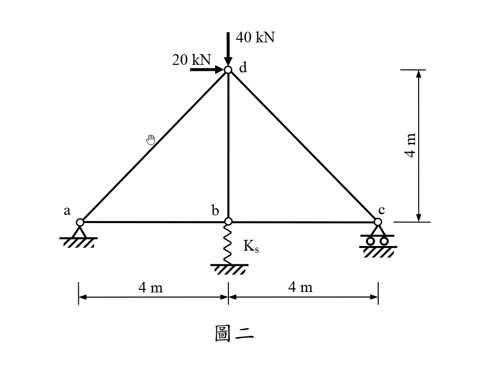
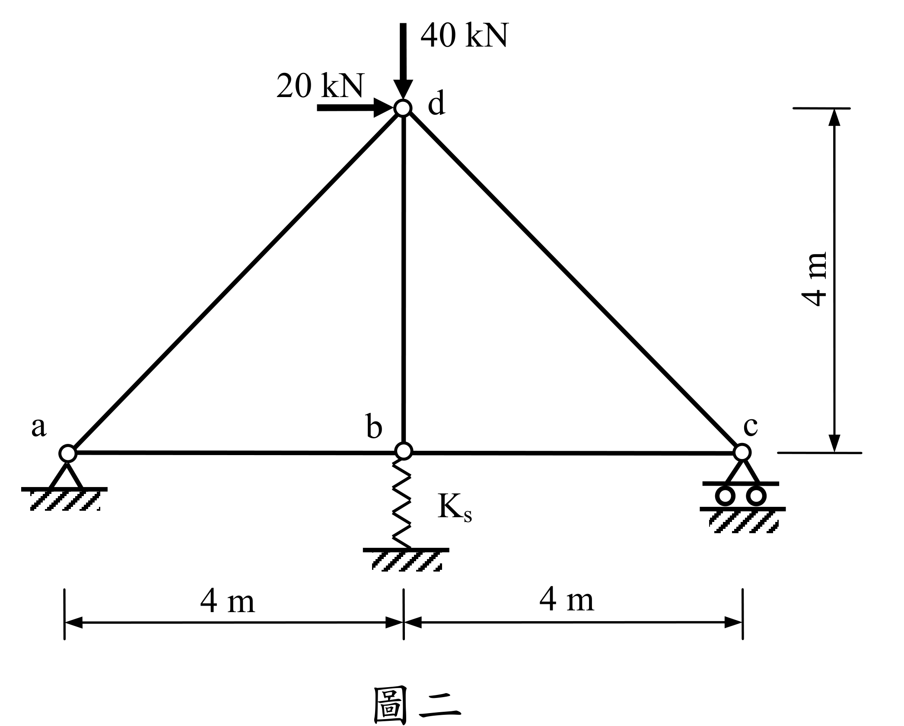

# SA-2012-2 題目正本

> 本檔只記錄考卷上寫了什麼、圖上畫了什麼，不含任何解法。解析見同資料夾 `SA-2012-2.md`。
> 判讀清單經使用者確認前，狀態為「待確認」；確認後本檔原則上不再修改（改動須回考卷原圖並記 log）。

| 項目 | 內容 |
|---|---|
| 考卷 | `raw/exams/SA-2012_結構學.pdf`，第 1 頁（正面）下半，第二題（圖二） |
| 考年 | 2012（民國 101 年）專技高考結構工程技師「結構學」 |
| 配分 | 25 分 |
| 附圖 | `SA-2012-2-fig-1.png`、`SA-2012-2-fig-2.png` |
| 判讀狀態 | **已確認**（2026-11-07 使用者確認。原轉錄：2026-11-07 轉錄；PyMuPDF 110 dpi 整頁＋300–500 dpi 局部放大、PDF 向量座標核對；盲讀於開啟解析前完成） |

## 1. 考卷原文（逐字）

二、如圖二所示桁架，a點為鉸接，c點為滾支承，b點有軸向線彈性彈簧。若每根桿件的EA值皆為10,000 kN，線彈性彈簧之勁度Ks為2,500 kN/m。試以最小功法計算各桿件內力（若以其他方法計算，不予以計分）。（25 分）

## 2. 考卷給的公式、附表與參數

- 考卷沒有給任何參考公式或附表。
- EA＝10,000 kN（每根桿件）；Ks＝2,500 kN/m。
- 指定方法：最小功法；他法不計分。
- 卷首注意事項：㈠可以使用電子計算器。㈡不必抄題，作答時請將試題題號及答案依照順序寫在試卷上，於本試題上作答者，不予計分。㈢本試題之相關公式、物理常數、符號意義及設計參數未提及時，請自行合理推斷與假設。
- 考試時間：2 小時。

## 3. 附圖

*證據圖 SA-2012-2-fig-1.png*

*證據圖 SA-2012-2-fig-2.png（2026-11-07 自考卷重新擷取 500 dpi，無游標）*

圖面文字照錄：40 kN、20 kN、d、4 m、a、b、c、Ks、4 m、4 m、圖二

## 4. 判讀清單

| # | 項目 | 判讀 | 圖上／題文依據 | 把握 |
|---|---|---|---|---|
| 1 | 桿件 | ad、dc、db（豎桿）、ab、bc 共 5 根 | 圖面 | 確定 |
| 2 | a | 鉸支承（2 反力） | 題文；三角形＋剖線 | 確定 |
| 3 | c | 滾支承：提供垂直反力 | 題文；三角形＋兩圓輪 | 確定 |
| 4 | 彈簧 | b 點垂直彈簧接地，Ks＝2,500 kN/m（只提供垂直力） | 鋸齒線在 b 正下方 | 確定 |
| 5 | 幾何 | a(0,0)、b(4,0)、c(8,0)、d(4,4)；斜桿長 4√2 m | 下方 4 m｜4 m；右側 4 m | 確定 |
| 6 | 載重 | d 點 40 kN 向下、20 kN 向右 | 兩箭頭指向 d | 確定 |
| 7 | 靜不定度 | m 5＋r 4（a 2、c 1、彈簧 1）＝9＞2j 8：一度靜不定 | 計數 | 確定 |
| 8 | 所求 | 各桿件內力；最小功法（彈簧能量須計入） | 題文 | 確定（解讀）；使用者確認 |
| 9 | 證據圖 | 舊 fig-1 的滑鼠游標壓在 ad 桿中段；新增 fig-2（500 dpi） | — | 確定 |

---
*轉錄：2026-11-07（SA-U2-1 題目正本推廣・批 1）*
*確認：2026-11-07 使用者確認*
