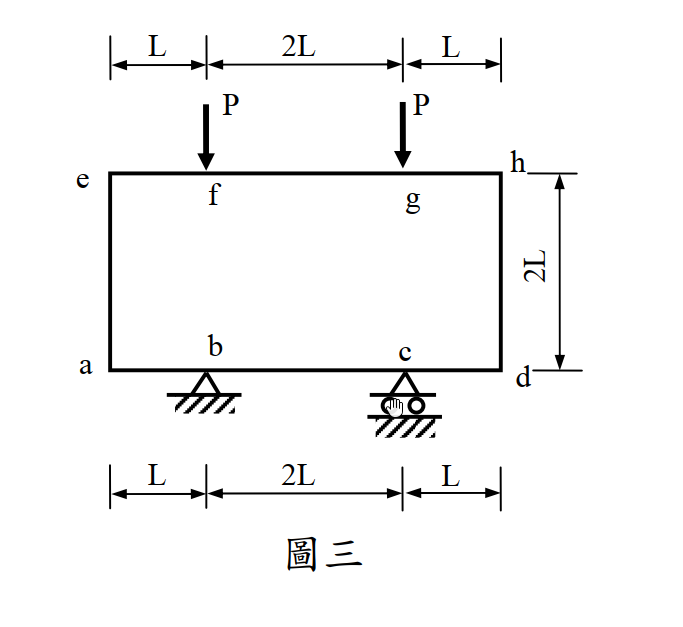
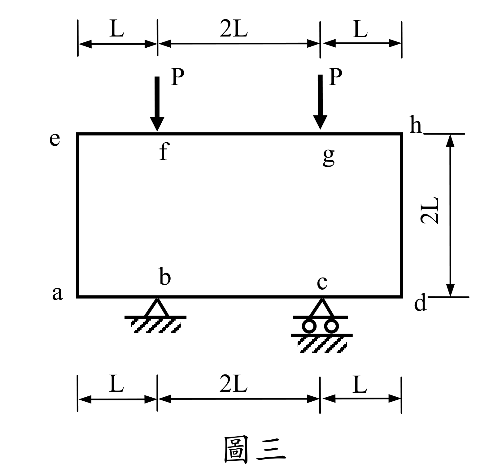

# SA-2012-3 題目正本

> 本檔只記錄考卷上寫了什麼、圖上畫了什麼，不含任何解法。解析見同資料夾 `SA-2012-3.md`。
> 判讀清單經使用者確認前，狀態為「待確認」；確認後本檔原則上不再修改（改動須回考卷原圖並記 log）。

| 項目 | 內容 |
|---|---|
| 考卷 | `raw/exams/SA-2012_結構學.pdf`，第 2 頁上半，第三題（圖三） |
| 考年 | 2012（民國 101 年）專技高考結構工程技師「結構學」 |
| 配分 | 25 分（㈠20 分、㈡5 分） |
| 附圖 | `SA-2012-3-fig-1.png`、`SA-2012-3-fig-2.png` |
| 判讀狀態 | **已確認**（2026-11-04 使用者確認；影響答案項目定案：#2 b 為鉸支承、框身連續（使用者確認）。原轉錄：2026-11-04 轉錄；PyMuPDF 150 dpi 整頁＋350–500 dpi 局部放大；盲讀於開啟解析前完成） |

## 1. 考卷原文（逐字）

三、如圖三所示剛架，b 點為鉸接，c 點為滾支承，若每根桿件有相同的彈性模數 E 與慣性矩 I，EI 為常數：㈠試計算各桿件之彎矩，並繪彎矩圖；（20 分）㈡繪變形曲線，並須標示反曲點之約略位置（若有反曲點）。（5 分）

## 2. 考卷給的公式、附表與參數

- 考卷沒有給任何參考公式或附表；所需公式須自備。
- 卷首注意事項：㈠可以使用電子計算器。㈡不必抄題，作答時請將試題題號及答案依照順序寫在試卷上，於本試題上作答者，不予計分。㈢本試題之相關公式、物理常數、符號意義及設計參數未提及時，請自行合理推斷與假設。
- 考試時間：2 小時。

## 3. 附圖

*證據圖 SA-2012-3-fig-1.png*

*證據圖 SA-2012-3-fig-2.png（2026-11-04 由考卷重新擷取 500 dpi；原 fig-1 截圖含游標圖示）*

圖面文字照錄：L、2L、L、P、P、e、f、g、h、2L、a、b、c、d、L、2L、L、圖三

## 4. 判讀清單

| # | 項目 | 判讀 | 圖上／題文依據 | 把握 |
|---|---|---|---|---|
| 1 | 結構 | 封閉矩形框 a-b-c-d-h-g-f-e，各角剛接 | 四角無鉸圈 | 確定 |
| 2 | b | 鉸支承；框身於 b 連續（非內鉸） | 題文「b 點為鉸接」＋圖上三角形支承、框線於 b 無鉸圈（500 dpi，fig-2） | 確定（解讀）；使用者確認 |
| 3 | c | 滾支承 | 雙圓滾輪 | 確定 |
| 4 | 尺寸 | 底邊 a-b L、b-c 2L、c-d L；頂邊 e-f L、f-g 2L、g-h L；高 2L | 上下兩組尺寸線、右側 2L | 確定 |
| 5 | EI | 各桿相同 | 題文 | 確定 |
| 6 | 載重 | f、g 各 P 向下 | 箭頭 | 確定 |
| 7 | 考卷沒有給 | EA、軸向變形條件 | 題文未提 | 確定 |
| 8 | 指定方法 | 未指定 | 題文 | 確定 |
| 9 | 所求 | ㈠ 各桿彎矩＋彎矩圖；㈡ 變形曲線並標反曲點約略位置 | 題文 | 確定 |

---
*轉錄：2026-11-04（SA-U2-3 題目正本推廣・批 1；判讀沿用同日盲解稽核紀錄 wiki/queries/盲解紀錄-SA-U2-3a-2026-11-04.md，並回考卷原圖核對）*
*確認：2026-11-04 使用者確認*
