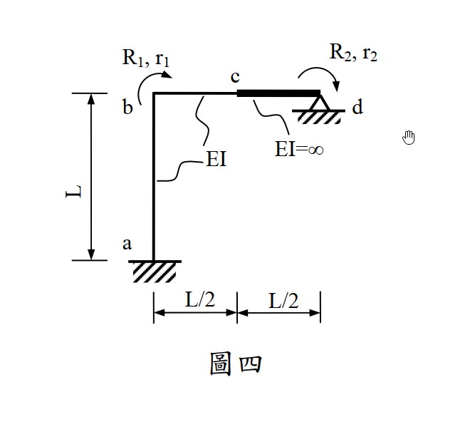
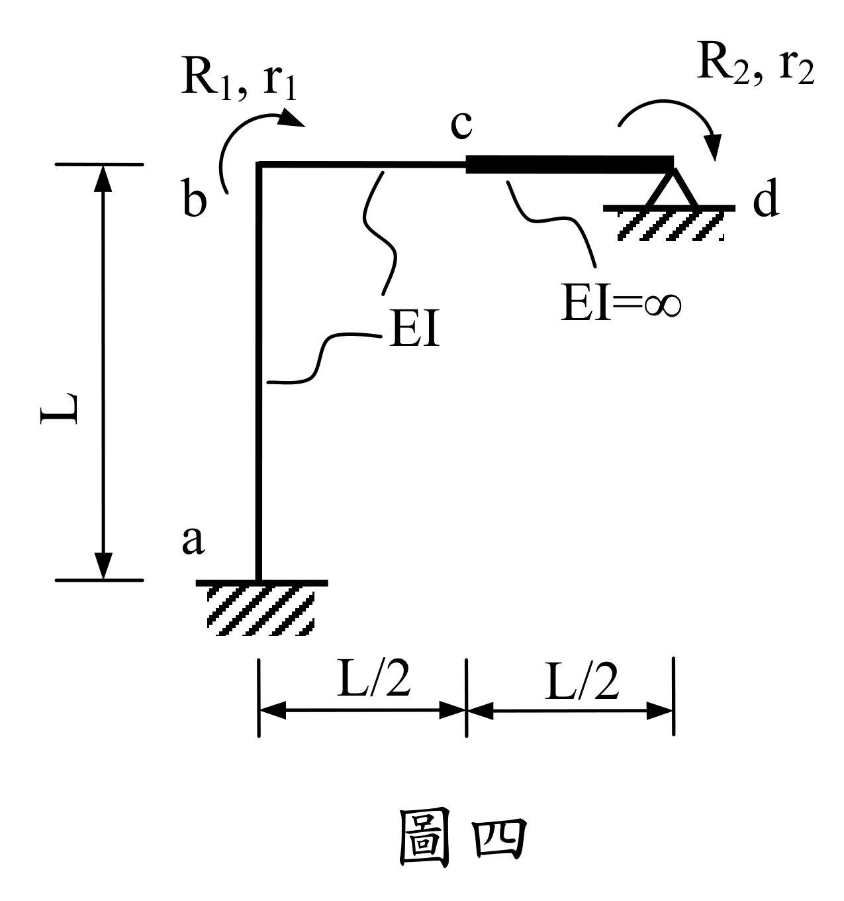

# SA-2012-4 題目正本

> 本檔只記錄考卷上寫了什麼、圖上畫了什麼，不含任何解法。解析見同資料夾 `SA-2012-4.md`。
> 判讀清單經使用者確認前，狀態為「待確認」；確認後本檔原則上不再修改（改動須回考卷原圖並記 log）。

| 項目 | 內容 |
|---|---|
| 考卷 | `raw/exams/SA-2012_結構學.pdf`，第 2 頁（背面）下半，第四題（圖四） |
| 考年 | 2012（民國 101 年）專技高考結構工程技師「結構學」 |
| 配分 | 25 分 |
| 附圖 | `SA-2012-4-fig-1.png`、`SA-2012-4-fig-2.png` |
| 判讀狀態 | **已確認**（2026-11-05 使用者確認。原轉錄：2026-11-05 轉錄；PyMuPDF 110 dpi 整頁＋250–800 dpi 局部放大、PDF 向量座標；盲讀於開啟解析前完成） |

## 1. 考卷原文（逐字）

四、如圖四所示剛架有二個自由度，a 點為固接，d 點為鉸接。R₁ 與 R₂ 為作用於結點彎矩，r₁ 與 r₂ 為對應於 R₁ 與 R₂ 之變位。若 ab 與 bc 桿件有相同的彈性模數 E 與慣性矩 I，EI 為常數；cd 桿件 EI 值為無限大。{R₁; R₂} = [K₁₁ K₁₂; K₂₁ K₂₂]{r₁; r₂}。試求勁度矩陣 [K₁₁ K₁₂; K₂₁ K₂₂]。（25 分）

## 2. 考卷給的公式、附表與參數

- 考卷沒有給任何參考公式或附表。
- 矩陣式在考卷上是排版公式，此處以分號表示換列。
- 考卷沒有給數值，答案為 EI、L 的式子。
- 考卷沒有明說忽略軸向變形；題文寫「有二個自由度」。
- 卷首注意事項：可以使用電子計算器。不必抄題，作答時請將試題題號及答案依照順序寫在試卷上，於本試題上作答者，不予計分。本試題之相關公式、物理常數、符號意義及設計參數未提及時，請自行合理推斷與假設。
- 考試時間：2 小時。

## 3. 附圖

*證據圖 SA-2012-4-fig-1.png*

*證據圖 SA-2012-4-fig-2.png（2026-11-05 自考卷重新擷取 500 dpi，無游標）*

圖面文字照錄：R₁, r₁、c、R₂, r₂、b、d、EI、EI=∞、L、a、L/2、L/2、圖四

## 4. 判讀清單

| # | 項目 | 判讀 | 圖上／題文依據 | 把握 |
|---|---|---|---|---|
| 1 | 座標（a 為原點） | a(0,0)、b(0,L)、c(L/2,L)、d(L,L) | 尺寸線 L（左側）、L/2｜L/2（下方） | 確定 |
| 2 | 構件 | ab（柱，EI）、bc（梁，EI）、cd（梁，EI=∞，粗線） | 題文；附圖引線 | 確定 |
| 3 | 節點 b、c | 剛接（無鉸圈） | 附圖 | 確定 |
| 4 | 支承 a | 固定端 | 題文；剖線 | 確定 |
| 5 | 支承 d | 鉸支承（三角形＋剖線） | 題文「d 點為鉸接」；附圖 d 畫在支承上 | 確定 |
| 6 | 自由度 | r₁：b 點轉角；r₂：d 點轉角；兩者箭頭皆**順時針** | 題文；800 dpi 箭頭方向 | 確定 |
| 7 | 載重 | 無外加載重（只求勁度矩陣） | 題文 | 確定 |
| 8 | 考卷沒有給 | 軸向變形條件；數值 | — | 確定 |
| 9 | 證據圖 | 舊截圖 fig-1：滑鼠游標（手形）在 d 右方空白處，未壓到圖；新增 fig-2（2026-11-05 自考卷重新擷取 500 dpi） | — | 確定 |

---
*轉錄：2026-11-05（SA-U2-4 題目正本推廣・批 1）*
*確認：2026-11-05 使用者確認*
